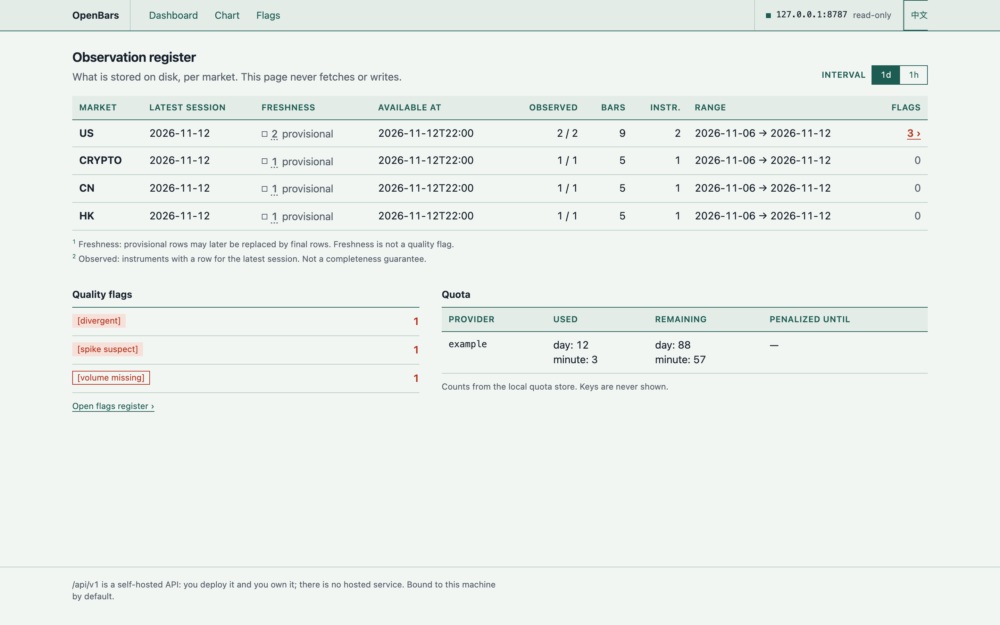
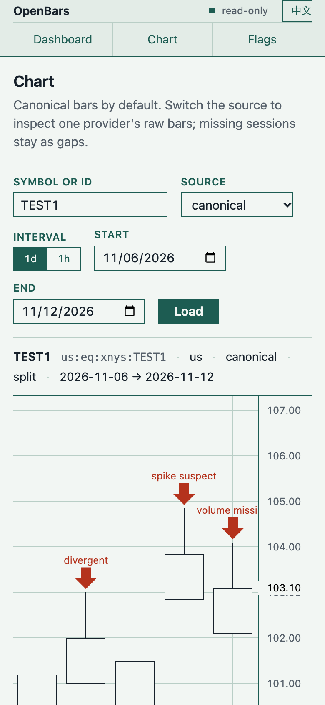

# OpenBars

**English** | [中文](README.zh-CN.md)

> **Free, multi-market, multi-source OHLCV bar collection, cleaning and reconciliation into one canonical dataset.**

**Status: pre-alpha.** US daily, crypto daily, China A-share daily (BaoStock primary; AKShare Eastmoney/Sina as a low-frequency backup; optional Tushare free-tier token source; all optional extras), and Hong Kong daily (yfinance primary, AKShare corroboration) run through the local `plan` / `run` path. `verify` covers every market in `markets` (US / crypto / China A-shares / Hong Kong, each on its own calendar and `policy_version`). US 1h collection is available as raw bars; other non-daily intervals come later. Pre-alpha: the API may change.

---

## What it is

OpenBars is a **local-first market data warehouse framework**, not yet another data client. Pick markets (US equities/ETFs, crypto, China A-shares, Hong Kong) and intervals (daily by default; hourly and minute optional) in a config file, bring your own API keys, and OpenBars will:

1. **Adapt providers** behind one abstraction; each source declares its capabilities (market × interval, history depth, quotas, terms).
2. **Schedule within free quotas**: a shared quota gate, retries, resumable checkpoints, historical backfill and daily increments.
3. **Clean and reconcile**: instrument master (stable IDs + symbol validity ranges), trading calendars, parameterized price adjustment, gap detection, multi-source arbitration and quality flags, producing one **canonical** dataset with provenance and an audit trail.

Default storage is Parquet + DuckDB; both are core dependencies available with a standard install. The `parquet` extra remains as an empty compatibility extra. Postgres is optional; the optional `postgres-export` plugin is a reference implementation. The `upstream_compat` backend is retained only for migration and compatibility testing and is not the routine production write path. Read through the Python library, open the local read-only UI with `openbars serve`, or call the self-hosted read API under `/api/v1` (see [the API reference](docs/api.md)).

### Why

There are many single-provider clients (yfinance, ccxt, AKShare) and unified query interfaces (OpenBB), but few projects combine **multi-source scheduling inside free quotas**, **auditable multi-source reconciliation into one canonical series**, and **one consistent cross-market model**. OpenBars focuses on that layer.

### Roadmap

US (including ETFs) daily → crypto daily → China A-share daily → Hong Kong daily → local read-only UI (v0.5); US hourly follows in v0.6. Hourly and minute data open up gradually as optional capabilities. See [docs/roadmap.md](docs/roadmap.md), [docs/architecture.md](docs/architecture.md), [docs/source-contract.md](docs/source-contract.md) (the generic bar + source-information contract for caller adapters), [docs/api.md](docs/api.md) (the `/api/v1` read API reference), and [docs/upstream-switch.md](docs/upstream-switch.md) (optional compatibility backend).

### Quick start

Needs Python ≥ 3.11 and [uv](https://docs.astral.sh/uv/). US daily bars as the example:

```bash
uv sync                               # install core dependencies (includes Parquet / DuckDB)
uv run openbars init                  # write config.yaml and .env here (git-ignored; never overwrites)
# fill in .env with your own keys (or point OPENBARS_ENV_FILE / --env-file at a dotenv you already have)
uv run openbars config                # print effective settings (secrets redacted as set/missing)
# optional: set universe.symbols in config.yaml (Alpaca / yfinance jobs need explicit symbols)
uv run openbars plan                  # preview jobs and request budget (writes nothing)
uv run openbars run                   # plan, queue and execute until idle; safe to re-run / resume
uv run openbars status                # job states, dead jobs, checkpoints, raw coverage (Parquet / Postgres)
uv run openbars verify                # per-market coverage and cross-source agreement report (read-only)
uv run openbars jobs retry --dead     # dead jobs are re-queued only on an explicit retry (--provider / --error / --dry-run)
# Optional: install the http extra and open the local read-only UI (loopback only; a non-loopback --host is rejected)
# uv sync --extra http
# uv run openbars serve               # http://127.0.0.1:8787
# Optional: shadow-compare against an external read-only research-series HTTP API.
# Keep the symbol list and the report outside this repository.
# uv run openbars shadow --symbols-file /path/to/symbols.txt \
#   --start YYYY-MM-DD --end YYYY-MM-DD --output /path/to/report-dir --fetch
# Optional: copy a recent window into the generic reference table (bars + source information;
# dry-run by default, reference implementation).
# uv sync --extra postgres-export
# uv run openbars export-postgres --source ./data/canonical --dsn "$TARGET_PG_DSN" --days 30 --apply
```

- `init [directory]` starts a terminal wizard; non-terminal use or `--yes` copies the example files. New installs write to `parquet_duckdb` and use a local SQLite quota gate. `upstream_compat` is for migration and tests only; explicit existing backend configuration continues to be honored. See the [provider key and limits guide](docs/provider-keys.md). If either target already exists it prints an error, writes nothing and exits 2.
- **Key priority (highest first):** (1) the process environment; (2) a dotenv file: `--env-file`, else `OPENBARS_ENV_FILE`, else `env_file` in `config.yaml`, and when none of those is set, **`.env` next to `config.yaml`** is loaded automatically (no error if it is absent); (3) `${VAR:-default}` in `config.yaml`. `ALPACA_API_KEY` / `ALPACA_API_SECRET` are accepted as aliases for `ALPACA_API_KEY_ID` / `ALPACA_API_SECRET_KEY` when the canonical name is unset.

### Runtime directory

`OPENBARS_HOME` selects the runtime home and defaults to `~/.openbars`. When neither `--config` nor `--env-file` is supplied, an existing `./config.yaml` in the current directory keeps the legacy behavior, including the `./data` default. Otherwise, config loads from `$OPENBARS_HOME/config/config.yaml`, and an omitted `storage.path` defaults to `$OPENBARS_HOME/data`. An explicit `--config` and a configured `storage.path` take precedence.

- The example config enables both Alpaca and Massive as primary providers: `run` fails with the missing variable names (for example `MASSIVE_API_KEY`) if one lacks credentials, so fill the keys in or set `enabled: false` on providers you do not use. `plan` only notes missing credentials (but errors when no usable provider is left, or when an interval is selected that no enabled provider offers).
- `quota:` may only **tighten** the default free-tier limits; raising one needs an explicit `quota: { per_minute: 999, override: true }`, otherwise it is an error.
- Reminder: OpenBars distributes no data; everything is fetched locally with your own keys (BYOK), and you must follow each provider's terms (see the disclaimer below).

### Daily run timing and source readiness

Daily collection has one path: **fetch the latest data each source can currently provide**. There is no user-selected mode switch; each row is labeled `provisional` or `final` automatically (see [Local service](#local-service)). Each `openbars run` plans and fetches as much recent data as source capabilities allow; a later final row can replace an earlier provisional row. Freshness thresholds are not provider delivery SLAs, and unverified sources remain best effort.

The actual run time is controlled by an external scheduler (cron or equivalent). `schedule.daily_at` is a display/record field: `openbars config` prints the `schedule` section, while the planner and CLI do not read this value to trigger a run. Changing it does not change when a run starts. The example `00:15 America/New_York` matches the common final window, 00:15 ET / 21:15 PT; an external scheduler must still trigger the run.

| Market | Suggested run time (proposal only) | Expected result and evidence status |
| --- | --- | --- |
| US | Around 13:20 PT after close (suggested, pending confirmation) | Alpaca SIP may provide a provisional daily bar; the `now - 16 minutes` request cutoff is code-verified, while after-close availability and completeness are unverified. The common final window at 21:15 PT (00:15 ET) is after Massive's next-day 00:00 ET readiness point; its 8-hour threshold and retryable `data_not_ready` response to earlier requests are code-verified. |
| China A-shares | After 15:30 Shanghai time (suggested, pending confirmation) | The code freshness threshold is 30 minutes after close; BaoStock / AKShare / Tushare free-tier delivery timing and completeness are unverified. |
| Hong Kong | 30 minutes after that day's actual close (suggested, pending confirmation) | The code freshness threshold is defined; actual delivery timing from Yahoo Finance / AKShare and other sources is unverified. Use the actual close on half days. |
| Crypto | After 00:30 UTC on the next day (suggested, pending confirmation) | The code freshness threshold is 00:30 UTC next day; Binance / Coinbase readiness and completeness are unverified. |

These are timing proposals and do not configure a scheduler. See [source readiness](docs/source-readiness.md).

- Data lands in `storage.path` (the default follows the runtime directory rule above; `./data/` is git-ignored); `--data DIR` overrides it. `run` is idempotent: finished windows are not fetched again, so running it daily is the incremental update.
- Non-daily intervals imply a large request budget and need an explicit `--accept-budget`.
- `verify` is a **report, not a gate**: it exits 0 even when agreement is below 100%. It produces one report per market in `markets`, each on its own calendar and `policy_version`: US XNYS + `research-daily-v2`; crypto `CryptoCalendar` (every UTC day is a session, weekends included) + `crypto-daily-v1`; A-shares XSHG (XSHE is an alias; Beijing is out of scope) + `cn-daily-v1`; Hong Kong XHKG (half days count as sessions) + `hk-daily-v1`. The window ends at the market's latest ready session (optionally capped by `history.end` / `--end`). A configured market with no stored bars is a note and the run continues; only when no market has bars is it an error. Each report shows coverage of expected sessions × instruments, per-source summaries (provider / feed / adjustment), OHLC and volume agreement wherever two comparable sources hold the same bar (default tolerances: price 0.5%, volume 5%, adjustable via `reconcile.tolerances`; incomparable series such as IEX vs SIP count as `not_comparable`, never as disagreement), quality-flag agreement (only when several projections exist, else `n/a`), and a "last N sessions" breakdown (`--recent N`). `--start/--end` bound the window; `--json reports/verify.json` writes the report under the data directory: one configured market gives a single report object (with `market` / `calendar` fields), several give `{"markets": {"us": {...}, "cn": {...}}}` (markets without data are listed under `skipped`).
- The default planner assigns each session to the cheapest source, so cross-source overlap needs an explicit fetch of a sample (for example audit jobs for a second provider) before `verify` has anything to compare.
- The repository's end-to-end test exercises the whole path with ~100 synthetic symbols (including ETFs) and offline fake providers. It does **not** sample real tickers or compare against any external production database: tests never touch the network and the repo ships no market data.

## Local service

`openbars serve` is an **optional, local, read-only preview UI** plus a self-hosted read API.
Install the HTTP extra and start it:

```bash
uv sync --extra http
uv run openbars serve                # http://127.0.0.1:8787
```





The screenshots use synthetic demo symbols (`TEST1`, `TESTA`, …) and a fictional `example` quota provider. They do not contain personal paths, API keys or real quota-account details.

- **What it is.** `/chart` draws candlesticks with [Lightweight Charts](https://tradingview.github.io/lightweight-charts/), `/` is a coverage and freshness dashboard that also shows quota usage, and `/flags` lists quality flags. It is **not** a full TradingView terminal and has no order entry, indicators or drawing tools.
- **Access.** It binds to loopback only (default `127.0.0.1:8787`); a non-loopback `--host` is rejected in this version. On startup it prints `no fetch, no writes`: it never plans, fetches or writes, and opens storage read-only. It only displays data that is already on disk, and there is no button or route that triggers a fetch to "fill in" final data.
- **A public, self-hosted API.** The JSON routes under `/api/v1` (`health`, `markets`, `instruments`, `bars`, `flags`, `quota`) are a public API in the sense that matters here: whoever downloads OpenBars deploys it and owns it, including fully private deployments. OpenBars itself provides no hosted service and never sees your data. Endpoints, parameters, response shapes, error format and the version/stability rules are documented in [the `/api/v1` reference](docs/api.md). Within v1, documented fields are stable; breaking changes move to a new major prefix (`/api/v2`).
- **Exposure.** The default bind is loopback only, and this version refuses a non-loopback `--host`. An explicit opt-in bind switch is tracked in [#207](https://github.com/Liyuk/openbars/issues/207). Exposing the service on a non-loopback interface publishes a read-only view of your stored bars to that network, and **there is no built-in authentication**: network isolation or an authenticating reverse proxy is the caller's responsibility.

### Same-day data: timeliness is not completeness

Timeliness and completeness are labeled separately. Canonical rows carry `freshness` and an optional `available_at`:

- `freshness=provisional`: a same-day row that later final data may replace;
- `freshness=final`: final data; a missing/null value in older rows reads as `final`;
- `available_at` is the earliest moment the row may be used for research; it is not a provider delivery SLA.

| Daily market | `provisional` tier | `final` tier (code threshold) |
| --- | --- | --- |
| US | During the session, T+0 | From 00:00 ET next day, T+1 |
| Crypto | During the UTC session day, T+0 | From 00:30 UTC next day, T+1 |
| A-shares | During the session, T+0 | 30 minutes after close, T+0 |
| Hong Kong | During the session, T+0 | 30 minutes after actual close, T+0 |

These are code thresholds for the freshness tier, not source delivery promises. Provisional is not final; freshness is not a quality flag (`flags` / `quality_status` keep their separate meaning) and it is not a coverage or completeness guarantee. Reads show the currently visible row, preferring final and otherwise showing provisional with its tier. Coverage shown on the dashboard is observed coverage, not a completeness guarantee. `serve` only displays what is already stored.

### Reading Parquet without the service

The local service is optional. Default storage is Parquet plus a rebuildable DuckDB catalog, and you can read the files directly. The data directory is `$OPENBARS_HOME/data` (default `~/.openbars/data`) or `./data` in the legacy layout:

```text
data/
  canonical/market=us/interval=1d/year=2024/part-*.parquet
  raw/provider=alpaca/market=us/interval=1d/year=2024/part-*.parquet
  openbars.duckdb            # views only; rebuilt from the Parquet tree on demand
```

`part-*.parquet` files are immutable and appended, so an older row that was later superseded can still be present until `openbars compact` merges the partition. The DuckDB views (`canonical_bars`, `raw_bars`, `instruments`, `symbol_mappings`, `corporate_actions`) apply the last-write-wins rule, so prefer them for analysis:

```python
import duckdb
from pathlib import Path

root = Path.home() / ".openbars" / "data"      # or $OPENBARS_HOME/data, or ./data
con = duckdb.connect(str(root / "openbars.duckdb"), read_only=True)
con.sql("""
    SELECT session_date, open, high, low, close, volume, freshness, available_at
    FROM canonical_bars
    WHERE market = 'us' AND interval = '1d'
      AND instrument_id = 'us:eq:00000000000000000000000000'
      AND session_date >= DATE '2024-01-01'
    ORDER BY session_date
""").show()
```

pandas and polars can read the same partition files; apply the same last-write-wins rule yourself or read through DuckDB:

```python
import pandas as pd
from pathlib import Path

root = Path.home() / ".openbars" / "data"
files = sorted(root.glob("canonical/market=us/interval=1d/**/part-*.parquet"))
df = pd.concat(pd.read_parquet(f) for f in files)
```

```python
import polars as pl
from pathlib import Path

root = Path.home() / ".openbars" / "data"
df = pl.read_parquet(root / "canonical/market=us/interval=1d/**/part-*.parquet")
```

`openbars.duckdb` holds no data and can be deleted; the backend rebuilds the views. You can also use the Python reader: `open_backend(path, read_only=True)` and `backend.reader.bars(...)`, which derives adjustments at query time.

The optional `export-postgres` plugin (`uv sync --extra postgres-export`) is a **write-only reference implementation**: it copies a recent window of canonical daily bars into the generic reference table `openbars_bars` (bars plus source information, dry run unless `--apply`). OpenBars does **not** read that table back, `serve` and the default Parquet workflow never query Postgres, and downstream systems read the exported table themselves. See [docs/postgres-export.md](docs/postgres-export.md).

### Upgrade notes

- **The Postgres export plugin writes the generic reference layout**: `openbars export-postgres` targets the generic `bars + source information` table only (default name `openbars_bars`). Callers that need their own tables with provenance columns should write an adapter. See [docs/postgres-export.md](docs/postgres-export.md).
- **Daily raw adjustment identity**: split-adjusted daily sources that did not set `extra.adjustment` in older stores were stored as `adjustment=raw`; refetching now writes `split`, so both rows can coexist. Reads (`scan_rows` on Parquet and Postgres native) restore those legacy rows to `split` from the source's capability and ignore a legacy row when a current row has the same key, so canonical selection matches a store holding only current rows; no migration command is needed. Hong Kong yfinance, AKShare, crypto and A-share `raw` rows really are unadjusted and are left alone; `upstream_compat` rows keep the upstream `adjustment`. The legacy rows only cost space; compaction does not remove them (their key differs).

### US hourly bars (optional)

Set the following in `config.yaml` (`1h` can also be used without `1d`):

```yaml
markets: [us]
intervals: [1d, 1h]
universe:
  us:
    symbols: [TEST1, ZZZA]
conventions:
  us_hourly_alignment: session_open
  include_extended_hours: false
```

Quote tickers like `ON` or numeric codes, for example `"ON"` and `"0001"`.

Enable the providers you need and configure your own credentials. Every US 1h source, including Massive, needs explicit `universe.us.symbols`. `session_open` aligns to the 9:30 New York open; `clock_hour` is also available, but the planner skips yfinance and Twelve Data, which require `session_open`. Only regular hours are stored by default; Twelve Data does not support extended hours. Massive and Alpaca aggregate 30-minute bars onto the hourly grid.

Point `storage.path` outside the repository; the default `./data` is inside the repository and git-ignored. Do not commit market data. First run `uv run openbars plan` to inspect jobs and the request budget, then `uv run openbars run --accept-budget`; submitting or running non-daily jobs requires this acceptance. Check progress with `uv run openbars status`; rerunning resumes from checkpoints.

Free tiers and history windows can change; check the official references. These are conservative project defaults or implementation limits:

- [Massive Basic](https://massive.com/pricing): approximately the last 2 years (730 days) of hourly data; default 4 requests per minute.
- [yfinance](https://ranaroussi.github.io/yfinance/): unofficial Yahoo data for approximately the last 730 days (the implementation leaves a one-day margin); the default 30 requests per minute is conservative pacing, not an official quota.
- [Alpaca](https://docs.alpaca.markets/docs/about-market-data-api): hourly history starts no earlier than 2016-01-01; default 200 requests per minute, tightened to 190 in the example config.
- [Twelve Data](https://twelvedata.com/pricing): defaults are 8 requests per minute and 800 per UTC day; the implementation sets a 2016-01-01 history floor, while actual availability depends on the provider.

See the [local measurement guide](docs/measuring-hourly.md) for timing and storage estimates.

Hourly canonical reconciliation and the hourly-versus-daily consistency check are pending. Dashboard 1h support is pending.

### China A-share daily (BaoStock; AKShare backup; optional Tushare)

```bash
uv sync --extra baostock --extra akshare --extra tushare   # or: pip install "openbars[baostock]" "openbars[akshare]" "openbars[tushare]"
# config.yaml: markets: [cn]; providers.baostock.enabled: true (or providers.akshare_ashare.enabled: true;
# providers.tushare.enabled: true when a Tushare token is available)
# universe.cn.symbols: [sh.600000, 000001.SZ]
uv run openbars plan && uv run openbars run
```

- No API key. Write `universe.cn.symbols` as `sh.600000` or `600000.SH`; bare 6-digit codes are **not** accepted (they are skipped with a note).
- Terms: BaoStock is for **personal local use only**; never commit or redistribute market data (`data/` is git-ignored). BaoStock may be unreachable from overseas networks; jobs then fail and show up in `openbars status`; re-run once the network is back to resume.
- The stored series is **unadjusted** (`cn-daily-v1`, `adjustment=raw`): suspended sessions stay in the raw layer only (with `tradestatus`), canonical gets no placeholder bar and carries limit-up / limit-down flags. Adjust factors are fetched as full history the first time and incrementally afterwards. Pass `adjustment=Adjustment.QFQ` / `Adjustment.HFQ` at read time (derived on query, never stored).
- AKShare backup: enable `providers.akshare_ashare` (default `feed: eastmoney`, optional `feed: sina`). It is a **low-frequency backup**, stored locally, never redistributed; only unadjusted bars are requested (`adjust=""`) and Eastmoney lot volume is converted to shares. The library is MIT but does **not** relicense upstream quotes: Eastmoney forbids redistributing exchange quotes without written consent or putting a disproportionate load on its site, and Sina restricts unlicensed scraping. AKShare provides no adjust factors, so QFQ / HFQ report missing factors when it is used alone; the A-share canonical layer is a single-source projection, so enable one A-share source at a time.
- Optional Tushare free tier (token required): enable `providers.tushare` and set `TUSHARE_TOKEN` in the environment or `.env` (the config only references `${TUSHARE_TOKEN}`). About 120 points, 50 requests/minute and 8,000/day, **unadjusted daily bars only**; the adapter does not call qfq/hfq or `adj_factor`. Volume is converted from lots to shares. The licence is personal, non-commercial and revocable; public use must carry Tushare's required attribution as stated in its terms. Store locally, never redistribute. Install `openbars[tushare]`.
- Optional smoke tests: `OPENBARS_BAOSTOCK_SMOKE=1 uv run pytest tests/test_baostock_public_smoke.py` (1 symbol, 2 sessions; skipped by default); `OPENBARS_AKSHARE_CN_LIVE=1 uv run pytest tests/test_akshare_cn_58.py` (AKShare, skipped by default).
- `verify` (A-shares): XSHG calendar, `cn-daily-v1`, scores the stored **RAW** series only; QFQ / HFQ are derived at read time and are not scored. `quality_status` stays `complete` under `LIMIT_UP` / `LIMIT_DOWN` / `SUSPENDED` flags, and the report counts those flags. A suspended day keeps its raw bar but gets no canonical placeholder; that expected hole is reported separately as `suspended_cells` and is not counted as `missing`.

### Hong Kong daily

- Set `markets: [hk]`, enable `providers.yfinance` (AKShare corroborates), and list `universe.hk.symbols` as `"00700"` / `0700.HK`; `plan` / `run` use the XHKG calendar. The stored series is RAW (`hk-daily-v1`, HKD); only split adjustment is derived at read time.
- `verify` (Hong Kong): XHKG calendar, `hk-daily-v1`, scores the stored RAW series, not the read-time adjusted view.

### Storage maintenance (Parquet backend)

- Python readers can open a Parquet data directory with `open_backend(path, read_only=True, index_dir=...)`. This mode does not create or modify files in the data directory and does not open `state.db`; writes and job-state operations raise `ReadOnlyError`. The DuckDB catalog index and its lock live in the user cache (default `~/.cache/openbars`); `index_dir` overrides the location.
- `openbars usage [--json]`: file count and bytes per layer / market / interval / year (raw also per provider), daily and hourly listed apart; prints paths relative to the data directory only.
- `openbars compact [--layer raw|canonical|all] [--min-parts N]`: lists the partitions it would merge and the estimated space freed; only `--apply` changes files. Deduplication semantics are unchanged. Run it when parts pile up (for example after an hourly backfill); it holds the writer lock, so it is safe next to `run`.
- Retention is off by default. Only when `storage.retention` has rules (for example `- {layer: raw, keep_years: 2, market: us, interval: 1h}`) does `openbars retention` list whole raw `year=` partitions older than the window, and only `--apply` deletes them. Canonical and ref are always kept; any other layer is a config error. If `history.start` reaches before the window, later `plan` / `run` may fetch the pruned range again.
- `openbars backup <dest> [--market M] [--interval I]`: copies the data directory to a new (or empty) directory under the writer lock, `state.db` / `quota.db` via the SQLite online backup; skips `.lock`, temp files, dotfiles and the rebuildable `openbars.duckdb`, and writes `backup-manifest.json`. Backups never contain the config file, dotenv files, keys or DSNs (none of them live in the data directory). To restore, stop `run` and point `storage.path` at the backup (or copy it back).

### Data terms disclaimer

- **OpenBars does not distribute or host any market data.** The repository contains code, rules and documentation only.
- All data is fetched locally **with your own accounts and API keys** (BYOK).
- Most free data sources restrict use to personal or internal purposes and forbid display or redistribution. **You are responsible for reading and complying with each provider's terms of service.**
- OpenBars is not affiliated with any data provider and makes no warranty about data accuracy, completeness or availability.

## License

[Apache-2.0](LICENSE)
