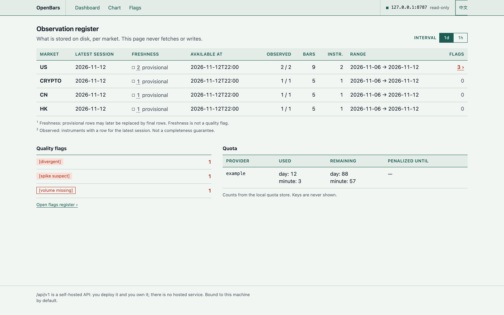
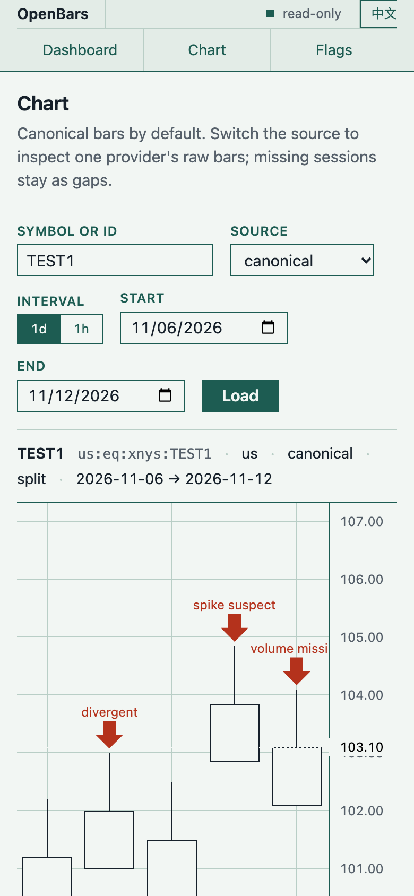

# OpenBars

[English](README.md) | **中文**

> **免费、多市场、多数据源的 K 线采集、清洗与合并框架，产出一份可审计的唯一数据源。**

**状态：pre-alpha。** 美股日线、加密日线、A 股日线（BaoStock 主源，AKShare 东财/新浪低频备源，Tushare 免费档可选 token 源，均为可选依赖）与港股日线（yfinance 主源，AKShare 佐证）已可在本地 `plan` / `run` 链路运行；美股 1h 可选采集到 raw 层；其他非日线粒度仍在路线图中。API 随时可能变化。

## 它是什么

OpenBars 是一个**本地运行的行情仓库框架**，不是又一个数据接口库。你在配置里选好市场（美股/ETF、加密、A 股、港股）和粒度（默认日线；小时线、分钟线可选），填上自己的各源 API key，OpenBars 负责：

1. **Provider 适配**：统一的数据源抽象，每个源声明自己的能力（市场 × 粒度、历史深度、限额、条款）。
2. **配额感知调度**：在免费额度内编排抓取——共享限流闸门、重试、断点续抓、历史回补、每日增量。
3. **清洗与合并**：证券主数据（稳定 ID + 代码有效期）、交易日历、复权参数化、缺口检测、多源仲裁、质量标记，最终写成一份带来源与审计记录的**规范层（canonical）**数据。

### 存储与界面

- 默认写入 **Parquet + DuckDB**；配额闸门使用本地 SQLite。普通安装即可使用默认存储。
- **Postgres 是可选后端**。可选的 `postgres-export` 插件只是**参考实现**：把近期 canonical 日线写入一张通用的「K 线 + 来源信息」表，默认表名 `openbars_bars`，默认 dry-run；它不了解调用方的官方表，也不会替调用方填外键。需要自己的官方表和溯源列时，请自己写适配器。
- `upstream_compat` 只作为可选的迁移/兼容后端保留，不是日常生产写入路径。
- 运行时只读界面可通过 `openbars serve` 打开，自托管的读取 API 在 `/api/v1`（详见[API 参考](docs/api.md)，英文）。

### 当日模式：时效性与完整性分开标注

日线只有「尽可能最近可得」这一条路径，没有用户可切换的模式开关。每根规范层 bar 单独记录 `freshness` 与 `available_at`：

- `freshness=provisional`：当日临时数据，之后可能被正式数据替换；
- `freshness=final`：正式数据；
- 旧行缺列或为空时按 `final` 处理；
- `available_at`：这根 bar 最早可用于研究的时刻，不是数据源交付 SLA。

| 日线市场 | 临时层 `provisional` | 正式层 `final`（代码判定门槛） |
| --- | --- | --- |
| 美股 | 会话日内，T+0 | 次日 00:00 ET 起，T+1 |
| 加密 | UTC 会话日内，T+0 | UTC 次日 00:30 起，T+1 |
| A 股 | 会话日内，T+0 | 收盘后 30 分钟起，T+0 |
| 港股 | 会话日内，T+0 | 当日实际收盘后 30 分钟起，T+0 |

以上是 freshness 层的代码门槛，不是数据源到货承诺。临时不等于正式；时效性不是质量标记（`flags` / `quality_status` 另有含义），也不等于覆盖率或完整性保证。读取默认显示当前可见行：正式行优先，没有正式行时返回临时行并标明层级。看板上的覆盖是观察到的覆盖，不是完整性保证；未验证来源尽力而为、不承诺。

## 安装

需要 Python ≥ 3.11 与 [uv](https://docs.astral.sh/uv/)：

```bash
git clone https://github.com/Liyuk/openbars.git
cd openbars
uv sync
```

按需安装可选数据源或界面依赖：

```bash
uv sync --extra http                                  # 本机只读界面
uv sync --extra baostock --extra akshare --extra tushare   # A 股数据源
uv sync --extra postgres-export                       # 可选 Postgres 导出（参考实现）
```

也可以使用 pip：`pip install "openbars[http]"`、`pip install "openbars[baostock]"` 等。

## 快速上手

以美股日线为例：

```bash
uv run openbars init                  # 在当前目录生成 config.yaml 和 .env（不覆盖已有文件）
# 编辑 .env 填入你自己的 key（或用 OPENBARS_ENV_FILE / --env-file 指向已有的 dotenv）
uv run openbars config                # 查看生效配置（所有 key 脱敏为 set/missing）
# 可选：在 config.yaml 里设置 universe.symbols（Alpaca / yfinance 需要显式 symbols）
uv run openbars plan                  # 预览任务与请求预算（不写入）
uv run openbars run                   # 规划、入队并执行，直到队列空闲；可随时重跑续抓
uv run openbars status                # 任务状态、失败/死信、断点、raw 覆盖摘要
uv run openbars verify                # 各市场的覆盖率与多源一致性报告（只读）
uv run openbars jobs retry --dead     # 死信作业只在显式重试后重新入队
```

- `init [目录]` 在终端启动向导；非终端或 `--yes` 复制示例配置。任一目标已存在就报错退出（退出码 2），什么都不写。
- `run` 幂等：已完成的窗口不会重复抓取，每天再跑一次即为增量。
- 非日线粒度会触发较大的请求预算，需要显式 `--accept-budget` 才会提交/执行。
- `verify` 是**报告而非闸门**：即使一致率不到 100% 也返回 0。
- 可选：安装 `http` 额外依赖后运行 `uv run openbars serve`，打开 `http://127.0.0.1:8787` 的本机只读界面。

更完整的市场、粒度、存储维护与升级说明见英文 [README](README.md) 和 [docs/](docs/)。

## 本地服务

`openbars serve` 是**可选的本机只读预览界面**，同时提供一个自托管的读取 API。先安装 http 额外依赖再启动：

```bash
uv sync --extra http
uv run openbars serve                # http://127.0.0.1:8787
```





截图使用合成演示品种（`TEST1`、`TESTA` 等）和虚构的 `example` 额度渠道，不含个人路径、API key 或真实额度账户信息。

- **它是什么。** `/chart` 用 [Lightweight Charts](https://tradingview.github.io/lightweight-charts/) 画 K 线；`/` 是覆盖与时效性看板，并显示额度用量；`/flags` 列出质量标记明细。它**不是**完整的 TradingView 终端，没有下单、指标或画图工具。
- **访问边界。** 默认只绑定回环地址（默认 `127.0.0.1:8787`），非 loopback 的 `--host` 必须显式加 `--allow-non-loopback`，否则以用法错误退出。启动时打印 `no fetch, no writes`：不规划、不抓取、不写库，存储以只读方式打开；只显示已经落盘的数据，也没有任何按钮或路由会为了「补正式数据」而触发抓取。
- **自托管的公开 API。** `/api/v1` 下的 JSON 路由（`health`、`markets`、`instruments`、`bars`、`flags`、`quota`）是公开 API：谁下载谁部署、谁使用，可以完全私有；项目本身不提供托管服务，也看不到你的数据。端点、参数、响应字段、错误格式与版本/稳定性约定见[英文 API 参考](docs/api.md)。在 v1 内，文档化字段视为稳定；破坏性变更走新的主版本前缀（`/api/v2`）。
- **暴露风险。** 默认只绑定回环地址。绑非回环地址（例如 `--host 0.0.0.0`）必须再显式加 `--allow-non-loopback`，打开后启动会打印醒目警告。把服务暴露到非回环地址等于向该网卡公开你的只读行情数据，而且**没有内置鉴权、也没有内置 TLS**：网络隔离、防火墙或反向代理鉴权由调用方自己负责。

### 当日数据：时效性不是完整性

时效性与完整性分开标注。规范层每行带 `freshness` 与可选的 `available_at`，本节直接写明同日标注的口径：

- `freshness=provisional`：当日临时行，之后可能被正式数据替换；它不是正式数据。
- `freshness=final`：正式数据；旧行缺列或为空（missing/null）时按 `final` 处理。
- `available_at`：可选字段，表示这根 bar 最早可用于研究的时刻，不是数据源交付 SLA。
- `freshness` 不是质量标记：`flags` / `quality_status` 仍然表达质量问题。
- `freshness` 也不等于覆盖率或完整性保证；看板上的覆盖是观察到的覆盖。
- `serve` 只展示已存数据，不会为了升级临时行去抓取。

各市场的 `provisional` / `final` 代码门槛（即上文「当日模式：时效性与完整性分开标注」的表格）同样是代码判定值，不是数据源到货承诺。

### 不起服务直接读 Parquet

本机界面是可选的。默认存储是 Parquet 加一个可重建的 DuckDB 目录，可以直接读文件。数据目录为 `$OPENBARS_HOME/data`（默认 `~/.openbars/data`），旧布局下为 `./data`：

```text
data/
  canonical/market=us/interval=1d/year=2024/part-*.parquet
  raw/provider=alpaca/market=us/interval=1d/year=2024/part-*.parquet
  openbars.duckdb            # 只含视图；由 Parquet 树按需重建
```

`part-*.parquet` 是不可变、追加写入的文件，被后写覆盖的旧行在 `openbars compact` 合并分区之前可能仍留在文件里。DuckDB 视图（`canonical_bars`、`raw_bars`、`instruments`、`symbol_mappings`、`corporate_actions`）已套用「最后写入者胜出」的去重规则，分析时优先用它：

```python
import duckdb
from pathlib import Path

root = Path.home() / ".openbars" / "data"      # 或 $OPENBARS_HOME/data，或 ./data
con = duckdb.connect(str(root / "openbars.duckdb"), read_only=True)
con.sql("""
    SELECT session_date, open, high, low, close, volume, freshness, available_at
    FROM canonical_bars
    WHERE market = 'us' AND interval = '1d'
      AND instrument_id = 'us:eq:00000000000000000000000000'
      AND session_date >= DATE '2024-01-01'
    ORDER BY session_date
""").show()
```

pandas 和 polars 可以直接读同一批分区文件；需要与视图一致的可见行时，请自行按最后写入者胜出规则去重，或经 DuckDB 读取：

```python
import pandas as pd
from pathlib import Path

root = Path.home() / ".openbars" / "data"
files = sorted(root.glob("canonical/market=us/interval=1d/**/part-*.parquet"))
df = pd.concat(pd.read_parquet(f) for f in files)
```

```python
import polars as pl
from pathlib import Path

root = Path.home() / ".openbars" / "data"
df = pl.read_parquet(root / "canonical/market=us/interval=1d/**/part-*.parquet")
```

`openbars.duckdb` 不存数据，可以删除，后端会重建视图。也可以用 Python 读取器：`open_backend(path, read_only=True)` 加 `backend.reader.bars(...)`，复权在查询时派生。

可选的 `export-postgres` 插件（`uv sync --extra postgres-export`）是**只写**的参考实现：把近期 canonical 日线复制到通用参考表 `openbars_bars`（K 线 + 来源信息，默认 dry-run，需 `--apply`）。OpenBars **不会读回**这张表；`serve` 和默认 Parquet 流程都不会访问 Postgres，导出表由下游自己读。详见 [docs/postgres-export.md](docs/postgres-export.md)。

## 配置

### `OPENBARS_HOME` 与默认目录

运行时家目录由 `OPENBARS_HOME` 指定，默认 `~/.openbars`：

```text
~/.openbars/
  config/config.yaml     # 默认配置文件
  data/                  # storage.path 未设置时的默认数据目录
```

- 未传 `--config` 或 `--env-file` 时，若当前目录有 `./config.yaml`，继续使用它且缺省数据目录仍为 `./data`；否则读取 `$OPENBARS_HOME/config/config.yaml`，未设置 `storage.path` 时写入 `$OPENBARS_HOME/data`。
- 显式 `--config` 和配置中写明的 `storage.path` 优先于此约定。
- 数据请放在仓库外；`./data/` 已被 git 忽略，但不要提交任何行情数据。

### 数据源与 key

OpenBars 采用 **BYOK（Bring Your Own Key）**：仓库不包含、不托管任何行情数据或凭据。

- 密钥来源优先级（高 → 低）：① 进程环境变量；② dotenv 文件：`--env-file`，否则 `OPENBARS_ENV_FILE`，否则 `config.yaml` 的 `env_file`，都没有时自动读取 `config.yaml` 同目录的 `.env`；③ `config.yaml` 里 `${VAR:-default}` 的默认值。
- `openbars init` 会引导你选择市场、数据源并写入 `.env`；`.env` 权限为 `0600`，且已被 git 忽略。
- `openbars config` 只显示密钥是 `set` 还是 `missing`，不打印值。
- 各数据源的申请方式、免费额度、历史范围与条款见 [docs/provider-keys.md](docs/provider-keys.md)。
- 示例配置默认启用 Alpaca 与 Massive；缺 key 时 `run` 会报错并列出变量名。把不用的源改成 `enabled: false` 即可。
- `quota:` 只能收紧默认免费额度；要调高必须显式写 `override: true`，否则报错。

### 运行时刻

真正何时运行由**外部调度器**（cron 或等价机制）决定。`schedule.daily_at` 只是展示/记录字段，规划器与 CLI 不会读取它来触发运行；修改它不会改变开跑时间。各市场建议时刻、预期时效及已核实/待验证状态见英文 README 与 [docs/source-readiness.md](docs/source-readiness.md)。

## 免责声明

- **OpenBars 不分发、不托管任何行情数据。** 仓库里只有代码、规则与文档。
- 所有数据由**用户使用自己的账号与 API key** 在本地抓取（BYOK）。
- 多数免费数据源（如 Alpaca Basic、Massive Basic、Yahoo、Tushare、BaoStock、AKShare 等）的条款限定个人或内部使用，禁止展示或再分发。**使用者须自行阅读并遵守各数据源的服务条款**；因违反条款产生的责任由使用者自负。
- OpenBars 与任何数据源提供方无关联，也不保证数据的准确性、完整性或可用性。

## 许可

[Apache-2.0](LICENSE)
