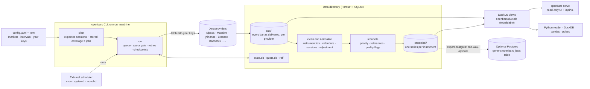
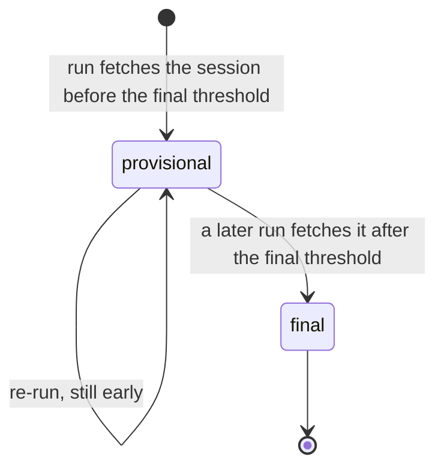

<p align="center"></p>

# OpenBars architecture overview

**English** | [中文](ARCHITECTURE.zh-CN.md)

This is the reader-facing overview of how OpenBars is put together and why. It is the entry
point for architecture questions. The long, section-numbered reference that code comments cite
(`§3`, `§10`, `§11`, ...) lives in [architecture-internals.md](architecture-internals.md); where
this page and that one overlap, they describe the same design and the internals file carries the
field-level detail.

Contents: [Positioning](#positioning) · [Data flow](#data-flow) ·
[Same-day mode](#same-day-mode-provisional-then-final) · [Storage layout](#storage-layout) ·
[Reading the data](#reading-the-data) · [Optional Postgres export](#optional-postgres-export) ·
[Scheduling](#scheduling) · [Adding a data source](#adding-a-data-source) ·
[Boundaries](#boundaries)

## Positioning

OpenBars is a **local-first market-data warehouse framework**, not a hosted service and not
another single-provider client.

- **Self-deployed.** Whoever downloads OpenBars runs it, owns the data directory and holds the
  provider keys (bring your own keys). Everything can stay fully private on one machine or inside
  your own network.
- **No hosted service.** There is no OpenBars-run server, account or API. The `/api/v1` read API
  is a *public API* only in the sense that its contract is documented and stable; you deploy it
  yourself with `openbars serve` ([api.md](api.md)).
- **Does not redistribute data.** The repository contains code, rules and documentation. Data
  comes from the providers you enable, under their terms ([DATA_SOURCES.md](../DATA_SOURCES.md)).
- **One canonical dataset.** Several free sources are fetched inside their quotas, cleaned,
  aligned and reconciled into a single series per instrument, with provenance and quality flags
  on every bar.
- **Not** a trading terminal, an order-entry system, a tick/real-time feed or a backtester.

## Data flow



The stages, in the order a bar travels through them:

| Stage | What happens | Code |
| --- | --- | --- |
| Plan | The planner expands `markets × intervals × universe × history` with the market's trading calendar into the expected sessions, subtracts what is already stored, and routes each gap to the cheapest enabled source that declares that market and interval. `plan` only prints; `run` plans and executes. | `orchestrator/planner.py` |
| Queue and quota | Jobs are idempotent rows in `state.db` with checkpoints. A worker leases a job and every outbound request first takes a token from the shared quota gate (`quota.db`); a 429 penalizes the provider, repeated failures trip a breaker, and permanent errors become `dead` jobs that only an explicit `openbars jobs retry` re-queues. | `orchestrator/`, `quota/` |
| Fetch | A provider adapter turns the request into provider calls and returns a `RawBatch`. Adapters declare capabilities (market × interval, history depth, batch shape, terms) and know nothing about reconciliation. | `providers/` |
| Raw | The bars as delivered are appended to immutable Parquet parts, keyed by provider, feed, adjustment and revision. Response sidecars (`raw-archive/`, secrets redacted) can accompany them. | `raw/`, `storage/` |
| Clean and normalize | Symbols become stable instrument ids with validity ranges, bar times become exchange-local sessions (UTC `ts_start` plus `session_date`), corporate actions and A-share adjustment factors are recorded, and single-source quality rules run (for example limit-up / suspension flags). | `normalize/`, `calendars/` |
| Reconcile | Per market a policy picks one bar per instrument and session: US `research-daily-v2` (primary, fallbacks, tolerances, corroboration), crypto `crypto-daily-v1` (per venue, never merged), A-shares `cn-daily-v1` (single-source projection), Hong Kong `hk-daily-v1` (yfinance primary, AKShare corroboration). Disagreement is flagged (`divergent`, `spike_suspect`, ...), never averaged. | `reconcile/`, `orchestrator/finalize.py` |
| Canonical | One row per `(instrument_id, time, policy_version)` with provenance (`provider`, `feed`, `price_source`, `source_fetch_id`), `freshness`, `available_at` and quality flags. Adjustment (QFQ/HFQ, split) is derived at read time, not stored. | `storage/` |
| Serve | DuckDB views read the Parquet tree; `openbars serve` exposes a read-only UI and the `/api/v1` JSON API over it. It never plans, fetches or writes. | `api/`, `web/` |

Gaps are never interpolated: a missing session stays missing, and canonical bars that look
suspicious are flagged, not deleted.

## Same-day mode: provisional, then final

Daily collection has exactly one path: **fetch the newest data each source can currently
provide.** There is no user-selected mode. Each canonical row is labelled automatically:



- `freshness=provisional`: a same-day row that later final data may replace. `freshness=final`:
  final data; rows with a missing value read as `final`.
- Final thresholds (a tier rule in code, not a provider promise): US from 00:00 ET the next day,
  crypto from 00:30 UTC the next day, A-shares and Hong Kong 30 minutes after the (actual) close.
- `available_at` is the earliest moment a row may be used for research. The first known time is
  kept when the same source bar is rewritten, so re-running never pushes availability later.
- Reads show the currently visible row: final wins, otherwise provisional is shown with its tier.
- Timeliness is **not** completeness, and freshness is **not** a quality flag. Observed coverage
  on the dashboard is not a completeness guarantee. Per-source evidence:
  [source-readiness.md](source-readiness.md); the per-source summary is in
  [DATA_SOURCES.md](../DATA_SOURCES.md#same-day-data-provisional-then-final).

## Storage layout

The default backend is **Parquet + DuckDB** with a local SQLite quota gate. The data directory is
`$OPENBARS_HOME/data` (default `~/.openbars/data`), or `./data` for a legacy `./config.yaml`
layout; `storage.path` and `--data` override it.

```text
data/
  state.db                                  # SQLite: jobs, checkpoints, fetch_log
  quota.db                                  # SQLite: shared quota gate state
  raw/provider=alpaca/market=us/interval=1d/year=2024/part-*.parquet
  canonical/market=us/interval=1d/year=2024/part-*.parquet
  ref/instruments.parquet                   # instrument master
  ref/symbol_mappings.parquet               # symbol validity ranges
  ref/corporate_actions.parquet
  ref/adjust_factors.parquet                # A-share factors (optional file)
  raw-archive/provider=…/market=…/interval=…/…   # redacted response sidecars
  openbars.duckdb                           # views only; safe to delete, rebuilt on demand
  _status/latest.json                       # last run completion document (#219)
  _status/runs/<run_id>.json                # one per run, never overwritten
  _status/sessions/<market>/<interval>/<session_date>.json
```

- Writes are **immutable and atomic**: every upsert writes a new `part-*.parquet` per touched
  partition (temp file, `fsync`, `os.replace`); existing parts are never edited. **Last write
  wins** by key, so older superseded rows can sit in older parts until `openbars compact` merges
  them. Retrying a job rewrites nothing that is unchanged.
- Partitions are `market / interval / year` (raw also `provider`; intraday adds `month`).
- Writers serialize on `data/.lock`; readers take no lock. Prices are `decimal128(20,8)` and
  volumes `decimal128(28,8)`, never binary floats.
- `openbars usage`, `compact`, `retention` and `backup` are the maintenance commands; only
  `--apply` changes files. Backups never contain config, dotenv files, keys or DSNs.
- Full schema, keys and migration rules:
  [architecture-internals.md §10](architecture-internals.md#10-storage-layout-parquet--duckdb-by-default)
  and [source-contract.md](source-contract.md).

## Run completion status (and webhooks)

Every `openbars run` ends by writing a schema-versioned document to `_status/`: `runs/<run_id>.json`
(one per invocation, never overwritten), `latest.json` (the most recent) and
`sessions/<market>/<interval>/<session_date>.json` (that session's latest result). It records the
overall `outcome` (`success` / `partial` / `failed` / `skipped` / `noop`), job counters, and per session the
`tier`, the `outcome`, the raw and canonical rows this run wrote, and the contributing providers.
The writes are atomic and a write failure is only a warning: it changes neither the exit code nor
the stored data.

The same document is the webhook payload (`notify.webhooks`), POSTed with
`X-OpenBars-Event: run.completed`, a per-delivery id and a timestamp. `X-OpenBars-Signature` is
`sha256=<hex>`, where `<hex> = HMAC-SHA256(secret, "<timestamp>.<body>")`; the signed body is the
exact UTF-8 bytes of the document without its `notifications` key (not a re-serialisation).
Retries are bounded and exponential inside one overall time budget. Delivery results are appended
to `notifications[]` in `runs/` and `latest.json` as `{url_hash, outcome, attempts, status_code,
error}` — never the URL or the secret — and a delivery failure never changes the exit code. The
files stay the fallback when an endpoint is down. Contract, field reference, retry rules and
verification code: [run-status.md](run-status.md) and the [JSON Schema](schemas/run-status.v1.json).

## Reading the data

1. **`openbars serve`** (`uv sync --extra http`): a local, read-only UI and the `/api/v1` API
   (`health`, `markets`, `instruments`, `bars`, `flags`, `quota`). It binds to loopback by
   default; a non-loopback bind needs `--allow-non-loopback` and has no built-in auth or TLS, so
   put a firewall or an authenticating proxy in front of it. See [api.md](api.md).
2. **Python:** `open_backend(path, read_only=True)` then `backend.reader.bars(...)`, which derives
   adjustments at query time and applies last-write-wins.
3. **Directly:** DuckDB, pandas or polars over the Parquet tree; prefer the DuckDB views
   (`canonical_bars`, `raw_bars`, `instruments`, ...) so deduplication is applied for you.

The [live demo](https://liyuk.github.io/openbars/) is a static copy of the same UI over a
checked-in synthetic `TEST*` sample; it has no backend and reads no live data.

## Optional Postgres export

`openbars export-postgres` is an **optional reference implementation** (`uv sync --extra
postgres-export`), not part of the default write path.

- It **only writes**: it copies a window of canonical daily bars into one generic table,
  `openbars_bars` ("bars + source information": data source, fetch batch, `freshness`,
  `available_at`). It is a dry run unless you pass `--apply`.
- It knows **no downstream tables**: no caller table names, no foreign keys, no integer upstream
  instrument ids, and it never runs DDL. You create the table from the documented DDL.
- OpenBars **never reads that table back**. `serve`, `run`, `verify` and the default Parquet
  workflow do not query Postgres. Downstream systems read the exported table themselves.
- Systems that need their own tables should write an adapter on their side that reads OpenBars
  data and maps it into their schema, keeping that schema outside this repository.

See [postgres-export.md](postgres-export.md). A separate, optional `storage.postgres` backend
(`native` mode, and a migration-only `upstream_compat` mode) also exists; it is not the default
and is described in [architecture-internals.md](architecture-internals.md) §10.5 and §11.

## Scheduling

OpenBars has **no built-in scheduler and no daemon.** `openbars plan` and `openbars run` are
ordinary CLI commands; an **external** scheduler decides when they start. `schedule.daily_at` in
`config.yaml` is a display/record field: the planner and CLI never read it to trigger a run.

`run` is idempotent: it plans what is missing, executes it, finishes when idle, and can be run
again at any time (finished windows are not fetched again; interrupted jobs resume from
checkpoints). So "run it daily after the market's final window" is the whole operating model, and
running it more than once a day simply refreshes provisional bars.

Generic examples (adapt the paths; nothing here is shipped or enabled by the repository):

```cron
# cron: weekdays shortly after the US final window; the time zone is the host's
15 0 * * 2-6  cd /path/to/openbars-project && uv run openbars run >> /path/to/logs/openbars.log 2>&1
```

```ini
# systemd: openbars.service (oneshot) + openbars.timer; make sure `uv` is on the unit's PATH
# --- openbars.service
[Service]
Type=oneshot
WorkingDirectory=/path/to/openbars-project
ExecStart=/usr/bin/env uv run openbars run

# --- openbars.timer
[Timer]
OnCalendar=Tue..Sat 00:15 America/New_York
Persistent=true
[Install]
WantedBy=timers.target
```

```xml
<!-- macOS LaunchAgent: a plist you create in your own user's LaunchAgents folder; times are local -->
<dict>
  <key>Label</key><string>local.openbars.run</string>
  <key>WorkingDirectory</key><string>/path/to/openbars-project</string>
  <key>ProgramArguments</key>
  <array><string>/usr/bin/env</string><string>uv</string><string>run</string><string>openbars</string><string>run</string></array>
  <key>StartCalendarInterval</key><dict><key>Hour</key><integer>13</integer><key>Minute</key><integer>20</integer></dict>
</dict>
```

Suggested run times per market, and which of them are verified, are in the README
([Daily run timing](../README.md#daily-run-timing-and-source-readiness)) and in
[source-readiness.md](source-readiness.md). Keep keys in a private dotenv file
(`OPENBARS_ENV_FILE` / `--env-file`) rather than in the scheduler definition.

## Adding a data source

Providers are the runtime plugin point: they are discovered through the `openbars.providers`
entry-point group (`providers/registry.py`), so a third-party package can ship one. Adding a
source for an existing market takes these steps; the bundled providers (for example
`providers/cn/tushare.py`, a token-based one) are the best templates.

1. **Implement the `Provider` protocol** (`providers/base.py`): `id`, `api_version`,
   `capabilities()`, `quota_policy()`, `list_instruments()`, `fetch_bars()` and
   `fetch_corporate_actions()`. `capabilities()` returns `SourceCapability` rows (market,
   interval, history start, rolling window, batch shape, adjustment modes, feed, terms and
   whether the latency is verified). `fetch_bars()` returns a `RawBatch` of `RawBar`s with a
   `fetch_id`; failures are `ProviderError(code, retryable, retry_at)`. HTTP-backed sources can
   subclass `HttpProviderAdapter` (`providers/adapter.py`) for quota acquisition, error mapping
   and secret redaction.
2. **Register it** under `[project.entry-points."openbars.providers"]` in `pyproject.toml`
   (`name = "package.module:ClassName"`), plus an optional extra if it needs an SDK.
3. **Wire it into the CLI** (`cli/wiring.py`): add the provider name to `_CREDENTIALS` (which
   constructor argument comes from which `providers.<name>` option, so keys are read from the
   environment) and to `_PROVIDER_MARKETS`; the init wizard lists live in `cli/init.py`. A
   registered provider that is **not** in `wiring.py` is an "adapter only" source: it can be
   called from Python but `plan` / `run` never construct it (Futu and LongPort today).
4. **Give it a source identity and a place in reconciliation.** Add a `SourceIdentity` and series
   semantics (`price_basis`, `adjustment_scope`, `session_semantics`, `volume_basis`) in
   `core/series.py`, and decide its role in the market's policy (`reconcile/`): US priority comes
   from the `reconcile` section of the config, crypto sources are per venue, A-shares are a
   single-source projection (enable one at a time), Hong Kong uses a primary plus a corroborator.
   Unknown identities stay `unknown`; nothing is assumed compatible.
5. **Declare quota and terms honestly.** Defaults may only be tightened by users. Mark
   `latency_verified` only when the code proves a bound; otherwise the source is best effort and
   makes no T+0 promise.
6. **Test offline.** Tests never touch the network and never use real market data: use the fake
   providers and synthetic symbols under `tests/` (see `tests/fakes.py`).
7. **Document it:** [DATA_SOURCES.md](../DATA_SOURCES.md), [provider-keys.md](provider-keys.md),
   [source-readiness.md](source-readiness.md) and `config.example.yaml`.

A new **market** additionally needs a trading calendar (`calendars/`), a canonical sink and a
`policy_version` (`orchestrator/finalize.py`, `reconcile/`), and read-path wiring. A new
**interval** is an `Interval` member plus provider capability declarations, not a code branch.

## Boundaries

- No market data, keys, tokens or personal paths belong in the repository; `scripts/check.sh`
  runs the tests, a sanitization scan and gitleaks.
- OpenBars never reads or writes your downstream systems' tables. The only database output is the
  optional one-way `openbars_bars` export.
- Everything the static demo shows is synthetic (`TEST*` symbols and a fictional `example`
  quota provider).

## Where to go deeper

- [architecture-internals.md](architecture-internals.md): layers and interfaces, data model,
  calendars, per-market conventions, storage schema, Postgres backends, policies.
- [source-contract.md](source-contract.md): the generic bar + source-information contract.
- [api.md](api.md) · [postgres-export.md](postgres-export.md) · [roadmap.md](roadmap.md) ·
  [DATA_SOURCES.md](../DATA_SOURCES.md)
