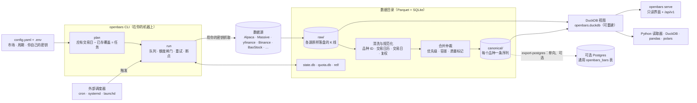
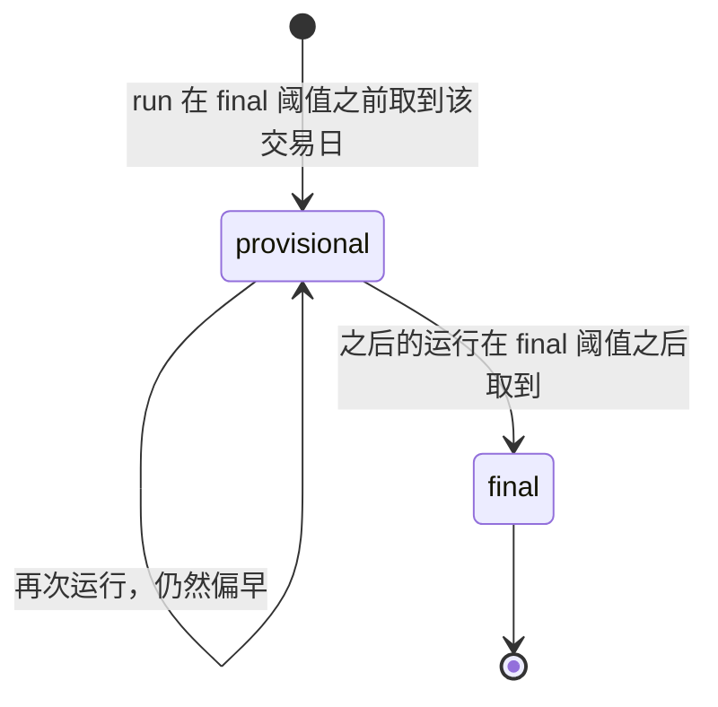

<p align="center"></p>

# OpenBars 架构总览

[English](ARCHITECTURE.md) | **中文**

这是面向读者的架构/方案总览，说明 OpenBars 是怎么搭起来的、为什么这样设计，也是架构问题的入口。代码注释里引用的带章节号的长篇参考（`§3`、`§10`、`§11` 等）在 [architecture-internals.md](architecture-internals.md)（英文）；本页与它重叠的部分描述的是同一套设计，字段级细节以该文件为准。

目录：[定位](#定位) · [数据流](#数据流) · [当日模式](#当日模式先-provisional再-final) · [存储布局](#存储布局) · [读取数据](#读取数据) · [可选的 Postgres 导出](#可选的-postgres-导出) · [调度](#调度) · [新增数据源](#新增数据源) · [边界](#边界)

## 定位

OpenBars 是一个**本地优先的行情仓库框架**，不是托管服务，也不是又一个单一数据源的客户端。

- **自部署。** 谁下载谁运行，数据目录归你，各数据源的密钥由你自备（BYOK）。一切都可以完全私有，只留在一台机器或你自己的网络里。
- **没有托管服务。** 没有 OpenBars 运营的服务器、账号或 API。`/api/v1` 读取 API 所谓「公开」，只是指它的契约有文档且稳定；你用 `openbars serve` 自己部署（见 [api.md](api.md)，英文）。
- **不分发数据。** 仓库只含代码、规则与文档。数据来自你启用的数据源，受其条款约束（见 [DATA_SOURCES.zh-CN.md](../DATA_SOURCES.zh-CN.md)）。
- **一份规范层（canonical）数据。** 在免费额度内抓取多个源，做清洗、对齐和合并，每个品种得到一条序列，每根 K 线都带来源和质量标记。
- **不是**交易终端、下单系统、逐笔/实时行情，也不是回测框架。

## 数据流



一根 K 线依次经过的阶段：

| 阶段 | 做什么 | 代码 |
| --- | --- | --- |
| 规划 | 规划器按 `市场 × 周期 × 品种 × 历史区间` 结合该市场的交易日历，算出应有的交易日，减去已存数据，把每个缺口派给声明了该市场与周期的、成本最低的已启用数据源。`plan` 只打印；`run` 规划并执行。 | `orchestrator/planner.py` |
| 队列与额度 | 任务是 `state.db` 里的幂等记录，带断点。worker 领取任务，每个对外请求先从共享额度闸门（`quota.db`）取令牌；429 会惩罚该数据源，连续失败会触发熔断，永久错误变成 `dead` 任务，只有显式的 `openbars jobs retry` 才会重新入队。 | `orchestrator/`、`quota/` |
| 抓取 | provider 适配器把请求翻译成对数据源的调用，返回 `RawBatch`。适配器声明自己的能力（市场 × 周期、历史深度、批量形态、条款），不涉及合并。 | `providers/` |
| 原始层 | 原样落盘的 K 线追加写入不可变的 Parquet 分片，键包含 provider、feed、复权方式与 revision。响应旁路文件（`raw-archive/`，已脱敏）可以一并保存。 | `raw/`、`storage/` |
| 清洗与规范化 | 代码解析为带有效期的稳定品种 ID；K 线时间换算为交易所本地交易日（UTC 的 `ts_start` 加 `session_date`）；记录公司行动与 A 股复权因子；执行单源质量规则（如涨跌停/停牌标记）。 | `normalize/`、`calendars/` |
| 合并仲裁 | 各市场用各自的策略为每个品种每个交易日选出一根：美股 `research-daily-v2`（主源、备源、容差、佐证）、加密 `crypto-daily-v1`（按交易所，绝不合并）、A 股 `cn-daily-v1`（单源投影）、港股 `hk-daily-v1`（yfinance 为主，AKShare 佐证）。分歧只做标记（`divergent`、`spike_suspect` 等），从不取平均。 | `reconcile/`、`orchestrator/finalize.py` |
| 规范层 | 每个 `(instrument_id, 时间, policy_version)` 一行，带来源（`provider`、`feed`、`price_source`、`source_fetch_id`）、`freshness`、`available_at` 与质量标记。复权（QFQ/HFQ、拆股）在读取时派生，不落盘。 | `storage/` |
| 读取服务 | DuckDB 视图读取 Parquet 目录；`openbars serve` 在其上提供只读界面和 `/api/v1` JSON API。它从不规划、抓取或写入。 | `api/`、`web/` |

缺口从不插值：缺失的交易日就是缺失；看起来可疑的规范层 K 线只做标记，不删除。

## 当日模式：先 provisional，再 final

日线只有一条路径：**取各源当前能提供的最新数据**，没有用户可选的模式。每根规范层行自动打标签：



- `freshness=provisional`：当日临时行，之后的正式数据可能将其替换。`freshness=final`：正式数据；缺失该值的旧行按 `final` 读取。
- final 阈值（代码里的分档规则，不是数据源的承诺）：美股次日美东 00:00 起，加密次日 UTC 00:30 起，A 股与港股为（实际）收盘后 30 分钟。
- `available_at` 是该行最早可用于研究的时刻。同一根源 K 线被重写时保留最早已知时间，因此重复运行不会把可用时间推后。
- 读取时展示当前可见的那一行：优先 final，否则展示 provisional 并标明档位。
- 时效性**不等于**完整性，freshness **不是**质量标记。看板上的观察覆盖也不保证完整。各源的证据状态见 [source-readiness.md](source-readiness.md)（英文）；按源的摘要见 [DATA_SOURCES.zh-CN.md](../DATA_SOURCES.zh-CN.md#当日数据先-provisional再-final)。

## 存储布局

默认后端是 **Parquet + DuckDB**，配额闸门使用本地 SQLite。数据目录是 `$OPENBARS_HOME/data`（默认 `~/.openbars/data`），传统的 `./config.yaml` 布局则是 `./data`；`storage.path` 与 `--data` 可以覆盖。

```text
data/
  state.db                                  # SQLite：任务、断点、fetch_log
  quota.db                                  # SQLite：共享额度闸门状态
  raw/provider=alpaca/market=us/interval=1d/year=2024/part-*.parquet
  canonical/market=us/interval=1d/year=2024/part-*.parquet
  ref/instruments.parquet                   # 品种主数据
  ref/symbol_mappings.parquet               # 代码有效期
  ref/corporate_actions.parquet
  ref/adjust_factors.parquet                # A 股复权因子（可选文件）
  raw-archive/provider=…/market=…/interval=…/…   # 已脱敏的响应旁路文件
  openbars.duckdb                           # 只含视图；可随时删除，按需重建
```

- 写入**不可变且原子**：每次 upsert 为每个涉及的分区写一个新的 `part-*.parquet`（临时文件、`fsync`、`os.replace`），已有分片从不修改。同键**后写者胜**，所以被取代的旧行可能留在旧分片里，直到 `openbars compact` 合并。重试任务不会重写未变化的内容。
- 分区键是 `market / interval / year`（raw 还有 `provider`；分钟级再加 `month`）。
- 写入方在 `data/.lock` 上串行，读取方不加锁。价格是 `decimal128(20,8)`，成交量是 `decimal128(28,8)`，从不经过二进制浮点。
- `openbars usage`、`compact`、`retention` 与 `backup` 是维护命令；只有 `--apply` 才会改动文件。备份从不包含配置、dotenv、密钥或 DSN。
- 完整的 schema、键与迁移规则见 [architecture-internals.md §10](architecture-internals.md#10-storage-layout-parquet--duckdb-by-default) 与 [source-contract.md](source-contract.md)（均为英文）。

## 读取数据

1. **`openbars serve`**（`uv sync --extra http`）：本地只读界面和 `/api/v1` API（`health`、`markets`、`instruments`、`bars`、`flags`、`quota`）。默认只绑定回环地址；绑定非回环地址需要 `--allow-non-loopback`，且没有内置认证或 TLS，请在前面放防火墙或带认证的反向代理。详见 [api.md](api.md)。
2. **Python：** `open_backend(path, read_only=True)` 然后 `backend.reader.bars(...)`，在查询时派生复权，并应用后写者胜规则。
3. **直接读取：** 用 DuckDB、pandas 或 polars 读 Parquet 目录；建议使用 DuckDB 视图（`canonical_bars`、`raw_bars`、`instruments` 等），去重由视图代劳。

[在线演示](https://liyuk.github.io/openbars/)是同一套界面的静态副本，数据是仓库内检入的合成 `TEST*` 样例；它没有后端，也不读取任何实时数据。

## 可选的 Postgres 导出

`openbars export-postgres` 是**可选的参考实现**（`uv sync --extra postgres-export`），不在默认写入路径上。

- 它**只写不读**：把一个窗口内的规范层日线复制到一张通用表 `openbars_bars`（「K 线 + 来源信息」：数据源、抓取批次、`freshness`、`available_at`）。不加 `--apply` 就只是 dry-run。
- 它**不认识任何下游表**：没有调用方表名、没有外键、没有整数型上游品种 ID，也从不执行 DDL。这张表由你按文档里的 DDL 自己建。
- OpenBars **不会读回**这张表。`serve`、`run`、`verify` 以及默认的 Parquet 流程都不会查询 Postgres；下游系统自己读取导出表。
- 需要自己表结构的系统，应在自己一侧写适配器：读取 OpenBars 的数据并映射进自己的 schema，且把该 schema 放在本仓库之外。

详见 [postgres-export.md](postgres-export.md)。另有一个可选的 `storage.postgres` 后端（`native` 模式，以及仅用于迁移的 `upstream_compat` 模式），它不是默认选项，说明见 [architecture-internals.md](architecture-internals.md) 的 §10.5 与 §11。

## 调度

OpenBars **没有内置调度器，也没有常驻进程。** `openbars plan` 与 `openbars run` 都是普通 CLI 命令，何时运行由**外部调度器**决定。`config.yaml` 里的 `schedule.daily_at` 只是展示/记录字段：规划器与 CLI 都不会读取它来触发运行。

`run` 是幂等的：它规划缺失的部分、执行、空闲即结束，随时可以再跑（已完成的窗口不会重复抓取；被中断的任务从断点继续）。所以「每天在该市场 final 窗口之后跑一次」就是完整的运行模型；一天多跑几次只会刷新 provisional 的 K 线。

通用示例（请按自己的情况修改路径；仓库不会提供也不会启用其中任何一个）：

```cron
# cron：工作日在美股 final 窗口之后不久；时区取决于本机
15 0 * * 2-6  cd /path/to/openbars-project && uv run openbars run >> /path/to/logs/openbars.log 2>&1
```

```ini
# systemd：openbars.service（oneshot）+ openbars.timer；请确认单元的 PATH 里有 `uv`
# --- openbars.service
[Service]
Type=oneshot
WorkingDirectory=/path/to/openbars-project
ExecStart=/usr/bin/env uv run openbars run

# --- openbars.timer
[Timer]
OnCalendar=Tue..Sat 00:15 America/New_York
Persistent=true
[Install]
WantedBy=timers.target
```

```xml
<!-- macOS LaunchAgent：在你自己用户的 LaunchAgents 目录里创建 plist；时间为本机时间 -->
<dict>
  <key>Label</key><string>local.openbars.run</string>
  <key>WorkingDirectory</key><string>/path/to/openbars-project</string>
  <key>ProgramArguments</key>
  <array><string>/usr/bin/env</string><string>uv</string><string>run</string><string>openbars</string><string>run</string></array>
  <key>StartCalendarInterval</key><dict><key>Hour</key><integer>13</integer><key>Minute</key><integer>20</integer></dict>
</dict>
```

各市场的建议运行时刻及其已核实/待验证状态，见 README 的[「运行时刻」](../README.zh-CN.md#运行时刻)与 [source-readiness.md](source-readiness.md)。请把密钥放在私有的 dotenv 文件里（`OPENBARS_ENV_FILE` / `--env-file`），不要写进调度器的定义。

## 新增数据源

provider 是运行时的插件点：通过 `openbars.providers` entry point 组发现（`providers/registry.py`），所以第三方包也可以自带 provider。为已有市场新增一个数据源，步骤如下；仓库自带的 provider（例如基于 token 的 `providers/cn/tushare.py`）是最好的模板。

1. **实现 `Provider` 协议**（`providers/base.py`）：`id`、`api_version`、`capabilities()`、`quota_policy()`、`list_instruments()`、`fetch_bars()` 与 `fetch_corporate_actions()`。`capabilities()` 返回 `SourceCapability`（市场、周期、历史起点、滚动窗口、批量形态、复权方式、feed、条款，以及延迟是否已核实）。`fetch_bars()` 返回由 `RawBar` 组成的 `RawBatch`，带 `fetch_id`；失败用 `ProviderError(code, retryable, retry_at)`。基于 HTTP 的源可继承 `HttpProviderAdapter`（`providers/adapter.py`），获得额度获取、错误映射与密钥脱敏。
2. **注册：** 在 `pyproject.toml` 的 `[project.entry-points."openbars.providers"]` 下加一行（`name = "package.module:ClassName"`）；需要 SDK 的话再加一个可选 extra。
3. **接入 CLI**（`cli/wiring.py`）：把 provider 名加入 `_CREDENTIALS`（构造参数对应哪个 `providers.<name>` 配置项，密钥从环境变量读取）和 `_PROVIDER_MARKETS`；初始化向导的列表在 `cli/init.py`。已注册但**没有**写进 `wiring.py` 的 provider 就是「仅适配器」：可以在 Python 里调用，但 `plan` / `run` 不会构造它（目前的 Futu 与 LongPort 就是这样）。
4. **给它一个来源标识，并确定它在合并中的位置。** 在 `core/series.py` 里加 `SourceIdentity` 与序列语义（`price_basis`、`adjustment_scope`、`session_semantics`、`volume_basis`），并在该市场的策略（`reconcile/`）里决定它的角色：美股优先级来自配置的 `reconcile` 段，加密源按交易所划分，A 股是单源投影（一次启用一个），港股是一个主源加一个佐证源。未知的标识保持 `unknown`，不会被假定为兼容。
5. **如实声明额度与条款。** 用户只能收紧默认额度。只有代码能证明延迟上界时才标 `latency_verified`；否则就是尽力获取，不承诺 T+0。
6. **离线测试。** 测试从不访问网络，也不使用真实行情：使用 `tests/` 下的 fake provider 与合成代码（见 `tests/fakes.py`）。
7. **补文档：** [DATA_SOURCES.zh-CN.md](../DATA_SOURCES.zh-CN.md)、[provider-keys.md](provider-keys.md)、[source-readiness.md](source-readiness.md) 与 `config.example.yaml`。

新增一个**市场**还需要交易日历（`calendars/`）、规范层 sink 与 `policy_version`（`orchestrator/finalize.py`、`reconcile/`），以及读取路径的接线。新增一个**周期**则是增加一个 `Interval` 成员并补充 provider 能力声明，而不是加代码分支。

## 边界

- 仓库里不放行情数据、密钥、token 或个人路径；`scripts/check.sh` 会运行测试、脱敏扫描与 gitleaks。
- OpenBars 从不读写你下游系统的表。唯一的数据库输出是可选的、单向的 `openbars_bars` 导出。
- 静态演示站展示的一切都是合成的（`TEST*` 代码与虚构的 `example` 额度渠道）。

## 更深入

- [architecture-internals.md](architecture-internals.md)（英文）：分层与接口、数据模型、交易日历、各市场约定、存储 schema、Postgres 后端、策略。
- [source-contract.md](source-contract.md)（英文）：通用的「K 线 + 来源信息」契约。
- [api.md](api.md) · [postgres-export.md](postgres-export.md) · [roadmap.md](roadmap.md) · [DATA_SOURCES.zh-CN.md](../DATA_SOURCES.zh-CN.md)
