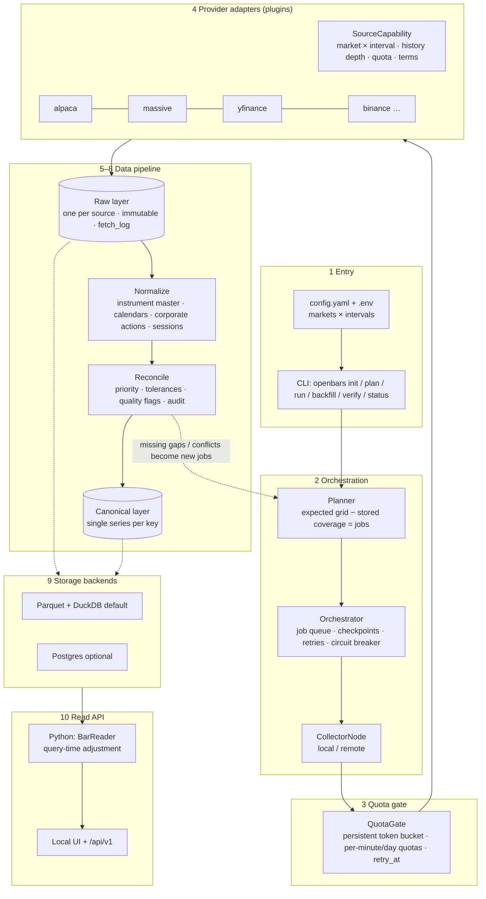

# OpenBars architecture

Status: draft v0.1. This document describes the current internal design. Field-level details
of the storage contract live in [source-contract.md](source-contract.md); the public read API
is documented in [api.md](api.md).

## 1. Goals and non-goals

**Goals**

- Collect the complete bar history for the markets × intervals a user selects, within **free
  provider quotas**, and keep it incrementally up to date.
- Turn several sources into **one canonical dataset** through cleaning, alignment and
  arbitration, where every bar carries its provenance and quality.
- Keep layers thin and explicit: adding a market or a data source means adding a provider
  plugin plus conventions, not editing the core.
- Offer an optional compatibility mode that can mirror a pre-existing external Postgres
  schema, for controlled migrations and tests only (§11). The default path is Parquet +
  DuckDB.

**Non-goals**

- Distributing or hosting data; reselling paid data.
- Real-time quotes, tick data, order execution, backtesting, strategies.
- Full-market minute bars in v0.x; intraday intervals are optional capabilities.

## 1.1 Timeliness versus completeness

The canonical layer stores and exposes `freshness` (`provisional` / `final`) and
`available_at` separately. They do not reuse `QualityFlag.STALE`, `divergent` or
`quality_status`. Reads return the currently visible row: final rows win; when no final row
exists, a provisional row is returned and labeled as such. Timeliness and completeness are
not reached at the same time, and observed coverage is not a completeness guarantee.

| Daily market | Provisional tier | Final tier (code threshold) |
| --- | --- | --- |
| US | during the session (T+0) | from 00:00 ET the next day (T+1) |
| Crypto | during the UTC session day (T+0) | from 00:30 UTC the next day (T+1) |
| China A-shares | during the session (T+0) | 30 minutes after the close (T+0) |
| Hong Kong | during the session (T+0) | 30 minutes after the actual close (T+0) |

These are freshness-tier rules, not provider delivery SLAs. Unverified sources stay best
effort; per-source status is tracked in [source-readiness.md](source-readiness.md).

### Daily run timing and scheduling

Daily collection has exactly one path: fetch the newest data each source can currently
provide. There is no same-day/final mode switch. Every run fetches as much recent data as
source capabilities allow; an earlier provisional row may be replaced by a later final row.
Freshness thresholds are not provider delivery SLAs.

When a run actually starts is decided by an **external** scheduler (cron or equivalent).
`schedule.daily_at` is a display/record field: `openbars config` prints the whole `schedule`
section, but neither the planner nor the CLI reads it to trigger a run, so changing it does
not change scheduling. The example value `00:15 America/New_York` matches the common final
window, 00:15 ET / 21:15 PT. Suggested per-market run times and their verified/unverified
status are in the [README](../README.md#daily-run-timing-and-source-readiness) and
[source-readiness.md](source-readiness.md).

## 2. Layer overview



Dependencies point downward: an upper layer depends on the **interface** of the layer below
(`typing.Protocol` / ABC), never on its implementation. The data models in `core/` are shared
by every layer and depend on none of them.

| Layer | Package | Responsibility | Not responsible for |
| --- | --- | --- | --- |
| 1 Entry | `openbars.config`, `openbars.cli` | read config, expand environment, validate selections, command line | business logic |
| 2 Orchestration | `openbars.orchestrator` | compute the pending grid, build idempotent jobs, checkpoints, retries/breaker, node dispatch | HTTP details |
| 3 Quota | `openbars.quota` | persistent quota shared per provider (and key); every outbound request takes a token first | retry policy |
| 4 Providers | `openbars.providers` | declare capabilities; translate requests into provider calls; return `RawBatch` | reconciliation, adjustment |
| 5 Raw layer | `openbars.raw` | store responses as delivered (append-only, immutable) + `fetch_log` | cleaning |
| 6 Normalize | `openbars.normalize` | symbol → `instrument_id`; time zone/session/daily split; corporate actions; single-source cleaning | cross-source decisions |
| 7 Reconcile | `openbars.reconcile` | multi-source alignment, priority, tolerances, fallback fill, quality flags, audit records | fetching |
| 8 Canonical layer | `openbars.reconcile` output | one series per `(instrument_id, time, policy_version)` | — |
| 9 Storage | `openbars.storage` | read/write raw, canonical, reference data and logs; atomic writes; partitioning | business rules |
| 10 Read | `openbars.api` | query canonical, derive adjustments, export; optional read-only HTTP service (`openbars serve`, loopback only, see §13) | writes |

## 3. Core data model (`openbars.core.models`)

All models are immutable dataclasses (frozen); the storage side maps them to Arrow/Parquet
schemas.

### 3.1 Enums

- `Market`: `us` | `crypto` | `cn` | `hk`
- `AssetClass`: `equity` | `etf` | `adr` | `index` | `crypto_spot` | `fund` …
- `Interval`: `1d` | `1h` | `30m` | `15m` | `5m` | `1m` (with `is_intraday` and `duration`)
- `Session`: `regular` | `pre` | `post` | `continuous` (crypto)
- `Adjustment`: `raw` | `split` | `split_dividend` | `all` | `qfq` | `hfq`. `qfq` / `hfq`
  (forward/backward adjustment) only apply to China A-shares under `cn-daily-v1`: storage
  keeps `raw`, and the adjusted series is derived at query time from the factor table (§3.4).
- `QualityFlag` (bit set): `divergent` (sources disagree beyond tolerance),
  `spike_suspect` (large move without a corporate action), `volume_missing`,
  `single_source`, `filled_from_fallback`, `stale` (source is late/unchanged; on the read path
  it also means "fetched before a later split, so the stored price basis may be out of date",
  see §3.4), `gap`, `revised` (the source revised history), `adjustment_unverified` (no
  corporate-action rows / A-share factor rows for this instrument, so the requested basis
  cannot be verified or derived; the bar keeps its stored basis, see §3.4), `limit_up` /
  `limit_down` (A-share close exactly at the daily limit, §3.4.4), `suspended` (A-share
  suspension day, `tradestatus=0`, §3.4.4). The three A-share flags do not change
  `quality_status` (it stays `complete`; flags are the source of truth).

### 3.2 Instruments and symbol mapping (ticker reuse)

```text
Instrument
  instrument_id: str        # stable internal id, e.g. "us:eq:01J…" (ULID), never reused
  market: Market
  asset_class: AssetClass
  name: str | None
  exchange: str | None      # MIC, e.g. XNAS
  currency: str
  listed_on / delisted_on: date | None
  external_ids: dict        # figi / cik / isin / provider-native id

SymbolMapping               # which instrument a symbol pointed at, when
  instrument_id, provider ("*" = provider-agnostic), symbol
  valid_from: date, valid_to: date | None
```

Principle: **a bar always hangs off an `instrument_id`, never off a ticker.** A provider
symbol is resolved together with the bar date via
`InstrumentMaster.resolve(symbol, on=date, provider=…)`; unmapped or ambiguous symbols go to
the `unresolved` queue and never reach the canonical layer.

Known failure mode: when a ticker is recycled by another company, a ticker-keyed store
attaches the new company's bars to the old company's instrument. The rules below (implemented
in `openbars.normalize.*`; storage only persists them) prevent that:

- **Stable ids**: `<market>:eq:<26-character ULID-shaped id>`, never reused. When a
  share-class FIGI is known the id is derived deterministically from
  `sha256("share_class_figi:<FIGI>")` (first 128 bits, Crockford base32); otherwise it is a
  random ULID. Before creating an instrument the code looks it up by external id (FIGI /
  provider-native id) and reuses an existing one. `asset_class` (including a distinct `etf`)
  is an attribute, not part of the id. An `upstream_ids` table can map `instrument_id` ↔ an
  external integer key (compatibility mode only, 1:1).
- **Identity evidence** (`normalize.identity`): only a share-class FIGI or a provider-native
  id is a stable key. A ticker alone (`symbol_only_evidence`), a CIK alone
  (`issuer_only_evidence`), or a `symbol:` fallback id that just repeats the ticker are all
  `unresolved`: they may not create, rename, retire or question any instrument. A conflicting
  stable key → `disputed`; single source → `provisional`; corroborated by several sources →
  `verified`. `observed_at` / `as_known_at` must carry a time zone.
- **Listing ingestion** (`InstrumentDirectory.ingest`, input: `ListingRecord` snapshots from
  any provider): a new stable identity creates an instrument with an open mapping
  (`valid_from` = listing date, else the first observation date); **ticker reuse** (the same
  symbol still has an open mapping on another instrument) closes the old mapping the day
  before the new listing date, or on the last observed day when no listing date exists, and
  goes to `unresolved` when neither can be determined — never a guess; **rename** (same
  identity, new symbol) closes the old symbol window and opens the new symbol on the same
  instrument; **delisting** writes `delisted_on` and closes open mappings (when a provider
  reports a ticker change as a delisting, only the old symbol window closes). The default
  universe is every common stock plus ETF in the snapshot; other types (ADR, fund) come only
  from configuration and default to empty. Ticker type → `AssetClass` mapping lives in
  `normalize.security_types`; unlisted types (preferred shares, warrants) are never written as
  equities.
- **`resolve` rules**: only mappings of the same market are considered, `valid_to` is
  inclusive; provider-specific mappings beat `"*"`; more than one instrument at the same
  priority is ambiguity → `None`. A date not covered by any window has exactly one **historic
  fallback**: the symbol must have been bound to a single instrument in its history and the
  date must not be after that instrument's last closed window (this covers listing dates
  observed late). As soon as two or more instruments shared the symbol (reuse), there is
  **no** fallback and uncovered dates stay unresolved.
- **`unresolved` queue**: unmapped, ambiguous or conflicting bars/listing rows go to
  `ref/unresolved.parquet` (`kind`, `reason_code`, `symbol`, `provider`, `session_date`);
  `unresolved_count()` feeds `status`; those bars never enter the canonical layer.
  `assign_instrument` / `assign_instruments` are functional helpers: resolve the id where
  possible, leave the rest empty and enqueue them. Queue keys
  (`UnresolvedRecord.key`): bars by `(provider, symbol, day)`, listing rows by
  `(provider, symbol)` (no date), corporate actions (`kind="corporate_action"`) by
  `(provider, symbol, ex_date, action kind)` (`session_date` holds the ex-date, `detail` the
  action kind), so re-ingesting the same event does not grow the queue.

#### 3.2.1 Crypto pair master data (`openbars.normalize.crypto_pairs`)

A crypto spot instrument is **one trading pair on one exchange**. It does not use ULIDs,
FIGIs or `<market>:eq`:

- **Id rule**: `crypto:spot:<venue>:<BASE>-<QUOTE>`, for example
  `crypto:spot:binance:TEST-USDT`. Derived deterministically from `(venue, base, quote)` and
  never reused; a relisted pair reuses the same id, and an id that was written wrong stays
  wrong (it is never "corrected"). `venue` is a lowercase `[a-z0-9]+` slug (`BINANCE` /
  `Binance` → `binance`); `base` / `quote` are uppercase alphanumeric asset codes; empty
  values or values containing `-` / `:` are rejected. `market_of` reads the first segment and
  yields `crypto`.
- **Base and quote are stored separately**, never as one symbol string.
  `Instrument.external_ids` always contains `base` / `quote` / `venue` (plus an informational
  `provider_symbol`); `currency` = quote (for example `USDT`; not required to be a 3-letter
  ISO code); `exchange` = the venue uppercased (`BINANCE`); `asset_class=crypto_spot`. Reads
  use `pair_assets(instrument) -> (base, quote)`, `pair_venue(instrument)` and
  `CryptoPair.parse(id)`.
- The same pair on **different exchanges is a different instrument**, even with the same
  base/quote: it must not be merged across venues and must not be used to price-check the
  other.
- The same exchange with the same base but a different quote (`TEST-USDT` vs `TEST-USDC`) is
  also two instruments.
- **Mappings are always provider-specific** (`binance` + `TESTUSDT`, `coinbase` +
  `TEST-USDT`); the provider-agnostic `"*"` form is never written, because both venues use
  that display form and `"*"` would be ambiguous or even merge them.
  `resolve("TESTUSDT", provider="binance", market=CRYPTO)` therefore hits the Binance pair
  only.
- **Ingestion** (`ingest_crypto_pairs(master, listings, as_of=…)`, input
  `CryptoPairListing`): look up by the deterministic id, reuse when present (update the name,
  keep the earlier `listed_on`) and confirm/open the `(provider, symbol)` mapping; a delisting
  (`active=False` or a `delisted_on`) writes `delisted_on` and closes that provider symbol's
  open window (`valid_to` inclusive); a delisted pair reported active again reuses the id and
  opens a new window after the closed one. Illegal venue/base/quote, one `(provider, symbol)`
  claimed by two different pairs in the same batch, or a symbol already open on another pair
  all go to `unresolved` (counted and queued; no exception, no merge). US equity instruments
  in the same master are unaffected.
- **Test coverage**: ingestion / resolve / delisting / idempotent re-ingestion run against
  in-memory, Parquet and Postgres-native masters; the Postgres part is tagged
  `postgres_live`, needs `OPENBARS_TEST_PG_DSN` (a temporary schema per test) and is skipped
  by default.
- **Orchestrator and CLI integration**: `openbars run` and `openbars plan --submit` (write
  paths) call `list_instruments(Market.CRYPTO)` on enabled providers that declare `crypto`
  (binance / coinbase) before planning, convert rows with
  `listing_from_provider_instrument` and ingest them via `ingest_crypto_pairs`
  (`cli.wiring.ingest_crypto_listings`; rows without base/quote count as unresolved, and a
  failing venue list only adds a note instead of failing the run), then plan with
  `DefaultPlanner(instruments=backend.instruments)`. Alpaca / Massive / yfinance are never
  called; a US-only configuration makes no extra network request and stores no crypto pairs.
  Dry-run `plan` does not ingest, does not call `list_instruments` and does not write the
  master; if the master already has pairs it is used for planning, otherwise the symbol
  heuristic applies.
- The instruments schema and `SCHEMA_VERSION` are unchanged; no column is added.

#### 3.2.2 China A-share security ids (`openbars.normalize.cn_instruments`)

See [discussion #54](https://github.com/Liyuk/openbars/discussions/54). This module is pure
functions; listing ingestion and providers are described below and in §3.5.3.

- **Format**: `cn:eq:<venue>:<code>`. `venue` is a lowercase slug: `xshg` (Shanghai,
  including STAR) or `xshe` (Shenzhen, including ChiNext); Beijing (`xbse`) is reserved and
  currently rejected. `code` is exactly six digits with leading zeros preserved (`000001`,
  `600000`, `688001`). `asset_class` is not part of the id. `market_of` yields `cn`.
- **The exchange is mandatory**: a bare six-digit code is not a valid id and cannot be
  normalized.
- **Common spellings** (`normalize_cn_symbol`, case-insensitive): `600000.SH` / `600000.SS`
  / `sh.600000` / `SH600000` → `xshg` + `600000`; `000001.SZ` / `000001.SZSE` /
  `sz.000001` / `SZ000001` → `xshe` + `000001`.
- **Reuse and generations**: a retired id is never given to a new company. The first listing
  is `cn:eq:xshg:600000`; a second listing of the same `(venue, code)` becomes
  `cn:eq:xshg:600000:g2` (then `g3` …). Generation 1 has no suffix; `:g1` is invalid.
  `cn_instrument_id(venue, code, generation=1)` builds it, `parse_cn_instrument_id` returns
  `(venue, code, generation)` and raises `ValueError` on invalid parts.
- Choosing the next generation (reading retired ids) belongs to listing ingestion, not to
  this module.

#### 3.2.3 Hong Kong security ids (`openbars.normalize.hk_instruments`)

See [discussion #68](https://github.com/Liyuk/openbars/discussions/68).

- **Format**: `hk:eq:xhkg:<code>`. `venue` is only `xhkg` (HKEX, main board and GEM).
  `code` is exactly five digits with leading zeros preserved (`00700`, `09988`).
  `asset_class` is not part of the id. `market_of` yields `hk`.
- **Common spellings** (`normalize_hk_symbol`): `00700` / `700` / `0700.HK` / `HK.00700` /
  `HK00700` / `xhkg:00700` → `xhkg` + `00700`. Hong Kong has a single exchange, so a bare
  1–5 digit code is unambiguous (unlike A-shares).
- **Reuse and generations**: as with A-shares, retired ids are never reused; a relisting
  becomes `:g2`, `:g3` …; generation 1 has no suffix and `:g1` is invalid.
  `hk_instrument_id` / `parse_hk_instrument_id` build and parse them.
- **US ADR links**: an HK ordinary line and its US ADR are two instruments. The ordinary
  line's `external_ids["us_adr"]` points at the ADR id and the ADR's
  `external_ids["hk_ordinary"]` points back (`hk_adr_external_ids` /
  `us_hk_ordinary_external_ids`). ADR tickers never enter HK ids.
- **yfinance `.HK` mapping**: `to_yahoo_hk_ticker` turns a five-digit code /
  `hk:eq:xhkg:00700` into the familiar `0700.HK` (one leading zero dropped). The HK source
  identity is `yfinance/yahoo/raw` (`auto_adjust=False`), rows on non-sessions are dropped by
  the XHKG calendar, and Yahoo's adjusted series is never treated as canonical. The planner
  uses yfinance only; AKShare stays out of `plan` / `run`.
- **Adjustment conventions**: the canonical profile is `hk-daily-v1`, **stored unadjusted
  (`RAW`)**; `SPLIT` / `SPLIT_DIVIDEND` / `ALL` are derived at query time by
  `openbars.normalize.hk_adjust` (a thin wrapper over `adjust_rows`), defaulting to `SPLIT`
  and reusing the US `Adjustment` enum (not A-share QFQ/HFQ). Splits (`hk_split`) and
  consolidations (`hk_consolidation`) are `kind=SPLIT` (`ratio` = new/old, so a consolidation
  is < 1). Bonus issues (`hk_bonus`) are encoded as a stock dividend with a `ratio` and are
  **not applied as a split by default** (`include_stock_dividends=False`; pass
  `include_bonus=True` to apply). Rights issues (`hk_rights`) are a separate `kind=RIGHTS`
  that is recorded and never applied to prices. Cash dividends (`hk_cash_dividend`) carry an
  ISO 4217 `currency` (default `HKD`) and are applied only when the dividend currency matches
  the bar currency, so a USD ADR dividend is never applied to an HKD bar.
- **AKShare HK backup source** (`openbars.providers.hk.akshare`, entry `stock_hk_hist`): five-
  digit codes, unadjusted only (`adjust=""`), non-sessions dropped by XHKG, source identity
  `akshare/eastmoney/raw`. The library is MIT but does not relicense upstream quotes;
  Eastmoney's terms forbid redistributing exchange quotes without written consent. OpenBars
  stores locally only, with conservative defaults (4 requests/minute, 80 per 24h) and one
  request per code. The planner still uses yfinance only, so this backup never enters
  `plan` / `run` automatically.
- **Futu OpenD HK daily** (`openbars.providers.hk.futu`): calls `request_history_kline`
  (`K_DAY`, `AuType.NONE`, paging with `page_req_key`) against the user's own locally running
  OpenD (`providers.futu.host` / `port`, default `127.0.0.1:11111`), codes written as
  `HK.00700`, source identity `futu/opend/raw`. OpenBars never touches Futu login and assumes
  no entitlement: market-data tier, history quota and domestic/international classification
  are decided by the account and Futu's rules. OpenD rate, quota and permission errors map to
  retryable `rate_limited` versus non-retryable `history_quota_exhausted` /
  `no_entitlement`; error text is not echoed. The Futu user agreement and exchange
  market-data rights forbid unauthorized forwarding and commercial redistribution, so storage
  is local and private. The `futu-api` SDK is not an OpenBars dependency; the user installs
  it. Default pacing is 30 requests / 30 seconds (half the official 60). Like AKShare it is
  not part of the planner.
- **LongPort HK daily** (`openbars.providers.hk.longport`): `QuoteContext.history_candlesticks_by_date`
  (`Period.Day`, `AdjustType.NoAdjust`), codes written as `700.HK`, long ranges split every
  1000 calendar days, source identity `longport/openapi/raw`. Requires the user's own
  LongPort account and developer credentials; `app_key` / `app_secret` / `access_token` are
  read at runtime from `${ENV}` references only, are excluded from `repr` and errors, and SDK
  exception text is not echoed (rate → retryable `rate_limited`, no entitlement →
  `no_entitlement`, rejected credentials → `auth_failed`). Daily bar timestamps are converted
  to `Asia/Hong_Kong` before the session date is taken (the SDK turns the API's UTC timestamp
  into a naive local-time datetime, so naive values are interpreted as local time and integer
  timestamps as UTC). The API licence is generally personal, revocable, non-commercial and
  non-transferable, and market-data attachments may not be copied or redistributed; storage
  is local and private. The `longport` SDK is not an OpenBars dependency. Default pacing is
  5 requests/second (half the official 10). It is likewise not part of the planner.

### 3.3 Bar

```text
Bar
  instrument_id: str
  interval: Interval
  ts_start: datetime (UTC)  # bar start, always UTC
  session_date: date        # exchange-local trading day (daily primary key component)
  session: Session
  open, high, low, close: Decimal   # precision (20,8), 0 < price < 1e12
  volume: Decimal | None            # precision (28,8), 0 <= volume < 1e20
  vwap: Decimal | None, trade_count: int | None
  adjustment: Adjustment    # v0.1 / research-daily-v2: canonical is split (see §3.4, §9); raw is as delivered
  source: str               # raw: provider id; canonical: the selected source
  feed: str | None          # e.g. alpaca:sip / alpaca:iex — volume basis label
  flags: QualityFlag
  ingested_at: datetime | None
```

`RawBar` = the price/volume fields of `Bar` plus `provider`, `fetch_id`,
`symbol_as_returned`, `payload_hash`, `revision` (source bar version, >= 1), optional
`instrument_id` / `session_date` (filled in after symbol resolution) and optional
`series: BarSeriesIdentity` (§11.2, §10.1).
`CanonicalBar` = `Bar` plus `price_source`, `volume_source`, `sources_seen`,
`reconcile_rule`, `revision`.

Numeric rules (`openbars.core.ohlcv`): **prices and volumes are always `Decimal`, never
routed through `float`**. Constructors accept `Decimal` / `int` / `str`; `float` (including
`bool`) raises `TypeError`; non-finite values or values with more than 8 decimal places
(which cannot be stored losslessly) raise `ValueError`. `validate_ohlcv(...)` checks price >
0, volume >= 0, `high >= low`, `low <= open <= high`, `low <= close <= high`, with magnitude
caps of `1e12` for price and `1e20` for volume (open intervals, so values stay inside the
declared numeric precision). `Bar`, `RawBar` and `CanonicalDailyRow` all call it.

### 3.4 Corporate actions and calendars

- `CorporateAction`: `instrument_id, ex_date, kind (split|dividend|spinoff|symbol_change),
  ratio / amount, source`. `ratio` / `amount` are **`Decimal | None`** (no `float`, no
  non-finite values; a split `ratio` must be > 0); `ratio = new / old` (a 4-for-1 split is
  `4`, a 1-for-4 consolidation is `0.25`). Stored as `decimal128(20,8)` and read back without
  `float`; infinite decimals (such as 1/3) are rounded half-to-even to 8 places at write
  time — the only rounding on the corporate-action path.
- **Observation append + vote merge** (`normalize.actions.merge_corporate_actions`): each
  source writes its own rows (the key includes `source`); rows for the same
  `(instrument_id, ex_date, kind)` vote per field on `ratio` / `amount` (`None` abstains).
  Unanimous → one canonical row; on disagreement the most-voted value wins, ties go to the
  earlier source in `source_priority` (unlisted sources follow in lexicographic order), and
  values are **never averaged**; conflicts are recorded in `MergedAction.conflicts` (value
  per source) and marked `disputed` / `QualityFlag.DIVERGENT`. For duplicate rows from the
  same source, the later input row wins.
- **Query-time adjustment** (`normalize.adjust`, pure functions plus `QueryTimeAdjuster`):
  the v0.1 default profile `research-daily-v2` stores series already split-adjusted as
  delivered, so **`SPLIT` with no `as_of` returns the stored values unchanged**. Every other
  basis is derived from stored bars plus corporate actions (exact `Decimal`, rounded to 8
  places at the end): `RAW` undoes every split whose `ex_date` is after the bar's
  `session_date` (price × ratio, volume ÷ ratio); `SPLIT` with `as_of=D` undoes splits with
  `ex_date > D`, so the series looks the way it did on D; `SPLIT_DIVIDEND` / `ALL` first
  produce `SPLIT`, then multiply the price of every bar with `session_date < ex_date` by
  `P/(P+amount)` for each cash dividend (`P` = the last **unadjusted** close before the
  ex-date, i.e. the stored close with later splits undone; it applies only when
  `ex_date <= as_of`, and multiple dividends multiply). If a future optional profile stores
  `RAW`, then `RAW` is a no-op and `SPLIT` back-adjusts by splits with `ex_date <= as_of`.
  Stock dividends (`kind=dividend` with a `ratio` and no `amount`) mean different things in
  different sources and are not treated as splits by default (`include_stock_dividends=True`
  applies them); spinoffs are never adjusted. An action that cannot be applied never silently
  changes a bar: it is listed in `AdjustResult.skipped` with a reason. Mixing rows with
  different `adjustment_as_of` in one window raises `adjustment_cutoff_mismatch`
  (`AdjustmentError`).
- **Mapping tickers to stable ids at ingest**: Alpaca / Massive `fetch_corporate_actions`
  return the provider's ticker in `CorporateAction.instrument_id`; mapping happens at
  **ingest** (`normalize.instruments.ingest_corporate_actions`, with
  `assign_corporate_actions` doing mapping and enqueueing). An `instrument_id` already known
  to the master is kept; anything else is treated as a ticker and resolved with
  `resolve(symbol, on=ex_date, provider=action.source, market=…)` (same rules as bars).
  Resolved actions are upserted into the reference table; unmapped/ambiguous ones are not
  written but enqueued as `unresolved` (`kind="corporate_action"`), and a summary is returned
  (resolved / unresolved / already_mapped / reason_code counts). Events that become
  resolvable are written and removed from the queue on a later ingest.
  `upsert_corporate_actions` itself remains a plain write for already-mapped ids.
- **Missing corporate actions**: no action rows does not mean "never split", so for an
  instrument with **zero** action rows, deriving a basis other than the stored one **never
  relabels stored prices**: by default it raises `AdjustmentError`
  (`reason_code="missing_corporate_actions"`); with `on_missing_actions="flag"` the stored
  basis is returned unchanged (the `adjustment` stays `split`; it is not claimed to be RAW)
  and `QualityFlag.ADJUSTMENT_UNVERIFIED` is set (`quality_status` is unchanged; flags stay
  the source of truth). When an instrument has action rows but no split after a bar, the
  scale is verified as 1 and `RAW` is valid. `SPLIT` with `as_of` and no action rows keeps
  the stored `SPLIT` prices (no relabeling, no error) but flags `ADJUSTMENT_UNVERIFIED`
  because the as-of claim cannot be verified. The default `SPLIT` read (no `as_of`, fast
  path) is unaffected.
- **A-share forward/backward adjustment** (`normalize.cn_adjust`): A-shares use the separate
  profile `cn-daily-v1` and **store unadjusted (`RAW`) only** — `qfq` / `hfq` are never
  stored, because a forward-adjusted series would rewrite all history at every new ex-date.
  `QFQ` / `HFQ` are derived at query time from stored `RAW` bars plus the factor table; no
  `CorporateAction` rows are reverse-engineered from factors. Factors live in the separate
  Parquet table `ref/adjust_factors.parquet` (§10.3; a missing file means an empty table and
  does not change `SCHEMA_VERSION`), recording source `source` and method `method`
  (BaoStock: `baostock` / `pct_return`), keyed by
  `(instrument_id, source, effective_from)`. The formula uses a stable cumulative
  back-adjustment factor `back_adjust_factor`: the factor `f(d)` of session `d` is the last
  event with `effective_from <= d` (and `<= as_of` when given), else 1 (sessions before the
  first event); `HFQ = raw × f(d)` and `QFQ = raw × f(d) / ref`, where `ref` is the
  `back_adjust_factor` of the last event visible at `as_of` (latest by default; 1 when no
  event is visible, which makes `QFQ = HFQ = raw`). `open/high/low/close` and any `vwap` /
  `preclose` on the row are scaled and rounded to 8 places like `adjust.py`; `volume` /
  `amount` keep their traded basis and are not scaled; result rows are labeled with the
  requested basis. **One instrument never mixes factors from different sources**: passing no
  `source` with several sources raises `AdjustmentError(ambiguous_factor_source)`; pass
  `source=` to pick one. **Missing factors** follow the same policy as missing corporate
  actions: with zero factor rows the default is
  `AdjustmentError(missing_adjust_factors)`, and `on_missing_factors="flag"` returns stored
  `RAW` (still labeled `raw`) with `ADJUSTMENT_UNVERIFIED`; at least one row means verified,
  with factor 1 for sessions before the first event. `SPLIT_DIVIDEND` / `ALL` do not apply to
  A-shares (`unsupported_cn_adjustment`), and US rows requesting `QFQ` / `HFQ` raise the same
  way.
- **STALE on the read path**: when an instrument has split rows, `DuckDbBarReader.bars` runs
  the per-bar form of `find_stale_after_split` (`stale_bar_indexes`) and ORs
  `QualityFlag.STALE` onto bars fetched before a later split (label only — no refetch, no API
  call; derived rows keep the same flag).
- **Stale history after a split** (`normalize.actions.find_stale_after_split`, a pure
  function): if a stored bar's `session_date` is before a split's `ex_date` **and** its fetch
  time (`generated_at` / `ingested_at`) is also before that `ex_date`, the window was not
  adjusted for that split and needs a refetch on the new price basis; the result aggregates
  by (instrument, split). Raw bars never expire; bars without a fetch time are reported as
  stale by default (`treat_unknown_as_stale=False` disables that).
- `TradingCalendar` (Protocol): `sessions(start, end)`, `is_session(d)`,
  `session_bounds(d) -> [(open_utc, close_utc), …]` (supports lunch breaks and half days;
  crypto is 24/7 UTC). Implementations in §3.4.1–§3.4.5.

#### 3.4.1 XNYS calendar (`openbars.calendars.xnys`)

- **Reuses the `XNYS` rules from [`exchange_calendars`](https://pypi.org/project/exchange-calendars/)**
  (`exchange-calendars>=4.9,<5`, Apache-2.0); no holiday table is maintained in this
  repository.
- `XNYSCalendar` implements `TradingCalendar` and registers through the
  `openbars.calendars` entry point as `xnys`; `market = Market.US`,
  `timezone = "America/New_York"`.
- `sessions(start, end)`: inclusive session list, `ValueError` when `end < start`;
  `is_session(day)`; `session_bounds(day)` returns **UTC** `(open, close)` — one segment, as
  XNYS has no lunch break — with early closes (for example the day after Thanksgiving) at
  13:00 America/New_York and an empty tuple on non-sessions. Daylight saving is handled by
  the time zone (09:30–16:00 EST = 14:30–21:00 UTC; EDT = 13:30–20:00 UTC).
- `TradingSession(session_date, opens_at, closes_at)` (defined in `core.calendar`, tz-aware;
  `XNYSCalendar.trading_session(s)` returns America/New_York times).
- `session_index(as_of, *, epoch=date(2000,1,1))`: zero-based index of the latest session not
  after `as_of`; 0 when `as_of < epoch`.
- `latest_completed_session(now, wait_minutes=30) -> date | None`: `now` must be tz-aware; a
  session counts as complete only `wait_minutes` after its close (compared in
  America/New_York); looks back at most ~14 days; negative `wait_minutes` raises.
- Range policy: the default `XNYS` calendar is cached; when a requested range exceeds its
  first/last session, a bounded calendar extended by one day on each side is built (and
  cached).
- `is_non_session_date(day)`: weekends are always non-sessions; holidays are only detected
  inside the default calendar range (roughly from 2006), and weekdays outside that range are
  **not** treated as non-sessions, so earlier long history is not rejected.
  `reject_non_session_bars(bars, *, session_date_attr="session_date")` is a pure function
  returning `accepted` and `rejected` (reason `"non_session_date"`).

#### 3.4.2 Crypto calendar (`openbars.calendars.crypto`)

- `CryptoCalendar` implements `TradingCalendar` and registers as `crypto`; `market =
  Market.CRYPTO`, `timezone = "UTC"`. Pure standard library; no `exchange_calendars`.
- **24/7**: every UTC calendar day is a session — no weekends, holidays or lunch breaks.
  `sessions(start, end)` covers every day in the inclusive range and raises `ValueError` when
  `end < start`; `is_session(day)` is always `True`.
- **Day boundary**: a daily bar's `session_date` is the bar's **UTC date**; `ts_start` is
  `00:00:00 UTC` that day; the series convention is `session_semantics=utc_day` (§3.5.1,
  §10.7). Sources that cut days in an exchange-local time zone (for example midnight UTC+8)
  cannot be used as canonical daily bars directly: they must be converted to the UTC 00:00
  boundary (re-aggregated from finer bars, or fetched from a UTC-day endpoint).
- `session_bounds(day)` returns exactly one half-open UTC interval
  `[00:00:00 UTC, next day 00:00:00 UTC)`; adjacent days abut (day N's `closes_at` equals day
  N+1's `opens_at`), with no overlap and no gap; the closing instant belongs to the next
  session. `closes_at > opens_at` always holds, satisfying `TradingSession`.
- `trading_session(day)` / `trading_sessions(start, end)` return `TradingSession` values that
  stay in UTC.
- `session_index(as_of, *, epoch=date(2000,1,1))`: `(as_of - epoch).days`, floored at 0.
- `latest_completed_session(now, wait_minutes=30) -> date | None`: `now` must be tz-aware;
  compared **in UTC**, a day is complete once `now >= closes_at + wait_minutes` (that is, N
  minutes after 00:00 UTC the next day); looks back at most ~14 days; negative
  `wait_minutes` raises.
- `is_non_session_date(day)` is always `False`; `reject_non_session_bars` has the same
  signature and return types as the XNYS version (`BarFilterResult` / `BarRejection`) but
  rejects nothing, including weekend dates.

#### 3.4.3 Shanghai/Shenzhen calendar (`openbars.calendars.cn`)

See [discussion #54](https://github.com/Liyuk/openbars/discussions/54).

- Wraps **XSHG** from `exchange_calendars`. The package has no XSHE, and both exchanges
  publish the same annual closure schedule, so **XSHE is an alias of XSHG**
  (`XSHECalendar is XSHGCalendar is CNCalendar`). Beijing is out of scope.
  `market = Market.CN`, `timezone = "Asia/Shanghai"`, entry point `cn`.
- **Lunch break**: continuous trading 09:30–11:30 and 13:00–15:00. `session_bounds(day)`
  returns **two** UTC `(open, close)` segments on sessions (11:30–13:00 Shanghai is the gap)
  and an empty tuple on non-sessions. `trading_session(s)` uses the day's 09:30 and 15:00
  (Asia/Shanghai) as `opens_at` / `closes_at`, not just the morning segment.
- `sessions`, `is_session`, `latest_completed_session(now, wait_minutes=30)` (wait N minutes
  after the 15:00 close). `openbars.calendars` exports these with a `cn_` prefix (`cn_sessions`
  …) to avoid clashing with the XNYS names.
- Coverage: the library only knows holidays up to a pinned year (2026 in 4.13.x) and raises
  `ValueError` beyond it rather than silently assuming no holidays; upgrading the dependency
  extends the range.
- **Planner integration**: `Market.CN` no longer yields `no_calendar`: sessions come from this
  calendar, "today" from `Asia/Shanghai`, and `latest_ready_session(now, CN)` =
  `latest_completed_session(now, 30)`. Without an enabled provider that declares `cn` / `1d`
  the planner records `no_provider` and invents no jobs. Hong Kong is covered by §3.4.5 and
  §3.5.4.

#### 3.4.4 A-share limit and suspension flags (`openbars.normalize.cn_quality`)

- **Board** comes from the six-digit code (leading zeros preserved; `sh.688001` /
  `688001.SH` / `cn:eq:xshg:688001` all work): `688`/`689` STAR; `300`/`301` ChiNext;
  `600`/`601`/`603`/`605`/`000`/`001`/`002`/`003` main board (`002` SME uses the main-board
  ±10%). Beijing (`8xxxxx` / `43xxxx` / `92xxxx`) and B-shares are out of scope:
  `board_of_code` raises `ValueError`, no Beijing limits are invented, and
  `flags_for_cn_bar` sets no `LIMIT_*` for those codes.
- **Limit ratio** (`limit_ratio`): main board ±10%; ChiNext ±20% from 2020-08-24 inclusive
  (±10% before); STAR ±20% from its 2019-07-22 launch; ST stocks (`is_st`, BaoStock
  `isST=1`) **by board and date** (as of 2026-11): ChiNext ±20% from 2020-08-24 inclusive
  (Shenzhen exchange notice of 2020-07-10) and ±5% before; STAR ±20% always (STAR ST stocks
  stay off the risk-warning board per the Shanghai exchange Q&A of 2024-04-12, so the ratio
  stays 20%); main board ±5% up to 2026-07-05 inclusive and ±10% from 2026-07-06 inclusive
  (Shanghai exchange trading-rules revision of 2026, mirrored by Shenzhen). Beijing is out of
  scope; the IPO no-limit window still takes precedence. `st_ratio` exists only for tests.
  **Prices** are computed from the unadjusted previous close (or the ex-rights reference
  price): `limit_prices(preclose, ratio)` returns `(upper, lower)` **rounded to 0.01 with
  `ROUND_HALF_UP`** (not banker's rounding, and in `Decimal`, never `float`).
- **Early listing days** follow the rules in force **at listing** (`listed_on`; the listing
  day is trading day 1, counted on the Shanghai/Shenzhen calendar, not calendar days): STAR
  has no limit for the first 5 trading days; ChiNext listings from 2020-08-24 have no limit
  for the first 5 days, while earlier listings only had a special day 1 (no regular limit)
  and ±10% afterwards; main-board listings from 2023-04-10 have no limit for the first 5
  days, earlier ones only a special day 1 and ±10% afterwards. During a no-limit window
  `limit_ratio` returns `None` and **no `LIMIT_*` flag is set regardless of the move**; an
  unknown `listed_on` means no early-listing assumption.
- **Reference price**: `RawBar.extra["preclose"]` (the source's unadjusted/ex-rights
  reference price) when present, otherwise the previous session's unadjusted close.
- **Flags** (`flags_for_cn_bar(bar, *, previous_close, listed_on, sessions, is_st)` and the
  series form `flags_for_cn_series`): `SUSPENDED` when `extra["tradestatus"]` is `0` / `"0"`
  (a suspension placeholder may have zero volume/amount and OHLC equal to the previous
  close); a non-suspended close **exactly equal** to the upper price → `LIMIT_UP`, exactly
  the lower price → `LIMIT_DOWN` (a 0.01 difference sets nothing); suspension rows are never
  also `LIMIT_*`. All three only enter `flags`; `quality_status` stays `complete`.
- **Raw and canonical**: the raw layer keeps suspension placeholder rows (BaoStock does
  provide them); the canonical layer **writes no placeholder bar** for a suspension day (a
  calendar hole plus a quality flag). Missing days are computed by
  `missing_sessions(calendar_sessions, present_session_dates, suspended_session_dates)`:
  suspension days are **not** missing, dates outside the calendar are not missing either, and
  only "in calendar, no bar, not suspended" counts. Because the fact must survive dropping
  the bar from canonical, suspension dates are collected from **raw**:
  `suspended_dates(raw_bars)` reads `extra["tradestatus"]` first. The Parquet raw layer stores
  `extra` keys that have no dedicated column (`tradestatus` / `isST` / `preclose` …) in a
  nullable JSON column `extra` (§10.1); Postgres native stores the same leftovers in a
  nullable JSONB column `raw_bars.extra` (§10.5). Read-back `RawBar.extra` still carries
  `tradestatus`; **only** rows without that field (raw files written before the column
  existed, or Postgres rows not yet migrated) fall back to the placeholder signature of zero
  volume. A session with zero volume but `tradestatus=1` is not a suspension. (No dedicated
  flag table is created in this version.)

#### 3.4.5 Hong Kong calendar (`openbars.calendars.hk`)

See [discussion #68](https://github.com/Liyuk/openbars/discussions/68).

- Wraps **XHKG** from `exchange_calendars`. `market = Market.HK`,
  `timezone = "Asia/Hong_Kong"`, entry point `hk`.
- **Regular hours** (recorded by the library from 2011-03-07): continuous trading
  09:30–12:00 and 13:00–16:00 (16:00 is the end of the closing auction).
  `session_bounds(day)` returns **two** UTC segments on regular sessions.
- **Half days**: Christmas Eve, New Year's Eve, Lunar New Year's Eve and the other early
  closes the library lists have only a morning segment, closing at 12:00 HKT with no lunch
  break. `TradingSession.opens_at` / `closes_at` still use the day's first open and last
  close (Asia/Hong_Kong, tz-aware).
- `sessions`, `is_session`, `latest_completed_session(now, wait_minutes=30)` (waiting N
  minutes after the day's actual close). Module functions are exported with an `hk_` prefix.
- **Coverage**: the library's default range is bounded (about 2006-11-13 to 2027-11-11 in
  `exchange-calendars` 4.13.x; see `coverage()`). Outside it a `ValueError` is raised —
  **do not hand-write holidays or future typhoon/black-rain closures**. Ad-hoc closures the
  library already records (some typhoon/black-rain days appear in `adhoc_holidays`) are used
  as data.
- **Ad-hoc closure registration** (`openbars.calendars.hk_closures`): this repository
  **ships no** typhoon/black-rain date table. A user may register a single day from an HKEX
  announcement, manually or semi-automatically, with `register_adhoc_closure` /
  `load_adhoc_closures`, and **must** supply both `source` and `reference` (announcement URL,
  notice number or title). The semi-automatic entry point only accepts already-parsed
  records; OpenBars **does not scrape** the HKEX site. Records outside the calendar range may
  be kept, but `is_session` still refuses to fabricate a holiday table. An optional
  `JsonAdhocClosureStore` writes registrations to a user file; by default the process uses an
  empty in-memory table. The planner and the yfinance / AKShare adapters share the
  module-level `is_session`, so a registered day is skipped automatically.
- **Planner integration**: `Market.HK` no longer yields `no_calendar`: sessions come from this
  calendar, "today" from `Asia/Hong_Kong`, and `latest_ready_session(now, HK)` =
  `latest_completed_session(now, 30)` (30 minutes after the actual close, 16:00 or 12:00 on
  half days). The planner uses **yfinance** only among enabled providers that declare
  `hk` / `1d`; AKShare can be called locally but never enters `plan` / `run`. Without
  yfinance it records `no_provider`. Symbols must be spellings that `normalize_hk_symbol`
  accepts (`00700` / `0700.HK` / `hk:eq:xhkg:00700` …; several spellings of one stock are
  planned once); unrecognized spellings are skipped with `no_symbols`. Coverage checks accept
  the configured spelling, the five-digit code, the Yahoo `0700.HK` form and the instrument id.
  After `run` writes raw, `HkCanonicalSink` writes `hk-daily-v1` canonical (§3.5.4) and never
  routes HK through US XNYS reconciliation.

### 3.5 Provider capability declarations

```text
SourceCapability
  provider: str
  market: Market
  asset_classes: set[AssetClass]
  interval: Interval
  history_start: date | "listing" | RollingWindow(days)
  latency: timedelta        # earliest time the data can be available
  batch: BatchShape         # per_symbol | multi_symbol(max_n) | whole_market_per_day
  max_bars_per_request: int
  adjusted_modes: set[Adjustment]
  feed: str | None
  terms: ProviderTerms      # personal_only / no_redistribution / url

QuotaPolicy
  provider: str, key_scope: "per_key" | "per_ip"
  limits: list[RateLimit(count, per: timedelta)]   # e.g. 5/min + 25/day
  weight_of: callable | dict  # request weight (Binance style)
  safety_margin: float        # default 0.9, avoids bursts at window edges
  backoff: BackoffPolicy      # 429/5xx/451 handling, honours retry-after
```

Capabilities and quotas are **declared as defaults by the provider plugin**; user
configuration can only tighten them (raising one needs an explicit `override: true`, for
example on a paid tier).

#### 3.5.1 Binance spot daily (`openbars.providers.crypto.binance`)

- Public spot klines (`/api/v3/klines`, `interval=1d`), **no API key**, empty
  `secret_values()`; source identity `binance/spot/raw`.
- **The default base URL is `https://data-api.binance.vision`** (the read-only market-data
  mirror). `api.binance.com` answers 451 in some regions (including US IPs), so it is not the
  default; `base_url` can be overridden at construction. A 451 maps to the non-retryable
  `provider_rejected_request` with a message saying the region is unavailable. Batch archives
  on `https://data.binance.vision` are a possible future source, not implemented here.
- **UTC 00:00 day boundary**: series convention `session_semantics=utc_day` (not the generic
  `provider_aligned`); `ts_start` must be exactly `00:00:00 UTC` that day and `session_date`
  is its UTC date, matching §3.4.2; a row whose `openTime` is not at UTC midnight rejects the
  whole batch as `invalid_payload`. Windows are requested as inclusive UTC millisecond ranges
  (start day `00:00:00.000` to end day `23:59:59.999`).
- Prices and volumes are parsed from strings into `Decimal` (no `float`); `volume` is base-
  asset volume, and quote volume / trade count go to `extra`. Conventions:
  `price_basis=raw`, `volume_basis=as_traded`, `currency=None` (quote assets such as USDT are
  not ISO currencies).
- One symbol per request; up to 1000 bars per page, paging past a longer window with
  "last bar's `openTime` + 1 ms" (the cursor must advance, otherwise `pagination_loop`). No
  data yields an empty batch, not an error.
- **Weight-based quota**: spot `REQUEST_WEIGHT` allows 6000 per rolling minute per IP
  (`key_scope="per_ip"`, `safety_margin=0.9`); klines weigh 2 and `exchangeInfo` weighs 20,
  all through `QuotaGate.acquire(weight=…)`. 429 / 418 honour `Retry-After` and `penalize`;
  5xx is `provider_unavailable`. The official limits URL is on `QuotaPolicy`.
- `list_instruments(Market.CRYPTO)` reads `exchangeInfo` and returns spot symbols only
  (`exchange="BINANCE"`, `active` = status `TRADING`), filling `base_asset` / `quote_asset`
  from `baseAsset` / `quoteAsset` (trimmed; empty → `None`); it does not build
  `instrument_id` (pair master data is §3.2.1). `listing_from_provider_instrument(...)`
  converts such rows into `CryptoPairListing` (missing base/quote raises `ValueError`;
  `venue` defaults to `row.exchange`), and the CLI write paths ingest them (§3.2.1); dry-run
  `plan` does not. No corporate actions.
- **Orchestrator integration**: with `markets: [crypto]`, `plan` / `run` plan and execute
  crypto daily jobs. The planner dispatches calendars by market: `Market.US` → XNYS,
  `Market.CRYPTO` → `CryptoCalendar` (`latest_ready_session(now, market=CRYPTO)` = the latest
  UTC day that closed at least 30 minutes ago, weekends included), `Market.CN` → §3.5.3,
  `Market.HK` → §3.5.4 (XHKG, yfinance only). Enabled providers that declare `crypto`/`1d`
  participate; yfinance is a US-only fallback and stays out. Binance and Coinbase are both
  `PER_SYMBOL`, and **each symbol is only sent to the provider whose dialect matches it**:
  without pair master data the heuristic treats names containing `-` as Coinbase product ids
  and `[A-Z0-9]+` as Binance symbols; with `DefaultPlanner(instruments=master)` a symbol is
  planned only when `resolve(symbol, provider=…, market=CRYPTO)` hits. Skipping a symbol is
  better than generating a job that must fail. The two exchanges are never merged into one
  job or one instrument. Configuration is `markets: [crypto]`, enabled
  `providers.binance` / `providers.coinbase` (no API key) and `universe.crypto.symbols`;
  `openbars verify` reports per configured market on its own calendar and `policy_version`
  (`CryptoCalendar` + `crypto-daily-v1` for crypto). Write paths ingest pairs before planning,
  so the planner uses `resolve`; when the master is empty and listing fails it falls back to
  the heuristic. Dry-run `plan` never ingests.

#### 3.5.2 Coinbase Exchange daily (`openbars.providers.crypto.coinbase`)

- Public Coinbase Exchange candles
  (`GET /products/{product_id}/candles?granularity=86400`), **no API key**, empty
  `secret_values()`; source identity `coinbase/exchange/raw` (Coinbase Exchange, not Advanced
  Trade).
- **The default base URL is `https://api.exchange.coinbase.com`** (not `api.coinbase.com`);
  `base_url` can be overridden. `User-Agent` is `openbars/<version>` with no email address.
- **UTC 00:00 day boundary**: `granularity=86400` buckets are cut at UTC midnight, series
  convention `session_semantics=utc_day`; `ts_start` must be exactly `00:00:00 UTC` that day
  with `session_date` its UTC date (§3.4.2); a `time` that is not at UTC midnight rejects the
  batch as `invalid_payload`. Requests use `start` = start day `00:00:00Z` and `end` = the
  next day's `00:00:00Z`, and rows outside the window are dropped (so a bar exactly at `end`
  is never kept).
- **The response is an array of arrays**, each row `[time, low, high, open, close, volume]`
  (low/high before open/close) with `time` in Unix seconds; results usually come
  newest-first, so the adapter sorts by `time` and rejects duplicate timestamps as
  `invalid_payload`. Prices and volumes are parsed with
  `json.loads(..., parse_float=Decimal)` (no `float`); `volume` is base-asset volume.
  Conventions: `price_basis=raw`, `volume_basis=as_traded`, `currency=None`.
- One product per request (a Coinbase product id such as `TEST-USDT`); at most 300 bars per
  request. Longer windows page in up to 300-day pages starting after the previous page's last
  bar (the cursor must advance, else `pagination_loop`; cross-page disorder is
  `invalid_payload`); if a later page fails, the partial result is returned with
  `next_cursor` (Unix seconds). No data yields an empty batch.
- **Quota**: public REST allows 10 requests per second per IP (`key_scope="per_ip"`,
  `safety_margin=0.9`), weight 1 per page, through `QuotaGate.acquire`; 429 honours
  `Retry-After` and `penalize`s, 5xx is `provider_unavailable`, other 4xx are
  `provider_rejected_request`.
- `list_instruments(Market.CRYPTO)` reads `GET /products` (`exchange="COINBASE"`, `active` =
  `status == "online"` and, when present, not `trading_disabled`), filling
  `base_asset` / `quote_asset` from `base_currency` / `quote_currency`; it does not build
  `instrument_id`. No corporate actions.
- Integrated with the orchestrator as described in §3.5.1 (product id as symbol, sent to
  Coinbase only). A public-endpoint smoke test runs only under
  `OPENBARS_CRYPTO_SMOKE=1` (skipped by default, uses `tmp_path`, ingests no pairs). The
  reconciliation conventions are `crypto-daily-v1` (§11.2.1).

#### 3.5.3 BaoStock China A-share daily (`openbars.providers.cn.baostock`)

Design discussion: [#54](https://github.com/Liyuk/openbars/discussions/54).

- **Stores unadjusted prices by default**: `query_history_k_data_plus` always uses
  `adjustflag="3"` (unadjusted) and never 1/2; source identity `baostock/ashare/raw`, with
  conventions `raw / none / regular / as_traded` and currency `CNY`. Forward/backward
  adjustment is derived at query time from stored `raw` bars plus the factor table (§3.4);
  limit/suspension flags are covered in §3.4.4.
- **Also fetches adjustment factors and suspension fields**: `fetch_adjust_factors(request)`
  calls `query_adjust_factor` and returns `BaoStockAdjustFactor` (`code`,
  `divid_operate_date`, `fore/back_adjust_factor`, `adjust_factor`, all `Decimal`;
  `source="baostock"`, `method="pct_return"`); an event-free window returns `[]`. The official
  default start is 2015-01-01, which would miss earlier factors — pass the listing date or
  `1990-01-01` when full history is needed. `preclose`, `tradestatus`, `isST`, `pctChg`,
  `amount` and `turn` go to `RawBar.extra`; **suspension rows (`tradestatus=0`) stay in
  raw**, possibly with zero volume/amount.
- **Optional dependency, no key**: `pip install openbars[baostock]` (anonymous login, empty
  `secret_values()`). Importing the module does not require the package; it is loaded lazily
  by the default client, and a missing package raises the non-retryable
  `baostock_not_installed`. BaoStock uses a login + socket protocol rather than HTTP, so the
  adapter works through an injectable client (login / logout / query) and the tests use a fake
  client with no network by default. The default client sets a 10-second socket timeout,
  performs "login → one query → logout" per fetch with **no retry loop**, and maps failures to
  `provider_unavailable` (network, retryable) or `provider_rejected_request` (bad
  parameters).
- **Symbols** use BaoStock's native `sh.600000` / `sz.000001`; other spellings go through
  `normalize.cn_instruments` and bare six-digit codes are rejected. `PER_SYMBOL`, one symbol
  per request; `ts_start` is `00:00 Asia/Shanghai` that session; prices and volumes are parsed
  from strings into `Decimal`.
- **Quota**: BaoStock publishes no rate numbers, so `QuotaGate` uses a conservative policy (2
  requests/second, `safety_margin=0.9`, `key_scope="per_process"`), one token per
  login+query; users can only tighten it.
- **Terms**: the PyPI package is BSD, but the site forbids copying, redistribution or
  commercial use without written permission; `personal_only=True`,
  `redistribution_allowed=False`, local storage only.
- `list_instruments(Market.CN, day=None)` wraps `query_all_stock` (one call, A-share stocks
  only, indices/funds skipped) and does not build `instrument_id` (§3.2.2).
- **Smoke test**: `tests/test_baostock_public_smoke.py` runs only under
  `OPENBARS_BAOSTOCK_SMOKE=1`, one stock, two sessions, one attempt, no retries; it is skipped
  when an overseas network cannot reach the service, and only writes `tmp_path`.
- `providers.baostock` is `enabled: false` in `config.example.yaml`.
- **Orchestrator integration**: `markets: [cn]`, `providers.baostock` enabled and
  `universe.cn.symbols` set (for example `sh.600000`) is enough to `plan` / `run` (no
  instrument master needed). Like crypto there is no whole-market path and no yfinance
  fallback; every enabled provider declaring `cn`/`1d` participates (BaoStock is
  `PER_SYMBOL`). Dates use `Asia/Shanghai`, only XSHG sessions are planned, and
  `latest_ready_session` = 15:00 close + 30 minutes. Symbols must be spellings that
  `normalize_cn_symbol` accepts (`sh.600000` / `600000.SH` …; several spellings of one stock
  are planned once); bare six-digit codes are skipped with a `no_symbols` note. Coverage
  checks accept both the configured spelling and BaoStock's native form, so switching
  spelling does not refetch.

#### 3.5.3b AKShare China A-share backup source

Design discussion: [#54](https://github.com/Liyuk/openbars/discussions/54). Module
`openbars.providers.cn.akshare`, entry `akshare_ashare`; it is a separate provider from the HK
entry `akshare`. Source identities are `akshare_ashare/eastmoney/raw` (default) and
`akshare_ashare/sina/raw`, with `raw / none / regular / as_traded` and currency `CNY`.

- **Unadjusted only**: Eastmoney's `stock_zh_a_hist` (`feed: eastmoney`, the default) and
  Sina's `stock_zh_a_daily` (`feed: sina`) both fix `adjust=""` and never request qfq / hfq;
  the raw storage convention matches BaoStock, and forward/backward adjustment is still
  derived from stored raw bars plus BaoStock factors. AKShare itself offers no factors, so
  using it alone makes `QFQ` / `HFQ` fail with missing factors.
- **Volume units**: Eastmoney returns lots (100 shares) and the adapter converts to shares
  (×100); Sina already returns shares. `RawBar.extra` keeps `volume_lots` (the raw Eastmoney
  lot count), `amount`, `amplitude`, `pct_change`, `change`, `turnover_rate` (Eastmoney,
  percent), `turnover_ratio` (Sina, ratio), `outstanding_share` and `code`.
- **Suspension flags**: AKShare history tables usually contain no suspension placeholder rows
  and no `tradestatus` / `isST`, so suspension days look like calendar holes and
  `CnCanonicalSink` cannot record them as `suspended_cells` the way it does for BaoStock;
  they may count as `missing`. The adapter does not infer suspensions.
- **Symbols**: accepts anything `normalize_cn_symbol` understands (`sh.600000` /
  `600000.SH` / `600000.SS` …) and rejects bare six-digit codes with `invalid_request`; stored
  `symbol_as_returned` is normalized to `sh.600000` / `sz.000001` (matching the planner's
  coverage check). Eastmoney calls use the bare six digits, Sina calls `sh600000`.
- **Calendar**: only XSHG sessions are kept (`openbars.calendars.cn`); non-session rows are
  counted in `skipped["non_session"]`; a window beyond `exchange-calendars` holiday coverage
  is rejected as `invalid_request` rather than inventing sessions. `ts_start` is
  `00:00 Asia/Shanghai`.
- **Pacing and errors**: `QuotaGate` defaults conservatively to 4 requests/minute and 80 per
  24h (`safety_margin=0.9`, `key_scope="per_process"`), one token per symbol, requested in
  order; when the quota runs out the partial result is returned with `next_cursor`.
  Transient errors (timeout / connection / rate-limit wording) map to retryable
  `rate_limited` with `penalize`, everything else to `provider_unavailable`; a symbol with no
  valid rows is `empty_result`.
- **Dependency and tests**: `pip install openbars[akshare]`; the module imports without the
  package and loads it lazily, raising the non-retryable `akshare_not_installed` when absent.
  Tests inject a hist callable and synthetic tables and by default do not touch the network;
  an optional smoke test runs under `OPENBARS_AKSHARE_CN_LIVE=1`.
- **Terms**: the library is MIT but does **not** relicense upstream data. Eastmoney's legal
  notice forbids copying, redistributing or disseminating quotes without the exchange's
  written consent and forbids disproportionate load on the site
  ([notice](https://about.eastmoney.com/home/disclaimer)); Sina's terms restrict
  unlicensed scraping and commercial use ([Sina Finance](https://finance.sina.com.cn/)). The
  adapter is positioned as a **low-frequency backup**: local private storage, no further
  distribution, `personal_only=True`, `redistribution_allowed=False`.
- **Orchestrator integration**: `markets: [cn]`, `providers.akshare_ashare` enabled and
  `universe.cn.symbols` set are enough for `plan` / `run`; like BaoStock it is `PER_SYMBOL`
  and the planner schedules each enabled `cn`/`1d` source. The A-share canonical layer stays a
  **single-source projection** (`CnCanonicalSink`, no reconciler), so enable one A-share
  source at a time to avoid two sources overwriting the same `instrument_id` for one session.

#### 3.5.3c Tushare free-tier China A-share daily

Design discussion: [#54](https://github.com/Liyuk/openbars/discussions/54). Module
`openbars.providers.cn.tushare`, entry `tushare`; source identity `tushare/ashare/raw`, with
`raw / none / regular / as_traded` and currency `CNY`.

- **Only the unadjusted daily bars the free tier provides**: calls
  `pro.daily(ts_code=…, start_date=…, end_date=…)` and always stores `RAW`; it never calls
  `pro_bar`'s `qfq` / `hfq` and never calls `adj_factor`. The free tier is about 120 points,
  50 requests/minute and 8000/day; `QuotaGate` defaults to 50/minute, 8000 per 24h,
  `safety_margin=0.9`, one token per request, `key_scope="per_key"`.
- **Token**: required, read only from the value resolved from configuration
  (`${TUSHARE_TOKEN}` in the example) or the `TUSHARE_TOKEN` environment variable; never
  written to the repository, logs or error messages. `secret_values()` returns it only so CLI
  output can be redacted. A missing token raises the non-retryable `tushare_token_missing`.
- **Volume and amount**: `daily`'s `vol` is in lots and the adapter converts to shares (×100,
  same convention as BaoStock / AKShare); `RawBar.extra` keeps `volume_lots`, the source
  `amount` (thousands of CNY, `amount_unit="thousand_cny"`), the converted `amount_cny`, plus
  `pre_close` / `change` / `pct_chg` / `ts_code`. Tushare returns no suspension placeholders
  and no `tradestatus` / `isST`, and the adapter does not infer them.
- **Symbols**: accepts anything `normalize_cn_symbol` understands (`sh.600000` /
  `600000.SH` / `600000.SS` / `SZ000001` …) and rejects bare six-digit codes with
  `invalid_request`; the API call uses Tushare's `600000.SH`, and stored
  `symbol_as_returned` is normalized to `sh.600000` / `sz.000001` (matching BaoStock and the
  planner's coverage check). `PER_SYMBOL`, one symbol per request, no cursor.
- **Calendar and parsing**: only XSHG sessions are kept; non-session rows are dropped; a
  window beyond `exchange-calendars` holiday coverage is rejected as `invalid_request`. Prices
  and volumes are parsed from strings into `Decimal`; `ts_start` is `00:00 Asia/Shanghai`. A
  row belonging to another `ts_code`, duplicate dates or invalid cells reject the batch as
  `invalid_payload`. `daily` returns at most ~6000 rows per call, so the capability declares
  `max_bars_per_request=6000`.
- **Dependency and tests**: `pip install openbars[tushare]`; the module imports without the
  package, loads it lazily and raises the non-retryable `tushare_not_installed` when absent.
  Tests inject a fake client and synthetic rows, never touch the network and never read a real
  token. There is no `fetch_adjust_factors`, so A-share `QFQ` / `HFQ` still need BaoStock
  factors; the A-share canonical layer is a single-source projection, so enable one A-share
  source at a time.
- **Terms**: Tushare's licence is personal, non-transferable, non-commercial and revocable;
  public use of its data must carry the required attribution. `personal_only=True`,
  `redistribution_allowed=False`; OpenBars stores locally and redistributes nothing.
- `providers.tushare` is `enabled: false` in `config.example.yaml` and only references
  `${TUSHARE_TOKEN}`.

#### 3.5.4 yfinance Hong Kong daily orchestration

`markets: [hk]`, `providers.yfinance` enabled (`openbars[yfinance]`) and `universe.hk.symbols`
(for example `00700` / `0700.HK`) enable `plan` / `run`. The calendar is XHKG (§3.4.5), dates
use `Asia/Hong_Kong`, only exchange sessions are planned, and `latest_ready_session` = the
day's actual close + 30 minutes. The planner has no whole-market path and no US fallback
window; yfinance is the only HK planning source (`MULTI_SYMBOL`). Several spellings of one
stock are planned once; coverage checks accept the configured spelling, the five-digit code,
the Yahoo ticker and `hk:eq:xhkg:…`. After `run` writes raw, `HkCanonicalSink`
(`DispatchingSink(hk=…)`, wired by `cli.wiring.make_sink`) writes `hk-daily-v1` canonical and
**never** goes through the US XNYS reconciler; a `DispatchingSink` without `hk=` keeps raw
only for HK.

- **Canonical layer**: yfinance (`yfinance/yahoo/raw`) is the primary source; AKShare
  (`akshare/eastmoney/raw`) only corroborates within the same market — it never enters
  `plan`/`run`, never fills holes and is never averaged. Disagreement beyond the US tolerances
  (price 0.5%, volume 5%) sets the existing `MemoryReconciler` flags (`divergent` …), never
  the A-share limit/suspension flags. `ensure_hk_instruments` (`openbars.normalize.hk_ingest`)
  registers `Instrument(market=HK, asset_class=EQUITY, currency=HKD)` plus five-digit code /
  Yahoo ticker mappings on first sight (generation-1 ids). Rows carry `currency=HKD`
  (`currency:HKD` capability; reads may fall back to the instrument currency). Corporate
  action `currency` is a nullable extra column; older files without it read as `None` and
  `SCHEMA_VERSION` stays 1.
- **A-share canonical sink** (`CnCanonicalSink`, for comparison): `DispatchingSink(cn=…)`
  hands `job.market = CN` daily jobs to it, bypassing the US XNYS reconciler; without `cn=` a
  `DispatchingSink` keeps raw only for CN. It resolves `instrument_id` from
  `bar.instrument_id`, the master, or the deterministic
  `cn_instrument_id(*normalize_cn_symbol(symbol))` (generation 1), registering
  `Instrument(market=CN, asset_class=EQUITY, currency=CNY)` plus BaoStock-native and generic
  `sh.600000` / `600000.SH` mappings on first sight (`ensure_cn_instruments`; upsert only,
  retired ids are never reused), **drops suspension days** (no placeholder; a zero-volume
  session with no suspension is kept), adds `LIMIT_UP` / `LIMIT_DOWN` per §3.4.4, and writes
  `adjustment=raw`, `policy_version=cn-daily-v1`, `session=regular`,
  `selection_reason=primary_source` (a single-source projection). `observation_from_raw`
  requires a volume, so CN does not use it.
- **Factor ingestion**: with a `factor_store`, `CnCanonicalSink` calls the provider's
  `fetch_adjust_factors` after writing canonical, converts rows with
  `normalize.cn_adjust.from_baostock` (`source=baostock`, `method=pct_return`) and upserts
  them into `ref/adjust_factors.parquet`, so `QFQ` / `HFQ` are readable right after `run`.
  **The window comes from `normalize.cn_ingest.adjust_factor_fetch_window`**: the first full
  pull happens when the instrument has no `baostock` factor yet (start = `listed_on`, else
  `1990-01-01`, because BaoStock factors accumulate from listing); afterwards only the
  increment is fetched (start = the last stored `effective_from`, inclusive, refreshing that
  event too). An explicit `factor_start` overrides the start; the end is always the job
  window end. **Seed row**: when a first full pull succeeds but returns `[]` (never
  ex-dividend), one `AdjustFactor` row is written with `effective_from` = job window end
  (verified up to that day) and all three factors = 1 (`source=baostock`,
  `method=pct_return`), so later `QFQ` / `HFQ` reads are a scale-1 identity instead of
  `missing_adjust_factors`; no seed is written when the window did not start at the full
  start (for example a later `factor_start`), and an increment returning `[]` with existing
  factors writes nothing. A real fetch failure writes nothing and `QFQ` still raises
  `missing_adjust_factors`. The entry point is `ingest_job_adjust_factors`
  (`CnCanonicalSink._ingest_factors` only calls it). A factor failure does not fail the job
  (the bars are already written) and is recorded in `CnCanonicalSink.factor_errors`. No
  `CorporateAction` rows are generated.

### 3.6 Job and checkpoint

```text
Job
  job_id: str               # hash of (provider, market, interval, instrument batch, window) → idempotent
  kind: backfill | daily | repair | verify
  provider, market, interval
  instruments: tuple[str, …] | "whole_market"
  window: DateRange
  priority: int
  node: str | None          # pinned collector node (e.g. cn-node)
  state: pending | leased | running | done | failed | dead
  attempts, last_error, retry_at

Checkpoint
  job_id, cursor (provider page cursor / last completed date), updated_at
```

Jobs and checkpoints persist in the local state store (SQLite by default at `data/state.db`;
the Postgres backend keeps them in Postgres). After `kill -9` a restart resumes from the
checkpoint, and writes deduplicate on `(provider, instrument_id, interval, ts_start)`.

## 4. Layer interfaces (`Protocol`)

```python
class Provider(Protocol):
    id: str
    def capabilities(self) -> Sequence[SourceCapability]: ...
    def quota_policy(self) -> QuotaPolicy: ...
    def list_instruments(self, market: Market) -> Iterable[ProviderInstrument]: ...
    def fetch_bars(self, req: FetchRequest) -> RawBatch: ...          # one request = one token
    def fetch_corporate_actions(self, req: FetchRequest) -> Iterable[CorporateAction]: ...

class QuotaGate(Protocol):
    def acquire(self, provider: str, weight: int = 1, *, key_scope: str = "default",
                timeout: float | None = None) -> Lease: ...
    def penalize(self, provider: str, until: datetime) -> None: ...    # 429 / retry-after
    def snapshot(self) -> Mapping[str, QuotaUsage]: ...

class Planner(Protocol):
    def plan(self, selection: Selection, coverage: CoverageIndex) -> Iterable[Job]: ...

class Orchestrator(Protocol):
    def submit(self, jobs: Iterable[Job]) -> None: ...
    def run(self, *, until_idle: bool = True) -> RunReport: ...

class CollectorNode(Protocol):
    name: str
    def markets(self) -> set[Market]: ...
    def execute(self, job: Job) -> JobResult: ...                     # local: call provider; remote: HTTP

class RawStore(Protocol):
    def append(self, batch: RawBatch) -> None: ...
    def scan(self, provider: str, market: Market, interval: Interval, window: DateRange) -> Iterable[RawBar]: ...

class InstrumentMaster(Protocol):
    def resolve(self, symbol: str, *, on: date, provider: str, market: Market) -> str | None: ...
    def upsert(self, instruments: Iterable[Instrument], mappings: Iterable[SymbolMapping]) -> None: ...

class Normalizer(Protocol):
    def normalize(self, raw: Iterable[RawBar]) -> Iterable[Bar]: ...

class Reconciler(Protocol):
    def reconcile(self, candidates: Mapping[str, Sequence[Bar]], policy: ReconcilePolicy) -> ReconcileResult: ...

class StorageBackend(Protocol):
    raw: RawStore
    canonical: CanonicalStore
    instruments: InstrumentMaster
    state: StateStore      # jobs, checkpoints, quota buckets, fetch_log

class BarReader(Protocol):
    def bars(self, symbols_or_ids, *, interval="1d", start=None, end=None,
             adjustment: Adjustment = Adjustment.SPLIT, as_of: date | None = None) -> "pyarrow.Table": ...
    # default SPLIT = the research-daily-v2 stored basis; tickers resolve per day;
    # as_of = knowledge date + adjustment as-of (see §10.4)
```

## 5. Orchestration and pacing rules

1. **Expected grid**: `Selection(markets × intervals × universe × history)` plus a
   `TradingCalendar` gives the expected bar set per instrument.
2. **Coverage index**: stored raw/canonical coverage is read from storage; the difference is
   the pending window.
3. **Source routing**: for each pending window, sources are chosen by `reconcile` priority and
   `SourceCapability` (history depth, batch shape, latency) to build the **cheapest** job (for
   example one request per day covering the whole market, 200 symbols per batch, or a pre-2016
   fill-in only).
4. **Execution**: a worker leases a job from the queue → `QuotaGate.acquire` → provider
   request → `RawStore.append` → checkpoint update.
5. **Errors**: one error model, `ProviderError(code, retryable, retry_at)`. A 429
   `penalize`s the whole provider; N consecutive failures trip a circuit breaker for a while;
   non-retryable errors become `dead` and show up in `status`. `dead` is terminal:
   `plan --submit` / `run` never modify an existing job row (re-planning the same gap yields
   the same job id, still `dead`). Only an explicit
   `openbars jobs retry [--dead] [--failed] [--provider P] [--market M] [--interval I] [--error TEXT] [--dry-run]`
   (`StateStore.retry_jobs`) moves matching `dead` / `failed` rows back to `pending`, resets
   `attempts`, clears `retry_at` and keeps `last_error` and the checkpoint; the next `run`
   picks them up. Permanent errors are therefore never retried forever.
6. **Daily increment**: schedule per source `latency` (for example the previous session after
   06:30 ET), primary sources first, fallbacks after.
7. **Backfill budget**: `openbars plan` reports the expected request count, minimum duration
   and quota usage per source; enabling non-daily intervals requires an explicit
   `--accept-budget` when the budget is large.

## 6. Adding an interval

- An interval is an `Interval` enum member plus a provider capability declaration, not a code
  branch. v0.1 ships providers and tests for `1d` only; the model, partitioning and convention
  fields for `1h` / `1m` and others are already in place.
- When an interval is enabled the planner only routes jobs to sources that declare it, and
  `QuotaGate` shares one quota per provider across intervals, so `plan` shows the combined
  usage.
- **yfinance hourly empty results**: `1h` uses `Ticker.history(raise_errors=True)` rather than
  `yf.download` (which swallows errors into an empty table). When Yahoo explicitly has no data
  for the window (`YFPricesMissingError`, no `status_code`, reason "no data"), the symbol is
  counted in `skipped["no_data"]` instead of failing; when no symbol has data the batch
  succeeds empty. Rate limits, missing time zones, HTTP status codes and other reasons still
  error, and an empty table without that signal is still `empty_result`. The daily path is
  unchanged.
- **Derived intervals**: the `Resampler` interface aggregates finer bars into coarser ones (for
  example Alpaca 30m → 1h aligned to 9:30 per `us_hourly_alignment`); derived bars are labeled
  `source=derived:<base>`.
- Storage partitions include `interval`, so intervals never interfere.

## 7. Remote collector nodes

Some sources (Eastmoney and others) are unreachable from overseas IPs and the Binance main
site answers 451 for US IPs, so collection and storage can be separated:

- `CollectorNode` has two implementations: `LocalNode` (in process) and `RemoteNode` (HTTP to
  a remote `openbars node serve`).
- A remote node **only executes jobs and returns a `RawBatch`** (or writes to shared object
  storage and returns a reference); it never holds the canonical layer. For `per_ip` sources
  the quota gate is scoped to the node.
- Authentication: a shared token (`OPENBARS_NODE_TOKEN`) plus TLS; a node's allow list accepts
  only the declared markets/sources.
- Routing is bound per node in `nodes[].markets`; a job may pin a `node`.

## 8. Plugin mechanism

- Providers register through Python entry points:
  `[project.entry-points."openbars.providers"] alpaca = "openbars_alpaca:AlpacaProvider"`.
  Several providers are bundled; third parties can ship their own package.
- The same pattern exists for `openbars.calendars`, `openbars.storage` and
  `openbars.reconcile_rules`.
- `openbars.providers.registry` discovers plugins, instantiates them per configuration and
  validates capability declarations (a missing field rejects the plugin).
- Plugin SDK stability: interfaces may change during v0.x; `Provider.api_version` is used for
  compatibility checks.

## 9. Conventions

| Topic | Convention |
| --- | --- |
| Timestamps | Always store the **bar start** `ts_start` in UTC, plus `session_date` in the exchange time zone. The adapter layer converts sources that identify a bar by its close time. |
| Daily split | Equities: the exchange-local trading day, regular hours only (pre/post market are not merged into daily bars). Crypto: **UTC 00:00 day boundary** (§3.4.2). |
| Hourly (reserved) | US defaults to session-open alignment (from 9:30, last bar 15:30–16:00), with clock-hour alignment optional; A-shares have 4 bars per day (none across the lunch break); Hong Kong includes the lunch break and the closing-auction treatment is still open. |
| Adjustment | v0.1 uses the `research-daily-v2` profile: split-adjusted only, stored as delivered (§11.2). A later optional profile stores **unadjusted prices plus the corporate-action table** and derives adjustment at query time from the `adjustment` parameter. Forward adjustment (qfq) is never stored, because every new ex-date rewrites all history. The default read basis is `split`. |
| Split timing conflicts | The corporate-action table is authoritative, with multi-source voting; inconsistent stretches are flagged `divergent` and audited. |
| Volume | Every bar is labeled with its `feed`; **volumes from different feeds are never mixed** (Alpaca IEX vs SIP). Volume priority is configured separately from price priority. |
| Currency | Stored in the exchange's own currency; no FX conversion. |
| Gaps | A missing cell in the expected grid tries the next source; if still missing it is written to `known_gaps` with a reason and never interpolated into canonical. |
| Outliers | A daily move beyond the threshold with no corporate action sets `spike_suspect`; nothing is deleted automatically. |
| Revisions | When a source rewrites history, canonical gets a new `revision` and the old value remains in the audit table. |

## 10. Storage layout (Parquet + DuckDB by default)

Implementation: `openbars.storage.schema` (schema definitions), `parquet_duckdb` (default
backend), `postgres` (optional backend), `openbars.raw.archive` (raw response archive).
Schema version: **`SCHEMA_VERSION = 1`** (`openbars-storage-v1`).

New installations write core data to Parquet + DuckDB and keep quota state in local SQLite.
Postgres is an explicitly configured optional backend; `upstream_compat` is only for migration
and tests, never a routine production write path. An existing configuration that explicitly
selects it keeps its current read/write behavior.

```text
data/
  state.db                         # SQLite: jobs, checkpoints, fetch_log
  raw/provider=alpaca/market=us/interval=1d/year=2024/part-*.parquet
  raw/provider=…/market=…/interval=5m/year=2024/month=03/part-*.parquet   # intraday adds a month level
  canonical/market=us/interval=1d/year=2024/part-*.parquet
  ref/instruments.parquet, symbol_mappings.parquet, corporate_actions.parquet, calendars/
  ref/adjust_factors.parquet       # A-share factors (optional; missing file = empty table)
  raw-archive/provider=…/market=…/interval=…/<window>/<request_digest>-<content_digest>.json
  audit/reconcile/…, known_gaps.parquet     # reserved
  openbars.duckdb                  # views and catalog_meta only; rebuildable at any time
```

- Writes are atomic: a temporary file in the same directory (`.<name>.<token>.tmp`) → `fsync`
  → `os.replace`, then an fsync of the directory. A `kill -9` mid-write only leaves a `.tmp`
  that readers ignore (`compact()` cleans stale `.tmp` files) and existing parts are intact.
- zstd compression; partition keys `market / interval / year` (raw also has `provider` first;
  minute bars add `month`). Partition values are also written as columns, so files are
  self-describing and do not depend on Hive path parsing.
- The Postgres backend implements the same `StorageBackend` interface with a table structure
  that mirrors the Parquet schema (§10.5, §11.3).

### 10.1 Write model: immutable parts, last write wins

- Every `append` / `upsert` writes **one new immutable part** per affected partition (file name
  `part-<19-digit nanosecond timestamp>-<random suffix>.parquet`, lexicographic order = write
  order; timestamps are strictly increasing within a partition and immune to clock jumps).
  Old files are never modified in place.
- **Deduplication (same key, last write wins)**: among rows with the same key, the row in the
  part with the largest file name is visible. Reads and the DuckDB views implement this with
  window functions, so duplicate rows are invisible before compaction. Duplicate keys within
  one batch: the last row in the batch wins.
- Before writing, the batch is compared with the currently visible rows of the partition
  (ignoring lineage columns); **identical content writes no file**. Retrying the same job or
  re-upserting therefore creates no new files or duplicate rows. Lineage columns: raw
  `fetch_id / source_artifact_ref / ingest_run_id / ingested_at`, canonical `generated_at`;
  a rewrite that only differs in those counts as unchanged (historical requests live in
  `fetch_log`).
- `compact()`: for raw it merges each partition into one deduplicated part; for canonical it
  keeps the distinct historical rows per key in on-disk order for point-in-time replay, while
  the default read still selects the last written row. The merged output is written atomically
  and inputs are deleted; a crash between "new part written" and "old part deleted" leaves
  duplicate history rows that do not change read results.
- Maintenance commands (`src/openbars/storage/maintenance.py`, `cli/storage.py`):
  `openbars compact` prints the plan only (partitions, part counts, visible raw rows / retained
  canonical history rows, estimated size) and calls `compact()` only with `--apply`;
  `openbars usage` reports per layer / market / interval / year (raw also per provider);
  `openbars retention` only works when `storage.retention` is configured and can only delete
  whole raw `year=` partitions (canonical and ref are never deleted), listing candidates first
  and deleting only with `--apply` under the writer lock; `openbars backup` copies the data
  directory under the writer lock (SQLite online backup, skipping `.lock`, `.tmp`, dotfiles and
  the rebuildable catalog). None of them change deduplication semantics or bump
  `SCHEMA_VERSION`, and the Postgres path is unchanged.
- Writers serialize on `data/.lock` (`flock`); readers take no lock.
- Python can open the data tree read-only with `open_backend(path, read_only=True,
  index_dir=...)`. A read-only backend creates no directories, does not open `state.db` and
  writes no DuckDB catalog, lock or temporary file into the data tree; write and state
  operations raise `ReadOnlyError`. The catalog and its lock live in the user cache
  (default `~/.cache/openbars`, overridable with `index_dir`). The catalog signature is built
  from the schema version and relative Parquet file names plus content digests, never from
  absolute mount paths; because the DuckDB views reference file paths, a different mount point
  rebuilds the views in the external cache.
- A new `revision` (part of the raw key) is a separate row and does not overwrite the old
  revision. This holds for raw only: the canonical key excludes `revision`, so a new revision
  overwrites the same key, and point-in-time reads use `available_by` (§10.4).

### 10.2 Numerics and model mapping

- Prices are `decimal128(20,8)` and volumes `decimal128(28,8)` (the same in Parquet / DuckDB
  `DECIMAL` / Postgres `NUMERIC`), held as `Decimal` in memory and **never routed through
  binary float**.
- `core.models` `Bar / RawBar / CanonicalBar` already carry `Decimal` prices and volumes.
  Storage ingestion: `Decimal` / `str` / `int` are **not silently rounded** — a value with more
  decimals or digits than the column allows is an error; a `float` that does arrive is
  converted with `Decimal(str(value))` (shortest repr) and then quantized to 8 decimals. Read
  paths (`scan` / `scan_rows` / `scan_table`) return exact `Decimal` or Arrow decimals, never a
  binary float round trip. Daily field declarations come from `openbars.core.schema`; storage
  adds implementation columns such as the partition key `market`, `session`, `flags` and
  `price_source` (§10.3, §10.7).
- Fields the model does not have are carried in the storage row mapping rather than added to
  the model: `RawBar.extra` keys `instrument_id / session_date / adjustment / price_basis /
  adjustment_scope / adjustment_as_of / session_semantics / currency / volume_basis / revision
  / vwap / trade_count` (other keys are not lost — see the `extra` column below; Postgres has
  no such column and stores only these columns). `market` comes from `RawBatch.request.market`;
  `session_date` comes from `extra["session_date"]`, else `RawBar.session_date` (A-share bars
  start at Shanghai 00:00, whose UTC date is the previous day), else the UTC date of `ts_start`
  (the normalizer should always provide the exchange-local session). The canonical
  `CanonicalBar` `market` comes from the instrument id prefix (`us:eq:…`) or the instrument
  master; `policy_version` (default `research-daily-v2`), `selection_reason` (default
  `unspecified`), `capabilities` and `source_fingerprint` (default: SHA-256 of key + OHLCV) are
  `upsert` arguments, and `quality_status` is derived from `QualityFlag`
  (`divergent` > `spike_suspect` > `volume_missing` > `complete`; `stale` /
  `adjustment_unverified` only appear in the `flags` column and do not change the status —
  flags are the source of truth). Timestamps must be tz-aware; naive values are rejected.
- Validation: OHLCV invariants are checked before writing (price > 0,
  `low ≤ open/close ≤ high`, volume ≥ 0); raw accepts `validate=False` to archive as delivered.

### 10.3 Schema v1

**`raw_bars`** (one row per provider bar, plus fetch identity)

| Column | Type | Notes |
| --- | --- | --- |
| `provider`, `market`, `feed`, `adjustment` | string | `feed` is `""` when absent; `adjustment` is the basis as delivered, `raw` when unadjusted |
| `symbol_as_returned` | string | symbol exactly as returned by the provider |
| `instrument_id` | string, null | empty before resolution |
| `interval` | string | `1d` … |
| `ts_start` | timestamp(us, UTC) | bar start |
| `session_date` | date32 | exchange-local trading day |
| `price_basis`, `adjustment_scope`, `session_semantics`, `volume_basis` | string | values as in §11.2; `unknown` when unknown (`volume_basis` defaults to `unknown`) |
| `adjustment_as_of` | date32, null | |
| `currency` | string, null | 3 uppercase letters |
| `revision` | int32 | 0 by default |
| `open/high/low/close` | decimal128(20,8) | |
| `volume` | decimal128(28,8), null | null = the source gave no volume |
| `vwap` | decimal128(20,8), null | |
| `trade_count` | int64, null | |
| `fetch_id` | string | references `fetch_log` |
| `source_artifact_ref` | string, null | relative path (or digest) under `raw-archive` |
| `ingest_run_id` | string, null | |
| `ingested_at` | timestamp(us, UTC) | |

Unique key: `(market, interval, provider, feed, adjustment, revision,
coalesce(instrument_id, symbol_as_returned), time)` where time is `session_date` for `1d` and
`ts_start` for intraday (`market` is included because a symbol is only unique within a
market).

**`canonical_bars`** (one row per selected bar plus OpenBars metadata)

`instrument_id, market, interval, ts_start, session_date, session, policy_version
(default research-daily-v2), provider, feed, adjustment, revision, open/high/low/close
decimal128(20,8), volume decimal128(28,8) (nullable), vwap (nullable), trade_count
(nullable), flags list<string> (QualityFlag member names such as DIVERGENT, lossless),
selection_reason, quality_status, capabilities list<string>, source_fingerprint, price_source,
volume_source (nullable), sources_seen list<string>, reconcile_rule, generated_at,
available_at timestamp(us, UTC) (nullable), freshness (nullable, `provisional` / `final`),
source_fetch_id (nullable, the selected raw row's `fetch_id`)`.

**`freshness`** (nullable column, `SCHEMA_VERSION` unchanged): independent of reconciliation
quality, adjustment staleness and identity provisional status; the only valid values are
`provisional` / `final`. An explicitly reported tier wins; otherwise rows before the final
readiness moment are provisional and later rows are final: US at 00:00 ET the next day,
CN/HK 30 minutes after the calendar close, crypto 30 minutes after the UTC day boundary. Older
rows with a missing column or null read as `final`. The additive column changes neither the
unique key nor partitioning.

**`available_at`** (nullable column, `SCHEMA_VERSION` unchanged): the earliest moment this bar
may be used for research. Value: the `ingested_at` of the raw row behind the selected price
source (bars read back from raw carry it through `to_raw_bar`); for bars fetched just now and
not yet stored, the canonical write time (nodes always write raw before calling the sink, so
the write time is never earlier than raw `ingested_at` — conservative, never forward-looking);
for compatibility imports, the selected row's `received_at` in the external schema. **The earliest known
time is kept for the same source bar**: on a same-key rewrite where it is the **same source
bar** (all `SAME_SOURCE_BAR_COLUMNS` equal: `source_fingerprint`, `provider` / `feed` /
`adjustment`, `price_source` / `volume_source`, OHLCV, `vwap`, `trade_count`), the earlier
non-null of the stored and new value is kept (re-running a job never pushes availability
later, and a stored null can be filled); if any of those changed (source switch, new revision,
price or volume correction) the new row's own value is used. `source_fingerprint` alone is not
enough: the daily path generates it without a source bar id, so a source switch or price
correction can leave it unchanged and reusing the old time would allow look-ahead. Files and
Postgres tables older than this column read it as null. Like `corporate_actions.currency`, this
is an additive nullable column: names, types, keys and partitions are unchanged, old files
stay readable, so `SCHEMA_VERSION` is not bumped (§10.6).

**`source_fetch_id`** (nullable column, `SCHEMA_VERSION` unchanged): a stable pointer from
canonical to the raw fetch batch, equal to the selected raw row's `fetch_id`; together with
`provider` / `feed` / `adjustment` / time / `instrument_id` it identifies the raw row uniquely,
and `state.db.fetch_log[(provider, fetch_id)]` yields the batch window, status and archive
reference. Current rows in older files / databases read it as null; a Postgres native write
connection (`write=True`) adds the column to `canonical_bars` and `canonical_bars_history`,
while read-only access never runs DDL; compatibility import rows may carry `compat:<row id>`.
It is a lineage column (like `generated_at`), so a content-identical rewrite does not write a
new part just because it changed. Do not join canonical `revision` to raw: the canonical
`revision` increments on rewrites. The full adapter contract is in
[source-contract.md](source-contract.md).

Unique key: `(instrument_id, interval, policy_version, time)` — for `1d`, time is
`session_date`, giving `(instrument_id, session_date, interval, policy_version)`. (The
compatibility table keys on `(instrument_id, session_date, policy_version)`;
`interval` is in the key here for future intraday intervals, and intraday replaces
`session_date` with `ts_start` so several bars of one session cannot overwrite each other.)

**`ref/`**: `instruments` (`instrument_id, market, asset_class, currency, name, exchange,
listed_on, delisted_on, external_ids map<string,string>`, key `instrument_id`);
`symbol_mappings` (`instrument_id, provider, symbol, valid_from, valid_to`, key
`(instrument_id, provider, symbol, valid_from)`, `valid_to` inclusive); `corporate_actions`
(`instrument_id, ex_date, kind, source, ratio decimal(20,8), amount decimal(20,8), currency`
nullable ISO 4217, key `(instrument_id, ex_date, kind, source)`; `kind` includes `rights`,
which is recorded but never applied; **`currency` is an additive nullable column, absent in
old files means `None`, `SCHEMA_VERSION` unchanged**). `adjust_factors` (A-share adjustment
factors; `ref/adjust_factors.parquet` in Parquet, a table with the same columns and key in
Postgres native; `instrument_id, source, method, effective_from, fore_adjust_factor,
back_adjust_factor, adjust_factor decimal(20,8), symbol nullable`, key
`(instrument_id, source, effective_from)`; **a new table, a missing file means an empty table,
`SCHEMA_VERSION` unchanged**; DuckDB view `adjust_factors`; API
`ParquetInstrumentMaster.upsert_adjust_factors(...)` /
`adjust_factors(instrument_ids=None, source=None)`). Reference tables are small, so each upsert
rewrites the whole file atomically after merging. `resolve(symbol, on, provider, market)`
filters by `valid_from ≤ on ≤ valid_to` and the instrument's market; provider-specific
mappings beat `"*"`; more than one distinct instrument at the same priority is ambiguity and
returns `None`.

**`state.db` (SQLite)**: `schema_meta`, `jobs` (`job_id` primary key; the window is split into
`window_start` / `window_end`, `instruments` is a JSON array), `checkpoints` (`job_id` primary
key), `fetch_log` (primary key `(provider, fetch_id)`; `market, interval, window_start/end,
status(started|ok|empty|partial|error), artifact_ref, row_count, error_code, error_message,
started_at, finished_at, job_id`).

### 10.4 DuckDB catalog and reads

- `openbars.duckdb` contains only views (`raw_bars`, `canonical_bars`, `instruments`,
  `symbol_mappings`, `corporate_actions`) and `catalog_meta`; views glob
  `raw/**/part-*.parquet` and apply the §10.1 dedup rule, so they never see partial files.
  `rebuild_catalog()` drops and recreates every view; `query()` rebuilds automatically when the
  catalog is missing, the data directory moved, or a layer sees its first file.
- `DuckDbBarReader.bars(...)` returns a `pyarrow.Table` with exact decimals and supports a
  whole market's year of daily bars (an empty `symbols_or_ids` means the whole market).
  **Adjustment**: when the requested basis equals the stored basis (`stored_adjustment`,
  `SPLIT` for `research-daily-v2`) and nothing must be undone, the fast path filters the stored
  `adjustment` column as-is; for `RAW` / `SPLIT_DIVIDEND` / `ALL`, or `SPLIT` with a split
  after `as_of`, it reads stored bars plus corporate actions and delegates to
  `normalize.adjust` (§3.4); dividend bases load sessions after `end` (to compute previous
  closes) and then trim back to the query window. `adjustment=None` filters nothing. When an
  instrument has no action rows, derivation raises `AdjustmentError(missing_corporate_actions)`
  by default, and `on_missing_actions="flag"` returns the stored basis with
  `ADJUSTMENT_UNVERIFIED`; `SPLIT` with `as_of` and no action rows does not error but returns
  stored prices with `ADJUSTMENT_UNVERIFIED` (the as-of claim is unverified). When an
  instrument has split rows, bars fetched before the split also get `STALE` (§3.4).
  **A-shares (`cn-daily-v1`)**: `market=CN` or a `cn:` id selects `cn-daily-v1` automatically
  and the stored basis is `RAW`; a default `adjustment=SPLIT` on those rows means "read the
  stored series" (identical to `RAW`), and `QFQ` / `HFQ` read stored bars plus
  `ref/adjust_factors.parquet` through `normalize.cn_adjust` (`as_of` both hides rows whose
  `generated_at` is later and acts as the factor knowledge date; `factor_source=` picks a
  source and otherwise the single source is used). Missing factors: the default is
  `AdjustmentError(missing_adjust_factors)`; `on_missing_factors="flag"` (defaulting to
  `on_missing_actions`) returns stored `RAW` with `ADJUSTMENT_UNVERIFIED`. A-share rows never
  use US corporate actions, and `SPLIT_DIVIDEND` / `ALL` raise `unsupported_cn_adjustment` for
  them.
- **Point-in-time availability (`available_by`)**: a tz-aware `datetime` selects, per key, the
  newest version with `available_at <= available_by`; a null availability time is not usable.
  Parquet compaction keeps canonical history and Postgres native keeps superseded rows in
  `canonical_bars_history`. Without `available_by` the current visible row is read. The
  compatibility backend has one row per external key and never changes that schema, so it only
  filters current rows and cannot replay superseded revisions.
- **`as_of` has two meanings**: (1) knowledge date — rows with `generated_at` later than
  `as_of` are invisible; (2) for derived adjustment it is the adjustment as-of date (actions
  with `ex_date ≤ as_of` apply, later splits are undone).
- **Symbols resolve per day across the whole window**: an `instrument_id` is queried as-is; a
  ticker is expanded into `(instrument_id, start, end)` intervals for every mapping that
  intersects `[start, end]` (provider-agnostic `"*"` mappings, same market, `valid_to`
  inclusive, with the same ambiguity and historic-fallback rules as `resolve`), and the query
  becomes `(instrument_id = A AND session_date BETWEEN …) OR (instrument_id = B AND …)`. When a
  ticker was reused, each company contributes only the days it held the ticker, the two are
  never mixed, and days when the ticker pointed elsewhere have no bar. There is no single
  `end or today` resolution for the whole query.
- **Reading by external integer id (`id_kind="upstream"`)**: `DuckDbBarReader.bars`,
  `StoreBarReader.bars` (Postgres native), `api.queries.load_canonical` / `list_bars` and
  `GET /api/v1/bars?id=42&market=us&id_kind=upstream` accept `id_kind`, default `auto` (the
  id/ticker rules above, unchanged behavior). With `upstream`, the value is an integer key from
  the compatibility schema (`"42"` or `42`, ASCII digits only) and is matched **verbatim
  against `instrument_id` across the whole window**: no symbol mapping, no instrument-master
  lookup, and no `instruments` / `symbol_mappings` record required. Identity (symbol, alias
  validity, ticker reuse) is governed by the alias table in that schema, so two ids that shared
  a ticker are read separately and never merged. Returned rows carry `instrument_id` verbatim; `list_bars` and
  the HTTP response return `symbol: null`, `market` is required, and raw sources also match by
  `instrument_id` only (no symbol fallback). A non-numeric id is an error (`ValueError` /
  `QueryError` / HTTP 400). The trade-off: an explicit parameter was chosen over "auto-detect
  numeric ids" because HK codes such as `00700` are numeric strings with mappings, and
  auto-detection would change existing symbol queries.
- Raw response archive (`RawArchive.write`): content digest (SHA-256), a required `license_tag`,
  redacted request parameters (values of `api_key / apikey / secret / token / password /
  authorization / credential` keys become `[REDACTED]`, and `key=value` credentials inside
  strings are masked); the file name derives from request and content digests, so identical
  input maps to the same path and rewrites are no-ops; the same name with different content
  (digest collision or tampering) raises `RawArchiveCollisionError`; writes are atomic
  (temporary file + fsync + exclusive `link`). The body is stored verbatim.

### 10.5 Postgres backend

`storage.postgres.PostgresBackend(dsn, mode=…, write=False)`:

- Canonical `freshness` is an additive nullable column (older nulls read as `final`); a native
  write connection creates `canonical_bars_history` for superseded rows, and `available_by`
  merges history with current rows for the point-in-time selection. `upstream_compat` keeps one
  row per external key, never migrates external tables and therefore filters current rows only.
- `native`: DDL is generated from the same schema (`native_ddl()`), with tables and columns
  matching Parquet one-to-one (`NUMERIC(20,8)/(28,8)`, `TEXT[]`, `JSONB`). `raw_bars.extra` is
  an additive nullable JSONB column outside `RAW_BARS_SCHEMA` / `TABLE_SCHEMAS`: `CREATE TABLE`
  still mirrors the shared schema, and `write=True` additionally runs
  `ALTER TABLE raw_bars ADD COLUMN IF NOT EXISTS extra JSONB`. Read-only access to an
  unmigrated database does not treat the missing column as an error (it reads as NULL). The
  same applies to `canonical_bars.available_at` (`TIMESTAMPTZ`, nullable): `CREATE TABLE`
  includes it, databases created earlier get
  `ALTER TABLE canonical_bars ADD COLUMN IF NOT EXISTS available_at TIMESTAMPTZ` when opened
  with `write=True`, read-only access reads null, and a type mismatch still raises
  `SchemaMismatchError`. Canonical upsert applies the same `available_at` rule as Parquet:
  `LEAST(stored, new)` when all `SAME_SOURCE_BAR_COLUMNS` are `IS NOT DISTINCT FROM`
  (`LEAST` ignores NULL), otherwise the new value. `SCHEMA_VERSION` stays 1. The unique key is
  two partial unique indexes (`session_date` for daily, `ts_start` for intraday) and writes use
  `INSERT … ON CONFLICT DO UPDATE` (last write wins). Only `write=True` creates tables;
  read-only connections only validate the structure (mismatch raises `SchemaMismatchError`).
  Besides `raw_bars / canonical_bars / instruments / symbol_mappings / corporate_actions` and
  the state tables, the native Postgres backend also keeps small identity helper tables for
  unresolved spellings, observed symbols, and an optional map from OpenBars `instrument_id` to
  an external integer key. `PgInstrumentMaster` implements the same `InstrumentStore`
  contract as the Parquet and in-memory masters (same resolve fallback and ambiguity rules),
  and `ratio` / `amount` read back as `Decimal` (values with more than 8 decimals are rounded
  half-to-even on write). **A-share
  factors** (`adjust_factors`): columns match `ADJUST_FACTORS_SCHEMA` (factors
  `NUMERIC(20,8)`, `symbol` nullable) with primary key `(instrument_id, source,
  effective_from)`; the table is outside `TABLE_SCHEMAS` / `NATIVE_REQUIRED` and validated by
  `ADJUST_FACTORS_REQUIRED`: when the table exists its columns and types must match, an older
  database without it reads as an empty table (`adjust_factors()` returns `[]`), and
  `write=True` creates it with `CREATE TABLE IF NOT EXISTS`. `upsert_adjust_factors` /
  `adjust_factors(instrument_ids=None, source=None)` mean the same as in Parquet: upsert by key
  (new value wins), round beyond 8 decimals half-to-even, return exact `Decimal` in key order.
  `CnCanonicalSink` / `ingest_job_adjust_factors` write factors on the native path as usual, and
  `StoreBarReader` derives A-share `QFQ` / `HFQ` from them through `normalize.cn_adjust` (same
  `factor_source` / `on_missing_factors` as `DuckDbBarReader`). `upstream_compat` stores no
  factors and creates no such table. `SCHEMA_VERSION` is unchanged. The quota gate tables
  (`quota_gate` / `quota_usage`, used by `PostgresQuotaStore`) belong to a separate schema
  domain created by `ensure_schema()` and are not part of `native_ddl()`.
- **`status` coverage summary**: raw `coverage_summary(provider, market, interval)` returns
  `(first day, last day, session count, bar count)` over visible rows. Parquet deduplicates by
  the newest part; native queries use the `(provider, market, interval)` prefix of
  `ix_raw_bars_scan` because keys are unique in the database; `upstream_compat` only counts US
  daily bars of that provider in the compatibility bar table and takes the newest revision per
  instrument / date / provider / feed / adjustment combination (other markets and intervals are
  empty). Each Postgres query runs `SET LOCAL statement_timeout` inside a transaction (15
  seconds by default); a timeout raises `CoverageTimeout`, `status` prints `unavailable (...)`
  for that row, keeps going and never prints connection details.
- `upstream_compat`: **runs no DDL or migration**. At construction it introspects
  `information_schema` per column; missing tables or columns and type mismatches (integer width
  is not checked, `numeric` precision must match) raise `UpstreamSchemaError` with a `problems`
  list. Reads map compatibility rows onto OpenBars row types: `instrument_id` becomes a string;
  fields the compatibility schema lacks (`ts_start / fetch_id / price_source / reconcile_rule`)
  are filled with session-day 00:00 UTC, `compat:<row number>`, `provider` and
  `policy_version`; `quality_status` maps back to the corresponding `QualityFlag`. With
  `write=True` it writes the existing compatibility tables (**still no DDL or migration**): a
  string `instrument_id` that is an integer is reused as that bigint, otherwise the symbol is
  looked up in the alias table for the session date — one hit is reused, no hit inserts an
  instrument plus a covering alias (`valid_from` not later than the first bar), and several
  hits for one symbol on one day (ticker reuse) raise `AmbiguousInstrumentError` with the
  candidates (numeric id, alias validity window, exchange / security type) so the caller can
  pass one numeric id. Bar rows are upserted by
  `(instrument_id, session_date, provider, feed, adjustment, revision)` and canonical rows by
  `(instrument_id, session_date, policy_version)`; a unique match to an existing bar row fills
  the selected-source reference, and when only canonical is written and no raw row exists, one
  bar row with the canonical OHLCV is inserted under the same unique key (existing raw values
  are not overwritten), so a successful canonical upsert always carries a source id. Corporate
  actions go to the observation / event / revision tables (plus a link table) with
  `event_key = openbars:{action_type}:{instrument_id}:{ex_date}`, idempotently; reads return the
  latest revision per event mapped to OpenBars `CorporateAction` (split / dividend / spinoff /
  symbol change). Unrecognized `action_type` values are not dropped silently: they go to the
  local unresolved queue (`reason_code=unknown_action_type`) with a warning. `mappings(provider=…)`
  lists the alias table as provider-agnostic (`provider="*"`) `SymbolMapping`s so wildcard rows
  stay visible when filtering by provider. `PgCompatInstrumentMaster` implements the full
  `InstrumentStore`: `instruments` / `get` / `remove_mappings` use the compatibility tables
  while `unresolved` / `observe` / explicit `upstream_ids` stay in local SQLite (`identity.db`
  next to `state.db`); compat never runs DDL for those tables in the external schema. Canonical
  writes take a transaction-level advisory lock per session on `(policy_version, session_date)`
  — the first 8 bytes of `sha256("research-daily:{policy_version}:{session_date}")` as a signed
  big-endian int64 passed to `pg_advisory_xact_lock` — to avoid unique-key contention with
  another writer of the same schema, and watermarks are advanced afterwards. `write=False` stays read-only. Jobs,
  checkpoints and the fetch log live in local SQLite (`state_path`).
- Read-only by default (read-only transactions, write methods raise `ReadOnlyError`). The schema
  definitions depend on pyarrow, and pyarrow plus the DuckDB needed by the default Parquet
  backend are core dependencies, so a normal install suffices.

### 10.6 Schema version and migration

v1 is the first on-disk version: every Parquet file carries `openbars.schema_version=1` and
`openbars.layer` in its key-value metadata, and `state.db`'s `schema_meta` records
`schema_version`. Any later change to column names, types, keys or partitions must bump
`SCHEMA_VERSION` and document the migration here (Parquet: offline part rewrite plus
`compact`; SQLite / Postgres: numbered migration scripts). **Readers reject a newer Parquet
file instead of guessing**: `parquet_schema_version()` reads the footer's
`openbars.schema_version` (missing means v1) and raises `SchemaVersionError` (a
`StorageError`) when it is greater than `SCHEMA_VERSION`; nothing is migrated or truncated. The
check covers opening a backend, reading `ref/*.parquet`, raw/canonical partition reads and the
pre-write dedup comparison, `compact()`, and `rebuild_catalog()` / `query()` before DuckDB
views are built (DuckDB would otherwise union a v2 file silently); checked files are cached by
`(mtime, size)` and repeat reads only `stat`. Files older than the current version are not
rejected (v1 is the first version; there is no migrator yet).

**Optional `extra` column on Parquet raw**: the Parquet raw schema (`RAW_BARS_PARQUET_SCHEMA`,
`RAW_LAYER` only) has one nullable string column `extra` beyond `RAW_BARS_SCHEMA`, holding a
JSON object with the `RawBar.extra` keys that have no dedicated column (BaoStock `tradestatus` /
`isST` / `preclose` / `code` …; `Decimal` / `date` / `datetime` are stored typed as
`{"$decimal": …}` / `{"$date": …}` / `{"$datetime": …}`, `bool` / `int` / `str` as-is, keys
sorted so rewrites stay identical). It is additive and Parquet-only: `RAW_BARS_SCHEMA` /
`TABLE_SCHEMAS` and Postgres are unchanged (Postgres keeps no leftover extra); old files lack
the column and reads fill it with null via DuckDB `union_by_name` / `_conform`, and
`_drop_unchanged` compares it as NULL, so old files stay readable, a refetch of the same day
rewrites once (because `extra` goes from empty to populated) and then not again.

**Nullable `available_at` on canonical**: appended to `CANONICAL_BARS_SCHEMA` (shared by
Parquet and Postgres native). Old parts lack it, `union_by_name` / `_conform` read null,
`DuckDbBarReader` adds an all-null column when every file lacks it, and `_drop_unchanged`
compares the missing column as NULL, so backfilling an availability time on an old row writes
one new part. Postgres migration is in §10.5.

**Appending members to string enums** (for example `session_semantics` gaining `utc_day`; the
value lists in `openbars.core.series` and `openbars.storage.schema` must stay identical, which
a test asserts) does not bump `SCHEMA_VERSION`: column names, types, keys and partitions are
unchanged and the on-disk type is still a string. Old files (`provider_aligned`, `regular` …)
remain readable by new code and new writers may emit `utc_day`. Old code rejects an unknown
value for that row (`InvalidBarError`) rather than rejecting the whole file with
`SchemaVersionError` — deliberately, because the column set is unchanged. `policy_version` (the
convention version, §11.2) and `SCHEMA_VERSION` (the storage format version) are independent.

### 10.7 Arrow / Parquet schema declarations (`openbars.core.schema`)

The authoritative daily field declarations live in `openbars.core.schema`; the Parquet writes,
DuckDB views, compaction and Postgres mapping in §10.1–10.6 reuse them (adding partition and
metadata columns). `SCHEMA_VERSION = 1`; schema metadata carries `openbars.schema_version`. The
module does not hard-depend on pyarrow: field declarations are plain data
(`RAW_DAILY_BAR_FIELDS`, `CANONICAL_DAILY_FIELDS`) and `raw_daily_bar_schema()` /
`canonical_daily_schema()` build the `pyarrow.Schema` lazily.

Type mapping: prices `decimal128(20,8)`; volumes `decimal128(28,8)`; `session_date` /
`adjustment_as_of` are `date32`; timestamps are `timestamp[us, tz=UTC]`; `revision` is
`int64`; `capabilities` is `list<item: string>`; everything else is `string`.

Raw daily bars (`?` means nullable):

| Group | Fields |
| --- | --- |
| Identity | `instrument_id?`, `session_date?`, `ts_start`, `symbol_as_returned`, `fetch_id`, `revision` (>= 1) |
| Source identity triple | `provider`, `feed`, `adjustment` |
| Series semantics | `interval` (`"1d"`), `price_basis`, `adjustment_scope`, `adjustment_as_of?`, `session_semantics`, `currency?`, `volume_basis` |
| Numbers | `open`, `high`, `low`, `close` (prices), `volume?` (volume), `vwap?` (price) |
| Provenance | `payload_hash?`, `ingested_at?` |

Canonical daily bars (`research-daily-v2`, mapped to `CanonicalDailyRow`), unique key
`(instrument_id, session_date, policy_version)`:

`instrument_id`(string), `session_date`(date32), `policy_version`(string),
`selected_source_bar_id?`(string), `provider`, `feed`, `adjustment`(string),
`revision`(int64), `open`, `high`, `low`, `close`(decimal 20,8), `volume`(decimal 28,8),
`selection_reason`, `quality_status`(string), `capabilities`(list<string>),
`source_fingerprint`(string), `generated_at`(timestamp UTC), `currency?`(string),
`source_fetch_id?`(string), `available_at?`(timestamp UTC, §10.3).

In OpenBars an `instrument_id` is a stable string, not an integer foreign key.
`selected_source_bar_id` is an optional internal string identifier on in-memory rows and
compatibility adapter paths; it is not a caller's official-table foreign key and native
canonical does not persist it. To trace a fetch batch use `source_fetch_id`.
`selection_reason` is `primary_source` / `primary_source_corroborated` /
`compatible_gap_fill` / `fill_<provider>` / `spike_replaced`; `quality_status` is `complete` /
`divergent` / `volume_missing` / `spike_suspect` (all stored as strings; `fill_<provider>` is
not a fixed enum).

In-memory models: the source identity `SourceIdentity(provider, feed, adjustment)`,
`BarSeriesIdentity`, the enums `PriceBasis` / `AdjustmentScope` / `SessionSemantics` /
`VolumeBasis` and `BarSeriesCatalog.resolve(source, *, interval=Interval.D1, currency="USD")`
live in `openbars.core.series`. The catalog's conservative mapping:

| Source identity (`1d`) | `price_basis` | `adjustment_scope` | `session_semantics` | `volume_basis` |
| --- | --- | --- | --- | --- |
| `alpaca/iex/split`, `alpaca/sip/split`, `massive/eod/split` | `split_adjusted` | `splits` | `provider_aligned` | `split_adjusted` |
| `alpha_vantage/daily/raw` | `raw` | `none` | `provider_aligned` | `as_traded` |
| `twelve_data/daily/split` | `split_adjusted` | `splits` | `provider_aligned` | `unknown` (volume handling depends on the source) |
| `yfinance/yahoo/split` | `provider_defined` | `unknown` | `provider_aligned` | `provider_defined` (inspectable, not proven compatible) |
| `yfinance/yahoo/raw` (HK daily, `currency=HKD`) | `raw` | `none` | `regular` | `as_traded` |
| `akshare/eastmoney/raw` (HK daily backup, `currency=HKD`) | `raw` | `none` | `regular` | `as_traded` |
| `futu/opend/raw` (HK daily via the user's OpenD, `currency=HKD`) | `raw` | `none` | `regular` | `as_traded` |
| `longport/openapi/raw` (HK daily via the user's LongPort account, `currency=HKD`) | `raw` | `none` | `regular` | `as_traded` |
| `binance/spot/raw` | `raw` | `none` | `utc_day` | `as_traded` |
| `coinbase/exchange/raw` | `raw` | `none` | `utc_day` | `as_traded` |
| `baostock/ashare/raw` | `raw` | `none` | `regular` | `as_traded` |
| `akshare_ashare/eastmoney/raw`, `akshare_ashare/sina/raw` (A-share daily backup, `currency=CNY`) | `raw` | `none` | `regular` | `as_traded` |
| anything else | `unknown` | `unknown` | `unknown` | `unknown` (`currency` still follows the argument) |

## 11. Optional compatibility backend, policies and downstream adapters

The default data path is Parquet + DuckDB with a local SQLite quota gate. An optional
compatibility backend (`storage.postgres` with `mode: upstream_compat`) can instead read and
write a pre-existing external Postgres schema, for controlled migrations and compatibility
tests. It is not the default and not a routine production write path, and OpenBars never
selects it implicitly. See [upstream-switch.md](upstream-switch.md) for the generic description
of that mode: a bar table, a symbol alias table, a canonical series table and optional
request-gate tables.

### 11.1 What compatibility mode does

- It can read and write a pre-existing external schema for bars, symbol aliases, a canonical
  series and related operational tables. The concrete table names and keys belong to that
  schema's owner and are not part of the public OpenBars contract.
- It **runs no migrations**. At startup it introspects the schema and refuses to run on a
  mismatch, reporting the differences.
- It is read-only unless `storage.postgres.write: true` is set, and even then it only writes
  the tables it is configured to own in that schema.
- Jobs, checkpoints and the fetch log stay in local SQLite. The default quota gate is also
  local SQLite; sharing external quota tables is an explicit opt-in for migration or test
  setups.
- Canonical writes take transaction-level advisory locks derived from the policy version and
  session date, so two writers never rebuild the same policy concurrently.

Downstream systems that need their own official tables should not point this backend at them.
They should write an adapter that reads OpenBars data and maps it into their schema: read
canonical rows, fill provenance columns from the generic contract (source identity, fetch
batch, freshness, availability time, `policy_version`), keep the instrument identity mapping in
the adapter, and keep the adapter's runbook, DDL and foreign keys outside this repository. The
optional `openbars export-postgres` command is a reference implementation of the generic
`bars + source information` layout: it only **writes** a generic reference table, and OpenBars
never reads it back. See [postgres-export.md](postgres-export.md) and
[source-contract.md](source-contract.md).

### 11.2 Policy versions (`research-daily-v2`)

`research-daily-v2` is OpenBars' default profile for US daily bars in v0.1; the "store
unadjusted bars plus corporate actions, derive adjustment at query time" model in §9 is a later
optional profile (see the roadmap) and does not change this one. The `policy_version` string is
part of the stored contract, so it stays stable.

| Item | `research-daily-v2` convention |
| --- | --- |
| Source identity | the triple `(provider, feed, adjustment)`, kept verbatim: `massive/eod/split`, `alpaca/sip/split`, `alpaca/iex/split`, `yfinance/yahoo/split`, `twelve_data/daily/split`, `alpha_vantage/daily/raw` |
| Series semantics | every raw bar carries `price_basis`, `adjustment_scope`, `adjustment_as_of`, `session_semantics`, `currency`, `volume_basis`, resolved conservatively by a single catalog; unknown stays `unknown` |
| Adjustment | **split-adjusted as delivered** only, no dividend adjustment, not a total-return series; history before a split is refetched on the new basis; mixed `adjustment_as_of` in one window is a `mismatch` |
| Source priority | primary `massive/eod/split` (0) → `alpaca/sip/split` (1); fallbacks by trust: `yfinance` (price and volume usable) → `twelve_data` (price only, unknown volume basis). In practice: recent data from Massive, history from Alpaca SIP since 2016, pre-2016 filled by yfinance |
| Tolerances and corroboration | price 0.5%, volume 5%; when the secondary source disagrees, two independent sources must corroborate the primary before the secondary is judged wrong |
| `selection_reason` | `primary_source`, `primary_source_corroborated`, `compatible_gap_fill`, `fill_<provider>`, `spike_replaced` |
| `quality_status` | `complete`, `divergent`, `volume_missing` (price moved but volume is 0), `spike_suspect` (flagged by rule R4; excluding it is a switch) |
| `capabilities` | ordered strings such as `price_basis:split_adjusted`, `adjustment_scope:splits`, `session_semantics:provider_aligned`, `volume_basis:*`, `currency:USD`, `adjustment_as_of:YYYY-MM-DD`, `price_ohlc`, `consolidated_volume`, `split_adjusted_volume` |
| Canonical row | `instrument_id, session_date, policy_version, selected_source_bar_id, provider, feed, adjustment, revision, open, high, low, close, volume, selection_reason, quality_status, capabilities, source_fingerprint, generated_at, source_fetch_id`; unique key `(instrument_id, session_date, policy_version)` |
| Numbers | prices `Numeric(20,8)`, volumes `Numeric(28,8)`, `Decimal` in memory, no float round trip |
| Sessions | the exchange session (XNYS); bars on non-sessions are rejected; a session counts as complete a configurable number of minutes after its close |
| Invalidation | one version watermark per policy plus a per-date watermark table, for downstream cache invalidation |

Crypto daily bars use the separate `policy_version` `crypto-daily-v1` (§11.2.1) and A-shares
use `cn-daily-v1` (§11.2.2); neither reuses the US profile.

`policy_version` is the version of the conventions: any rule change that could change the
selection result must ship a new version (for example `openbars-daily-v1`) and must never
silently redefine `research-daily-v2`.

#### 11.2.1 Crypto daily: `crypto-daily-v1` (`openbars.reconcile.crypto`)

`research-daily-v2` is the US profile and is **not** used for crypto; crypto uses the
independent `policy_version = "crypto-daily-v1"` without modifying the US default.

- **Reconciliation is per `instrument_id`**: ids look like
  `crypto:spot:<venue>:<BASE>-<QUOTE>` (§3.2.1) and belong to exactly one venue. The same
  base/quote on different exchanges is **two instruments**: it must not be price-compared,
  used to fill each other's gaps, or counted as independent corroboration.
- **Only same-instrument, same-venue sources enter arbitration**:
  - Binance instruments: primary `binance/spot/raw` (spot klines); a reserved backup
    `binance/archive/raw` (same-exchange batch archives; no provider yet, no `KNOWN_SOURCES`
    entry, registered in the catalog with the same `utc_day / raw / none / as_traded`
    conventions).
  - Coinbase instruments: primary `coinbase/exchange/raw` (Exchange candles), serving Coinbase
    instruments only, with no backup yet.
  - No fallback sources (`fill_sources` is empty): Coinbase never fills a Binance instrument
    or vice versa.
- **Venue filter** (`reject_cross_venue(observations, instrument_id)`) runs before selection: a
  bar whose `instrument_id` is not the target is dropped, a bar on the target instrument whose
  source venue does not belong to it (for example a Coinbase bar attached to
  `crypto:spot:binance:…`) is dropped as `cross_venue`, and an unknown provider cannot attach
  at all. Dropped bars never reach `project_canonical_bars`, are never used as a secondary
  source, filler or corroboration, and are returned by `reconcile_crypto` as rejections.
- **Tolerances** (as `Decimal` percentages): price **1%**, volume **10%** (US: 0.5% / 5%).
  Different crypto sources for one pair (live klines versus republished archives) can differ
  more than SIP versus an official close, so the tolerances are wider — but an overrun is still
  only flagged, never smoothed. `corroboration_quorum` stays 2, and bars from other venues do
  not count as independent corroboration.
- **Disagreement**: when the primary and a same-exchange backup exceed tolerance,
  `quality_status = divergent` (the volume capability is dropped, existing quality flags and
  `selection_reason` are kept); **the whole primary bar is still selected — never an average,
  never a mix of prices and volumes from different sources**.
- **Day boundary and completion**: `CryptoCalendar`, UTC 00:00 boundary,
  `session_semantics = utc_day` (§3.4.2); weekends and holidays are sessions; a session counts
  as complete `completion_wait_minutes = 30` after its close (00:00 UTC the next day).
- **Entry points**: `policy_for_instrument(instrument_id)` (raises `ValueError` for non-crypto
  ids or venues with no registered sources; only primary/backup change per venue), and
  `reconcile_crypto(instrument_id, start, end, observations, *, generated_at=None)`;
  `CRYPTO_DAILY_V1` is the alias for the Binance venue policy.
- **Orchestrator integration**: persistence happens in `orchestrator.finalize`. For
  `job.market = CRYPTO`, `CryptoReconcilingSink` resolves a missing `instrument_id` with
  `master.resolve(symbol, on=session_date, provider=bar.provider, market=CRYPTO)` and **keeps
  raw only when resolution fails** (nothing is written to canonical), then groups by
  `instrument_id` and calls `reconcile_crypto` (never `research-daily-v2`); Coinbase
  observations cannot fill or corroborate a Binance instrument thanks to `reject_cross_venue`.
  `DispatchingSink(us=…, crypto=…)` selects a sink by `job.market` so callers still pass one
  sink; `ReconcilingSink` (XNYS) keeps raw only for crypto jobs. Canonical rows carry
  `policy_version = crypto-daily-v1`, and `openbars run` builds the `DispatchingSink` through
  `cli.wiring.make_sink(backend, providers)` (US `ReconcilingSink`/XNYS plus crypto
  `CryptoReconcilingSink`), so `markets: [crypto]` writes both raw and canonical. `openbars
  verify` uses `CryptoCalendar` and `crypto-daily-v1` for crypto.
- **Read path**: `policy_version_for_market(market, override=None, *, instrument_ids=())`
  (exported from `openbars.reconcile`): `override` wins; `Market.CRYPTO` or a `crypto:` id →
  `crypto-daily-v1`; everything else → `research-daily-v2`. `DuckDbBarReader.bars` defaults
  `policy_version` to `"auto"` (`storage.schema.AUTO_POLICY_VERSION`): `market=CRYPTO` or
  crypto ids read `crypto-daily-v1`, everything else (including US calls that omit the
  parameter) still reads `research-daily-v2`; without `market` the policy is chosen per id, so
  a mixed read works, and an explicit string always wins. Semantics of
  `scan_table(..., policy_version=None)` (no filtering) are unchanged. Crypto canonical rows
  have no adjustment basis, so the read path never derives adjustment for them and ignores the
  `adjustment` parameter.
- **Ticker resolution**: crypto mappings are provider-specific (`binance` / `coinbase`) only,
  never `"*"`. For crypto markets a ticker is resolved through its provider-specific mappings
  in addition to provider-agnostic ones, so `bars(["TESTUSDT"], market=CRYPTO)` (or without
  `market`, inferred from the master) returns the `crypto-daily-v1` rows of that pair; the same
  text on two venues returns both instruments (no merge). US ticker resolution is unchanged.

#### 11.2.2 A-share daily: `cn-daily-v1`

A-shares use the independent `policy_version = "cn-daily-v1"`
(`POLICY_VERSION_CN_DAILY_V1`, exported from `openbars.reconcile`).

- **Stored basis**: unadjusted `RAW` (BaoStock `baostock/ashare/raw`; the AKShare backup
  `akshare_ashare/eastmoney/raw` or `akshare_ashare/sina/raw`, all `raw / none / regular /
  as_traded`, currency CNY); `session=regular`, session dates from the Shanghai/Shenzhen
  calendar. `QFQ` / `HFQ` are never stored and are derived at read time from factors (§3.4).
- **Single-source projection**: `CnCanonicalSink` projects each CN job's raw rows straight into
  canonical (`selection_reason=primary_source`) without any reconciler; suspension days write
  no bar and limit moves are flagged (§3.4.4, §3.5.3). Both BaoStock and the AKShare backup use
  this projection and jobs are never merged across sources, so enable one A-share source at a
  time.
- **Read path**: `policy_version_for_market(...)` maps `Market.CN` or a `cn:` id to
  `cn-daily-v1` (crypto unchanged, everything else `research-daily-v2`).

### 11.3 Postgres compatibility strategy

- `storage.postgres` has two schema modes:
  - `native`: OpenBars' own tables (mirroring the Parquet schema), managed by OpenBars
    migrations.
  - `upstream_compat`: reads and writes a pre-existing external schema directly.
- `upstream_compat` **never migrates**; the schema belongs to its original owner. Startup
  introspects columns and refuses to run with missing columns or mismatched types, reporting the
  differences.
- Read-only by default; writes need an explicit `storage.postgres.write: true` and only touch
  the tables OpenBars is responsible for.
- Quota defaults to the local SQLite `QuotaGate`; setting `storage.postgres.quota: postgres` is
  only for migration or tests that must share existing quota tables, and compat never migrates
  them.
- Mutual exclusion: canonical rebuilds take advisory locks derived from the policy version and
  session date, so two rebuilds of the same policy cannot overlap.

### 11.4 Migration guidance

The default path is Parquet + DuckDB. When moving an existing data layer over, run the new
pipeline against Parquet first and compare coverage, prices, volumes and quality flags read-only;
the compatibility backend (§11.3) is available for the controlled migration or test window and
is not meant to become a routine writer. Official downstream tables stay with their owner —
write an adapter as described above rather than pointing this backend at them.

### 11.5 Compatibility tests (synthetic data only)

- `tests/golden/research_daily_v2/`: synthetic symbols (such as `ZZZA`) and synthetic prices in,
  expected canonical rows out (including `selection_reason`, `quality_status`, `capabilities`,
  `source_fingerprint`). Covered: primary only; primary and secondary agreeing; disagreement
  (`divergent`); quorum judging the secondary wrong; compatible gap filling; fallback
  capability differences for yfinance / twelve_data; `volume_missing`; the R4 override
  (replace / flag); non-session rejection; alias validity windows under ticker reuse; mixed
  `adjustment_as_of` after a split.
- Golden samples are produced once from the same synthetic input and frozen in the repository;
  OpenBars tests require field-by-field equality, including `source_fingerprint`.
- `tests/compat/upstream_schema.sql`: DDL for a generic compatibility schema only (no data,
  no real business identifiers); tests create it in Postgres and exercise the compat adapter's
  reads, writes and introspection.
- Real market data or captured provider responses are never used as fixtures (see
  [sanitization.md](sanitization.md)).

## 12. Code structure

```text
src/openbars/
  core/          models.py · ohlcv.py · series.py · schema.py · errors.py · calendar.py
  calendars/     xnys.py · crypto.py · cn.py · hk.py
  config/        schema.py · loader.py
  cli/           main.py · serve.py · init.py · shadow.py · wiring.py
  orchestrator/  jobs.py · planner.py · runner.py · nodes.py
  quota/         policy.py · gate.py
  providers/     base.py · registry.py · us/… · crypto/binance.py · crypto/coinbase.py · cn/… · hk/…
  raw/           store.py · archive.py
  normalize/     instruments.py · crypto_pairs.py · cn_instruments.py · cn_ingest.py · cn_adjust.py
                 · cn_quality.py · adjust.py · actions.py · normalizer.py · …
  reconcile/     policy.py · reconciler.py · audit.py
  storage/       base.py · schema.py · rows.py · state.py · parquet_duckdb.py · postgres.py · bar_reader.py
  api/           reader.py · http.py · queries.py
  web/           static/   (preview UI: index.html, assets, vendor/lightweight-charts 4.2.3)
```

## 13. Local read-only service (`openbars serve`)

v0.5 provides a local data view for coverage, quality and charts — not a trading terminal.
The entry point is `openbars serve` (`uv sync --extra http`).

**Access boundary.** It binds `127.0.0.1:8787` by default, and this version always rejects a
non-loopback `--host`: any non-loopback address exits with an error instead of listening on a
LAN or public port. Storage is opened read-only and the UI offers no write or fetch entry
point. The quota snapshot returns usage only, never key material, and a missing `quota.db` is
never created.

**`/api/v1` is a public, self-hosted API.** These JSON routes serve the bundled UI, and they
are also the documented read API for anyone who deploys OpenBars themselves — including fully
private deployments. There is no hosted service. The endpoints, parameters, response shapes,
error envelope and the version/stability rules are documented in [api.md](api.md). Exposing the
service beyond loopback is not possible in this version; the opt-in bind switch is tracked
separately, and exposing it would publish a read-only view of your stored data with **no
built-in authentication**.

**Pages (English / Chinese toggle).** The dashboard shows per-market coverage, first/last
session, quality-flag counts and quota usage; the flags page lists the details; the chart page
draws candles with the vendored TradingView Lightweight Charts (4.2.3, Apache-2.0). The chart
shows the reconciled canonical series by default and can switch to each provider's raw bars via
`source=canonical|<provider>`; missing days in raw data are shown as gaps and annotations, and
missing fields are marked.
