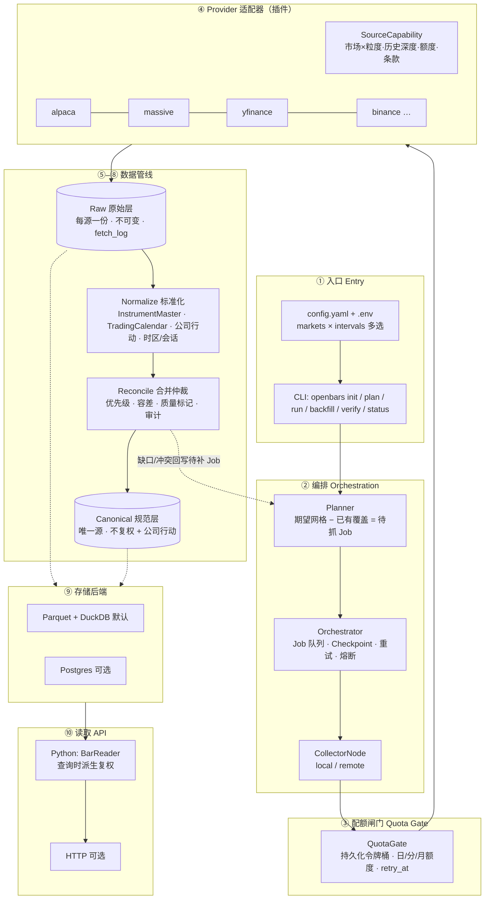

# openbars 架构设计

状态：draft v0.1 · 2026-11-11（11-11 补充 §11 搬运与兼容） · 讨论见 GitHub Discussion「v0.1 架构与范围」

## 1. 目标与非目标

**目标**

- 在**免费额度**内，把用户选定的市场 × 粒度的 K 线稳定拉全，并持续增量更新。
- 多源数据经清洗、对齐、仲裁后形成**唯一的规范层（canonical）**，每根 bar 可追溯来源与质量。
- 高抽象、分层清晰：新增一个市场或数据源只需新增 provider 插件与口径配置，不改核心。
- 将来能替换上游内部实现（一套已在运行的研究 backend）的抓取与清洗服务，并保持口径兼容（见 §11）。

**非目标**

- 不分发、不托管数据；不做付费数据转售。
- 不做实时行情、逐笔、交易执行、回测、策略。
- v0.x 不追求分钟线全市场；分钟线只作为可选能力。

## 2. 分层总览



依赖方向自上而下：上层依赖下层的**接口**（`typing.Protocol` / ABC），不依赖实现。`core/` 中的数据模型被所有层共享，自身不依赖任何层。

| 层 | 包 | 职责 | 不负责 |
| --- | --- | --- | --- |
| ① 入口 | `openbars.config`, `openbars.cli` | 读配置、展开环境变量、校验多选组合、命令行 | 业务逻辑 |
| ② 编排 | `openbars.orchestrator` | 计算待抓网格、生成幂等 Job、Checkpoint、重试/熔断、分派到节点 | 具体 HTTP |
| ③ 配额 | `openbars.quota` | 按 provider（及 key）共享的持久化额度；所有出站请求必须先拿令牌 | 重试策略 |
| ④ Provider | `openbars.providers` | 声明能力；把请求翻译成源 API；返回 `RawBatch` | 合并、复权 |
| ⑤ 原始层 | `openbars.raw` | 按源原样落盘（追加、不可变）+ `fetch_log` | 清洗 |
| ⑥ 标准化 | `openbars.normalize` | 代码 → `instrument_id`；时区/会话/日线切分；公司行动；单源清洗 | 跨源决策 |
| ⑦ 仲裁 | `openbars.reconcile` | 多源对齐、优先级、容差、兜底拼接、质量标记、审计记录 | 抓取 |
| ⑧ 规范层 | `openbars.reconcile` 输出 | 唯一源 `bars_canonical` | — |
| ⑨ 存储 | `openbars.storage` | Raw/Canonical/主数据/日志的读写，原子写入、分区 | 业务规则 |
| ⑩ 读取 | `openbars.api` | 查询 canonical、派生复权、导出；可选 HTTP | 写入 |

## 3. 核心数据模型（`openbars.core.models`）

所有模型为不可变 dataclass（frozen），存储侧对应 Arrow/Parquet schema。

### 3.1 枚举

- `Market`: `us` | `crypto` | `cn` | `hk`
- `AssetClass`: `equity` | `etf` | `adr` | `index` | `crypto_spot` | `fund` …
- `Interval`: `1d` | `1h` | `30m` | `15m` | `5m` | `1m`（带 `is_intraday`、`duration`）
- `Session`: `regular` | `pre` | `post` | `continuous`（加密）
- `Adjustment`: `raw` | `split` | `split_dividend` | `all`（A 股另有 `qfq`/`hfq` 视作查询时派生）
- `QualityFlag`（位集合）：`divergent`（跨源超容差）、`spike_suspect`（无公司行动的大幅跳变）、`volume_missing`、`single_source`、`filled_from_fallback`、`stale`（源晚到/未更新）、`gap`、`revised`（源修订过历史）

### 3.2 Instrument 与代码映射（解决 ticker 重用串台）

```text
Instrument
  instrument_id: str        # 稳定内部 ID，例: "us:eq:01J…"（ULID），永不复用
  market: Market
  asset_class: AssetClass
  name: str | None
  exchange: str | None      # MIC, e.g. XNAS
  currency: str
  listed_on / delisted_on: date | None
  external_ids: dict        # figi / cik / isin / provider-native id

SymbolMapping               # 代码在某段时间指向哪个 instrument
  instrument_id, provider ("*" = 通用), symbol
  valid_from: date, valid_to: date | None
```

原则：**bar 永远挂在 `instrument_id` 上，不挂在 ticker 上**。provider 返回的 symbol 必须结合 bar 日期经 `InstrumentMaster.resolve(symbol, on=date, provider=…)` 映射；映射不到或歧义时进入 `unresolved` 队列，不写入 canonical。

### 3.3 Bar

```text
Bar
  instrument_id: str
  interval: Interval
  ts_start: datetime (UTC)  # bar 开始时刻，统一 UTC
  session_date: date        # 交易所本地交易日（日线主键）
  session: Session
  open, high, low, close: Decimal | float64
  volume: float | None
  vwap, trade_count: optional
  adjustment: Adjustment    # raw 层/规范层恒为 raw
  source: str               # raw: provider id; canonical: 选中的源
  feed: str | None          # 如 alpaca:sip / alpaca:iex —— 成交量口径标注
  flags: QualityFlag
  ingested_at: datetime
```

`RawBar` = Bar + `provider`、`fetch_id`、`symbol_as_returned`、`payload_hash`。
`CanonicalBar` = Bar + `price_source`、`volume_source`、`sources_seen`、`reconcile_rule`、`revision`。

### 3.4 公司行动 / 日历

- `CorporateAction`: `instrument_id, ex_date, kind (split|dividend|spinoff|symbol_change), ratio / amount, source`
- `TradingCalendar`（Protocol）：`sessions(start, end)`、`is_session(d)`、`session_bounds(d) -> [(open_utc, close_utc), …]`（支持午休、半日市；加密为 24/7 UTC）

### 3.5 Provider 能力声明

```text
SourceCapability
  provider: str
  market: Market
  asset_classes: set[AssetClass]
  interval: Interval
  history_start: date | "listing" | RollingWindow(days)
  latency: timedelta        # 数据最早何时可取（如 Massive 收盘日 0 点 ET 后）
  batch: BatchShape         # per_symbol | multi_symbol(max_n) | whole_market_per_day
  max_bars_per_request: int
  adjusted_modes: set[Adjustment]
  feed: str | None
  terms: ProviderTerms      # personal_only / no_redistribution / url

QuotaPolicy
  provider: str, key_scope: "per_key" | "per_ip"
  limits: list[RateLimit(count, per: timedelta)]   # 例: 5/min + 25/day
  weight_of: callable | dict  # 请求权重（Binance 权重制）
  safety_margin: float        # 默认 0.9，避免窗口边界突发
  backoff: BackoffPolicy      # 429/5xx/451 处理，尊重 retry-after
```

能力与额度**由 provider 插件声明默认值**，用户配置只能收紧不能放宽（除非显式 `override: true`，例如付费档）。

### 3.6 Job / Checkpoint

```text
Job
  job_id: str               # 由 (provider, market, interval, instrument 批, 窗口) 哈希得出 → 幂等
  kind: backfill | daily | repair | verify
  provider, market, interval
  instruments: tuple[str, …] | "whole_market"
  window: DateRange
  priority: int
  node: str | None          # 指定采集节点（如 cn-node）
  state: pending | leased | running | done | failed | dead
  attempts, last_error, retry_at

Checkpoint
  job_id, cursor (provider 分页游标 / 最后完成的日期), updated_at
```

Job 与 Checkpoint 持久化在本地状态库（默认 SQLite，`data/state.db`；PG 后端时放 PG）。`kill -9` 后重启从 Checkpoint 继续，写入以 `(provider, instrument_id, interval, ts_start)` 去重。

## 4. 各层接口（`Protocol`）

```python
class Provider(Protocol):
    id: str
    def capabilities(self) -> Sequence[SourceCapability]: ...
    def quota_policy(self) -> QuotaPolicy: ...
    def list_instruments(self, market: Market) -> Iterable[ProviderInstrument]: ...
    def fetch_bars(self, req: FetchRequest) -> RawBatch: ...          # 一次请求 = 一次令牌
    def fetch_corporate_actions(self, req: FetchRequest) -> Iterable[CorporateAction]: ...

class QuotaGate(Protocol):
    def acquire(self, provider: str, weight: int = 1, *, key_scope: str = "default",
                timeout: float | None = None) -> Lease: ...
    def penalize(self, provider: str, until: datetime) -> None: ...    # 429/retry-after
    def snapshot(self) -> Mapping[str, QuotaUsage]: ...

class Planner(Protocol):
    def plan(self, selection: Selection, coverage: CoverageIndex) -> Iterable[Job]: ...

class Orchestrator(Protocol):
    def submit(self, jobs: Iterable[Job]) -> None: ...
    def run(self, *, until_idle: bool = True) -> RunReport: ...

class CollectorNode(Protocol):
    name: str
    def markets(self) -> set[Market]: ...
    def execute(self, job: Job) -> JobResult: ...                     # local: 直接调 provider；remote: HTTP

class RawStore(Protocol):
    def append(self, batch: RawBatch) -> None: ...
    def scan(self, provider: str, market: Market, interval: Interval, window: DateRange) -> Iterable[RawBar]: ...

class InstrumentMaster(Protocol):
    def resolve(self, symbol: str, *, on: date, provider: str, market: Market) -> str | None: ...
    def upsert(self, instruments: Iterable[Instrument], mappings: Iterable[SymbolMapping]) -> None: ...

class Normalizer(Protocol):
    def normalize(self, raw: Iterable[RawBar]) -> Iterable[Bar]: ...

class Reconciler(Protocol):
    def reconcile(self, candidates: Mapping[str, Sequence[Bar]], policy: ReconcilePolicy) -> ReconcileResult: ...

class StorageBackend(Protocol):
    raw: RawStore
    canonical: CanonicalStore
    instruments: InstrumentMaster
    state: StateStore      # jobs, checkpoints, quota buckets, fetch_log

class BarReader(Protocol):
    def bars(self, symbols_or_ids, *, interval="1d", start=None, end=None,
             adjustment: Adjustment = Adjustment.SPLIT, as_of: date | None = None) -> "pyarrow.Table": ...
```

## 5. 编排与节奏规则

1. **期望网格**：`Selection(markets × intervals × universe × history)` + `TradingCalendar` → 每个 instrument 的期望 bar 集合。
2. **覆盖索引**：从存储读已有 raw/canonical 覆盖 → 差集即待抓窗口。
3. **源路由**：对每个待抓窗口，按 `reconcile` 优先级和 `SourceCapability`（历史深度、批形状、延迟）挑选能覆盖的源，生成**最省额度**的 Job（例：Massive 一天一请求覆盖全市场；Alpaca 200 只一批；yfinance 只补 2016 年前）。
4. **执行**：worker 从队列租用 Job → `QuotaGate.acquire` → provider 请求 → `RawStore.append` → 更新 Checkpoint。
5. **错误**：`ProviderError(code, retryable, retry_at)` 统一错误模型（沿用上游内部实现）；429 → `penalize` 整个 provider；连续失败 N 次 → 熔断该 provider 一段时间；不可重试 → `dead` 并进入 `status` 报告。
6. **每日增量**：按各源 `latency` 定时（例如美股 06:30 ET 后跑前一交易日），先主源后兜底源。
7. **回补预算**：`openbars plan` 输出每个源预计请求数、耗时下限与额度占用；启用非日线粒度时若超过预算，要求用户确认（`--accept-budget`）。

## 6. 粒度扩展方式

- 粒度是 `Interval` 枚举 + provider 能力声明，不是代码分支。v0.1 只有 `1d` 的 provider 实现与测试；`1h`/`1m` 等的模型、分区、口径字段已就位。
- 开启某粒度时：Planner 只会把 Job 路由给声明了该粒度的源；QuotaGate 用同一份额度（日线和小时线共享一个 provider 的额度），因此 `plan` 会显示叠加后的占用。
- **派生粒度**：`Resampler` 接口支持由细到粗合成（如 Alpaca 30m → 1h，按 `us_hourly_alignment` 对齐 9:30），派生 bar 标注 `source=derived:<base>`。
- 存储分区包含 `interval`，不同粒度互不干扰。

## 7. 远程采集节点

A 股/港股的部分源（东财等）对海外 IP 不可用，Binance 主站对美国 IP 返回 451，因此采集与存储可分离：

- `CollectorNode` 两种实现：`LocalNode`（进程内）与 `RemoteNode`（HTTP 调用远端 `openbars node serve`）。
- 远端节点**只执行 Job 并回传 RawBatch**（或写入共享对象存储后回传引用），不持有规范层；额度闸门对 `per_ip` 类源以节点为作用域。
- 认证：共享 token（`OPENBARS_NODE_TOKEN`）+ TLS；节点白名单只接受声明的市场/源。
- 配置中按 `nodes[].markets` 绑定路由；Job 可指定 `node`。

## 8. 插件机制

- Provider 通过 Python entry points 注册：`[project.entry-points."openbars.providers"] alpaca = "openbars_alpaca:AlpacaProvider"`。核心内置几个首批 provider，第三方可单独发包。
- 同样的 entry point 组：`openbars.calendars`、`openbars.storage`、`openbars.reconcile_rules`。
- `openbars.providers.registry` 负责发现、按配置实例化、校验能力声明（缺字段直接拒绝加载）。
- 插件 SDK 稳定性：v0.x 期间接口可变，`Provider.api_version` 字段用于兼容检查。

## 9. 口径约定

| 议题 | 约定 |
| --- | --- |
| 时间戳 | 一律存 UTC 的 **bar 开始时刻** `ts_start`；另存交易所时区的 `session_date`。适配层负责把“收盘时刻标识”的源转换过来。 |
| 日线切分 | 股票：交易所本地交易日，只含常规时段（盘前盘后不并入日线）。加密：**UTC 00:00 切日**。 |
| 小时线（预留） | 美股默认按开盘对齐（9:30 起，最后一根 15:30–16:00），整点对齐可选；A 股每天 4 根（午休不出 bar）；港股含午休，收市竞价口径待定。 |
| 复权 | v0.1 默认使用兼容 profile `research-daily-v2`：只拆股复权、按源交付落库（见 §11.2）。后续可选 profile：**落库只存不复权价 + 公司行动表**；复权在查询时按 `adjustment` 参数派生。前复权（qfq）不落库，因为每次除权都会改写整段历史。默认读取口径 `split`。 |
| 拆股时点冲突 | 以公司行动表为准，多源投票；不一致区段标 `divergent` 并记审计。 |
| 成交量 | 每根 bar 标 `feed`；**不同 feed 的成交量不混用**（如 Alpaca IEX vs SIP）；volume 优先级与 price 分开配置。 |
| 货币 | 存交易所原币种，不做汇率换算。 |
| 缺口 | 期望网格中缺失 → 先尝试下一优先级源 → 仍缺写入 `known_gaps`（附原因），canonical 中不插值。 |
| 异常值 | 单日涨跌幅超阈值且无公司行动 → `spike_suspect`，不自动删除。 |
| 修订 | 源改写历史时 canonical 产生新 `revision`，旧值保留在审计表。 |

## 10. 存储布局（Parquet + DuckDB 默认）

```text
data/
  state.db                         # SQLite：jobs、checkpoints、quota buckets、fetch_log
  raw/provider=alpaca/market=us/interval=1d/year=2024/part-*.parquet
  canonical/market=us/interval=1d/year=2024/part-*.parquet
  ref/instruments.parquet, symbol_mappings.parquet, corporate_actions.parquet, calendars/
  audit/reconcile/…, known_gaps.parquet
  openbars.duckdb                  # 视图与查询目录，可随时重建
```

- 写入原子化（临时文件 + rename）；小文件定期合并（compaction）。
- zstd 压缩；分区键 `market / interval / year`（分钟线再加 `month`）。
- Postgres 后端实现同一 `StorageBackend` 接口，表结构与 Parquet schema 一一对应。

## 11. 上游搬运来源与 backend 兼容与切换

openbars 的数据层**以一套已在生产运行的上游内部实现（下称 upstream）为主搬运**，不是重新发明；搬运时按 [`docs/sanitization.md`](sanitization.md) 脱敏。upstream 的模块路径与 openbars 的逐文件对照只记录在仓库外的私有笔记中，本文与 issue 只写功能描述。

### 11.1 搬运来源（按层）

| openbars 层 | 来自 upstream 的功能 | 搬运方式 |
| --- | --- | --- |
| `core.errors` / `providers.base` | 统一错误模型 `ProviderError(code, retryable, retry_at, status_code, request_id)`、有界诊断信息、HTTP 状态 → 错误码映射、响应中凭据替换为 `[REDACTED]` | 直接搬 |
| `providers`（HTTP 公共层） | 共享 httpx 客户端、请求前限速钩子、超时/传输错误映射、分页 token 防死循环、payload 摘要与数值校验 | 直接搬 |
| `providers.us.*` | Alpaca SIP/IEX 日线（多代码批量、免费档最近时段处理）、Massive grouped daily / 单代码区间 / 代码清单 / 退市清单 / 代码类型、yfinance 批量（`auto_adjust=False`）、公司行动适配器；Twelve Data、Alpha Vantage 作为可选兜底源 | 直接搬，改导入与配置注入 |
| `quota` | 进程内固定节奏限速、**持久化令牌闸门**（按 provider 行锁预约下一个请求时刻）、可选日额度（UTC 日 / 滚动 24h）与 `retry_at`、各源请求上限常量 | 改接口后搬：常量变为 `QuotaPolicy` 默认值；新增 SQLite 实现（upstream 只有 PG 行锁） |
| `orchestrator` | Job 租约与重试、优先级策略、过期租约回收、调度单例锁、每日同步计划与批次切分、历史回补窗口与“覆盖即废弃”规则、每会话重建调度 | 改接口后搬：脱离 upstream ORM 与 worker 进程模型 |
| `core.calendar` | XNYS 交易日历（`exchange_calendars`）、收盘后等待 N 分钟才算完成的会话、非交易日拒收 | 直接搬 |
| `normalize.instruments` | 点时（point-in-time）身份证据与解析、代码别名有效期、退市目录、身份对账、代码类型 → 证券类型映射、ETF 作为独立证券类型 | 改接口后搬 |
| `normalize.adjust` | 公司行动“观测追加 + 规范修订”模型、拆股后旧历史重抓检测、`adjustment_as_of` 一致性检查（只拆股复权，不含分红） | 改接口后搬 |
| `reconcile` | **research-daily-v2 选数**：按源优先级、兼容性闸门、兜底源能力集、价格 0.5% / 成交量 5% 容差、独立源佐证（quorum 2）、质量标记、人工/规则覆盖、确定性数据修复 R1–R4（预览/应用、熔断上限、可撤销审计） | 核心逻辑直接搬，持久化改接口 |
| `storage` / `raw` | 原始响应归档（内容摘要、许可标签）、按源 bar 表、规范层表、水位表 | Parquet+DuckDB 重写；PG 提供 upstream 兼容适配（§11.3） |
| `verify` | 跨源对比与每日校准、覆盖率对账、覆盖汇总、历史深度报告 | 改接口后搬 |

不搬：基本面与申报、宏观序列、新闻、扫描/策略/回测/提醒/选股、研究代理、HTTP API 与鉴权、计费与权限、运维控制台、指数成分校验、AI 辅助退市复核、依赖授权数据的成分股导入。理由：不属于“行情采集与清洗”，或包含私有业务/授权数据。

### 11.2 口径对齐

openbars 提供一个与 upstream 逐字段一致的**兼容口径 profile `research-daily-v2`**，v0.1 美股日线默认使用它；§9 中“落库只存不复权 + 查询时派生复权”的模式作为后续可选 profile（见 roadmap），不影响兼容 profile。

| 项 | `research-daily-v2` 约定（与 upstream 一致） |
| --- | --- |
| 源身份 | 三元组 `(provider, feed, adjustment)`，取值保持原字符串：`massive/eod/split`、`alpaca/sip/split`、`alpaca/iex/split`、`yfinance/yahoo/split`、`twelve_data/daily/split`、`alpha_vantage/daily/raw` |
| 序列语义 | 每根源 bar 带 `price_basis`、`adjustment_scope`、`adjustment_as_of`、`session_semantics`、`currency`、`volume_basis`；由单一目录（catalog）按源身份保守解析，未知即 `unknown` |
| 复权 | **只拆股复权**（split-adjusted as delivered），不做分红复权，不是总回报序列；拆股后旧历史按新基准重抓；同一窗口内 `adjustment_as_of` 混用视为 `mismatch` |
| 选数优先级 | 主源 `massive/eod/split`(0) → `alpaca/sip/split`(1)；兜底按信任度 `yfinance`（价量可用）→ `twelve_data`（仅价格，成交量口径未知）。实际效果：近端由 Massive 覆盖，2016 起历史由 Alpaca SIP 覆盖，2016 前由 yfinance 补齐 |
| 容差与佐证 | 价格 0.5%、成交量 5%；与次源分歧时需 2 个独立源佐证主源，才判定次源出错 |
| `selection_reason` | `primary_source`、`primary_source_corroborated`、`compatible_gap_fill`、`fill_<provider>`、`spike_replaced` |
| `quality_status` | `complete`、`divergent`、`volume_missing`（价格有变动但成交量为 0）、`spike_suspect`（R4 标记，是否排除由开关控制） |
| `capabilities` | 有序字符串集合，如 `price_basis:split_adjusted`、`adjustment_scope:splits`、`session_semantics:provider_aligned`、`volume_basis:*`、`currency:USD`、`adjustment_as_of:YYYY-MM-DD`、`price_ohlc`、`consolidated_volume`、`split_adjusted_volume` |
| 规范层行 | `instrument_id, session_date, policy_version, selected_source_bar_id, provider, feed, adjustment, revision, open, high, low, close, volume, selection_reason, quality_status, capabilities, source_fingerprint, generated_at`；唯一键 `(instrument_id, session_date, policy_version)` |
| 数值 | 价格 `Numeric(20,8)`、成交量 `Numeric(28,8)`，内存中用 `Decimal`，不经 float 往返 |
| 会话 | 交易所会话日（XNYS），非交易日 bar 拒收；当日会话收盘后等待可配置分钟数才视为完成 |
| 失效通知 | 每个 policy 一行版本水位 + 按日期的水位表，供下游缓存失效 |

`policy_version` 是口径的版本号：任何改变选数结果的规则修改都必须换新版本号（如 `openbars-daily-v1`），不得静默改写 `research-daily-v2` 的语义。

### 11.3 PG 兼容策略

- `storage.postgres` 有两种 schema 模式：
  - `native`：openbars 自己的表结构（与 Parquet schema 一一对应），由 openbars 迁移管理。
  - `upstream_compat`：直接读写 upstream 现有表（`instrument`、`symbol_alias`、`daily_bar`、`research_daily_bar`、两张水位表、`provider_request_gate` / `provider_request_usage`、`source_artifact`、`data_ingest_run`、公司行动相关表）。
- `upstream_compat` **不执行任何迁移**，表结构归 upstream 所有；启动时做列级 introspection，缺列或类型不符即拒绝运行并报告差异。
- 默认只读；写入需显式 `storage.postgres.write: true`，并且只写 openbars 负责的表。
- 并行期额度共享：`upstream_compat` 下 `QuotaGate` 使用同一套 `provider_request_gate` / `provider_request_usage`，保证 openbars 与 upstream 共用一个 key 时不会叠加超限（或者给 openbars 配独立 key）。
- 互斥：规范层重建沿用 upstream 的 PG 事务级 advisory lock 键算法，避免两边同时重建同一 policy。

### 11.4 backend 切换步骤

1. **搬运 + 金标准**：按 11.1 顺序搬运；每个模块搬运时，用合成输入在 upstream 侧生成一次期望输出，冻结为 openbars 的金标准样例（§11.5）。
2. **作为库导入**：upstream 依赖 `openbars`，把对应内部模块改为薄 shim（re-export openbars 的实现），行为由金标准保证不变。可以逐模块替换，先换纯函数层（日历、序列目录、兼容性闸门、选数），再换 provider 与额度闸门。
3. **影子运行**：openbars 以 `upstream_compat` 只读 + 独立 `policy_version`（或独立 schema）跑完整日线管线，`openbars verify` 与 `research-daily-v2` 逐 bar 对比，指标：覆盖率、价格一致率、质量标记一致率。
4. **切换写入**：对比稳定后，由 openbars 接管 `research-daily-v2` 的写入（`write: true`），upstream 抓取 worker 逐个下线：先兜底源，再主源。
5. **回滚**：切换期间保留 upstream worker 代码与开关，任一指标回退时关闭 openbars 写入、恢复 upstream worker；因为口径与表结构一致，无需数据迁移。
6. **之后**：多市场需求直接通过 openbars 配置开启；upstream 只保留业务层。

### 11.5 兼容性测试（只用合成数据）

- `tests/golden/research_daily_v2/`：合成代码（如 `ZZZA`）、合成价格的输入 → 期望的规范层行（含 `selection_reason`、`quality_status`、`capabilities`、`source_fingerprint`）。覆盖：仅主源；主次一致；主次分歧（`divergent`）；佐证 quorum 判定次源出错；兼容缺口填充；yfinance / twelve_data 兜底的能力差异；`volume_missing`；R4 覆盖（替换 / 标记）；非交易日拒收；代码复用的别名有效期；拆股后 `adjustment_as_of` 混用。
- 金标准由维护者在私有环境用 upstream 纯函数对同一合成输入生成后冻结；openbars 测试要求逐字段一致，`source_fingerprint` 一致。
- `tests/compat/upstream_schema.sql`：仅包含相关表的 DDL（无数据、无私有命名），CI 用 Postgres service 建表后跑 `upstream_compat` 适配器的读写与 introspection 测试。
- 禁止使用真实行情数据或 provider 抓包作为夹具（见 `docs/sanitization.md`）。

## 12. 代码结构

```text
src/openbars/
  core/          models.py · errors.py · calendar.py · types.py
  config/        schema.py · loader.py
  cli/           main.py
  orchestrator/  jobs.py · planner.py · runner.py · nodes.py
  quota/         policy.py · gate.py
  providers/     base.py · registry.py · (us/alpaca … 实现随 issue 加入)
  raw/           store.py
  normalize/     instruments.py · calendar.py · actions.py · normalizer.py
  reconcile/     policy.py · reconciler.py · audit.py
  storage/       base.py · parquet_duckdb.py · postgres.py
  api/           reader.py · http.py
```
