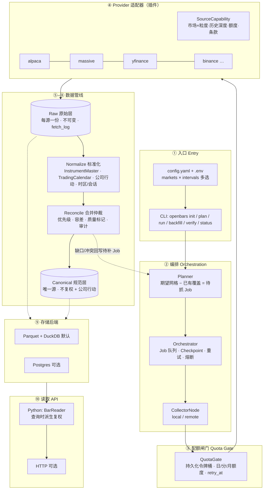

# openbars 架构设计

状态：draft v0.1 · 2026-11-11（11-11 补充 §11 搬运与兼容） · 讨论见 GitHub Discussion「v0.1 架构与范围」

## 1. 目标与非目标

**目标**

- 在**免费额度**内，把用户选定的市场 × 粒度的 K 线稳定拉全，并持续增量更新。
- 多源数据经清洗、对齐、仲裁后形成**唯一的规范层（canonical）**，每根 bar 可追溯来源与质量。
- 高抽象、分层清晰：新增一个市场或数据源只需新增 provider 插件与口径配置，不改核心。
- 将来能替换上游内部实现（一套已在运行的研究 backend）的抓取与清洗服务，并保持口径兼容（见 §11）。

**非目标**

- 不分发、不托管数据；不做付费数据转售。
- 不做实时行情、逐笔、交易执行、回测、策略。
- v0.x 不追求分钟线全市场；分钟线只作为可选能力。

## 2. 分层总览



依赖方向自上而下：上层依赖下层的**接口**（`typing.Protocol` / ABC），不依赖实现。`core/` 中的数据模型被所有层共享，自身不依赖任何层。

| 层 | 包 | 职责 | 不负责 |
| --- | --- | --- | --- |
| ① 入口 | `openbars.config`, `openbars.cli` | 读配置、展开环境变量、校验多选组合、命令行 | 业务逻辑 |
| ② 编排 | `openbars.orchestrator` | 计算待抓网格、生成幂等 Job、Checkpoint、重试/熔断、分派到节点 | 具体 HTTP |
| ③ 配额 | `openbars.quota` | 按 provider（及 key）共享的持久化额度；所有出站请求必须先拿令牌 | 重试策略 |
| ④ Provider | `openbars.providers` | 声明能力；把请求翻译成源 API；返回 `RawBatch` | 合并、复权 |
| ⑤ 原始层 | `openbars.raw` | 按源原样落盘（追加、不可变）+ `fetch_log` | 清洗 |
| ⑥ 标准化 | `openbars.normalize` | 代码 → `instrument_id`；时区/会话/日线切分；公司行动；单源清洗 | 跨源决策 |
| ⑦ 仲裁 | `openbars.reconcile` | 多源对齐、优先级、容差、兜底拼接、质量标记、审计记录 | 抓取 |
| ⑧ 规范层 | `openbars.reconcile` 输出 | 唯一源 `bars_canonical` | — |
| ⑨ 存储 | `openbars.storage` | Raw/Canonical/主数据/日志的读写，原子写入、分区 | 业务规则 |
| ⑩ 读取 | `openbars.api` | 查询 canonical、派生复权、导出；可选 HTTP | 写入 |

## 3. 核心数据模型（`openbars.core.models`）

所有模型为不可变 dataclass（frozen），存储侧对应 Arrow/Parquet schema。

### 3.1 枚举

- `Market`: `us` | `crypto` | `cn` | `hk`
- `AssetClass`: `equity` | `etf` | `adr` | `index` | `crypto_spot` | `fund` …
- `Interval`: `1d` | `1h` | `30m` | `15m` | `5m` | `1m`（带 `is_intraday`、`duration`）
- `Session`: `regular` | `pre` | `post` | `continuous`（加密）
- `Adjustment`: `raw` | `split` | `split_dividend` | `all`（A 股另有 `qfq`/`hfq` 视作查询时派生）
- `QualityFlag`（位集合）：`divergent`（跨源超容差）、`spike_suspect`（无公司行动的大幅跳变）、`volume_missing`、`single_source`、`filled_from_fallback`、`stale`（源晚到/未更新；读取路径上还表示“抓取时间早于之后某次拆股，价格口径可能过时”，见 §3.4）、`gap`、`revised`（源修订过历史）、`adjustment_unverified`（该 instrument 没有任何公司行动行，无法验证/派生所请求的复权口径，bar 仍保持落库口径，见 §3.4）

### 3.2 Instrument 与代码映射（解决 ticker 重用串台）

```text
Instrument
  instrument_id: str        # 稳定内部 ID，例: "us:eq:01J…"（ULID），永不复用
  market: Market
  asset_class: AssetClass
  name: str | None
  exchange: str | None      # MIC, e.g. XNAS
  currency: str
  listed_on / delisted_on: date | None
  external_ids: dict        # figi / cik / isin / provider-native id

SymbolMapping               # 代码在某段时间指向哪个 instrument
  instrument_id, provider ("*" = 通用), symbol
  valid_from: date, valid_to: date | None
```

原则：**bar 永远挂在 `instrument_id` 上，不挂在 ticker 上**。provider 返回的 symbol 必须结合 bar 日期经 `InstrumentMaster.resolve(symbol, on=date, provider=…)` 映射；映射不到或歧义时进入 `unresolved` 队列，不写入 canonical。

已知失败模式：ticker 被另一家公司回收后，按 ticker 存的历史会把新公司的 bar 挂到旧公司的 instrument 上。下面的规则（实现在 `openbars.normalize.*`，存储层只做持久化）保证这种情况不发生：

- **稳定 ID**：`<market>:eq:<26 位 ULID 形 id>`，永不复用。已知 share-class FIGI 时 id 由 `sha256("share_class_figi:<FIGI>")` 前 128 位的 Crockford base32 确定性导出，否则是随机 ULID；新建前总是先按外部 id（FIGI / provider-native id）查找，已存在则复用同一个 instrument。`asset_class`（含独立的 `etf`）是属性，不进 id。可用 `upstream_ids` 表记录 `instrument_id` ↔ upstream 整数 id（兼容层用，一对一）。
- **身份证据**（`normalize.identity`）：只有 share-class FIGI 或 provider-native id 能构成稳定 key；仅 ticker（`symbol_only_evidence`）、仅 CIK（`issuer_only_evidence`）、或只是复述 ticker 的 `symbol:` 兜底 id 都是 `unresolved`，不能创建、改名、回收或质疑任何 instrument。稳定 key 冲突 → `disputed`；单源 → `provisional`；多源互证 → `verified`。`observed_at` / `as_known_at` 必须带时区。
- **上市清单入库**（`InstrumentDirectory.ingest`，输入为任意 provider 的 `ListingRecord` 快照）：新稳定身份 → 新 instrument + 开放映射（`valid_from` = 上市日，无则首次观测日）；**ticker 回收**（该 symbol 在另一 instrument 上仍有开放映射）→ 旧映射 `valid_to` 关在新上市日前一天，没有上市日则关在旧映射最后一次被观测的日期，两者都定不出来就进 `unresolved`，绝不猜；**改名**（同一稳定身份换 symbol）→ 旧 symbol 映射关闭，新 symbol 在同一 `instrument_id` 上开启；**退市** → 写 `delisted_on` 并关闭开放映射（provider 把“换 ticker”也报成退市时只关旧 symbol 的窗口）。默认股票池为快照中全部普通股 + ETF，额外类型（如 ADR、基金）只来自配置，默认为空；ticker type → `AssetClass` 的映射见 `normalize.security_types`，未列入的类型（优先股、权证等）不会被写成股票。
- **`resolve` 规则**：只看同市场映射，`valid_to` 含当日；provider 专属映射优先于 `"*"`；同优先级多个 instrument → 歧义 → `None`。日期没被任何窗口覆盖时有一个**唯一历史回退**：该 symbol 历史上只绑定过一个 instrument，且日期不在其最后一个已关闭窗口之后，才返回该 instrument（应对首次观测日晚于真实上市日）；只要曾绑定过两个及以上 instrument（回收），**永远不回退**，未覆盖日期一律 unresolved。
- **`unresolved` 队列**：映射不到、歧义、或证据冲突的 bar / 清单行写入 `ref/unresolved.parquet`（含 `kind`、`reason_code`、`symbol`、`provider`、`session_date`），`unresolved_count()` 供 `status` 展示；这些 bar 不写入 canonical。`assign_instrument` / `assign_instruments` 是纯函数式的入库助手：解析出 id 的 bar 填上 `instrument_id`，其余留空并入队。队列键 `UnresolvedRecord.key`：bar 按 `(provider, symbol, 日)`、清单行按 `(provider, symbol)`（无日期）、公司行动（`kind="corporate_action"`）按 `(provider, symbol, ex_date, 行动种类)`（`session_date` 存 ex-date，`detail` 存行动种类），重复入库同一事件不会让队列膨胀。

#### 3.2.1 加密交易对主数据（`openbars.normalize.crypto_pairs`）

加密现货的 instrument 是**某交易所上的某个交易对**，不走 ULID / FIGI，也不使用 `<market>:eq`：

- **id 规则**：`crypto:spot:<venue>:<BASE>-<QUOTE>`，例 `crypto:spot:binance:TEST-USDT`。由 `(venue, base, quote)` 确定性导出，永不复用；同一交易对再次上架复用同一个 id，任何一段写错就是另一个 id，已有 id 不会被“修正”。`venue` 为小写 `[a-z0-9]+` slug（`BINANCE` / `Binance` → `binance`），`base` / `quote` 为大写字母数字资产代码，空值或含 `-` / `:` 一律拒绝。`market_of` 取 id 首段，自然得到 `crypto`。
- **base / quote 分开存**：不拆单一 symbol 字符串。`Instrument.external_ids` 固定含 `base` / `quote` / `venue` 三个键（另有信息性的 `provider_symbol`）；`currency` = quote（如 `USDT`，不要求 3 位 ISO）；`exchange` = venue 的大写形式（`BINANCE`）；`asset_class=crypto_spot`。读取走 `pair_assets(instrument) -> (base, quote)`、`pair_venue(instrument)`、`CryptoPair.parse(id)`。
- **不同交易所的交易对是不同 instrument**，即使 base/quote 相同，也不能跨所合并、不能拿来对价格。
- 同一交易所、同一 base、不同 quote（`TEST-USDT` vs `TEST-USDC`）也是两个 instrument。
- **映射只写 provider 专属 symbol**（`binance` + `TESTUSDT`、`coinbase` + `TEST-USDT`），不写通用 `"*"` 的 `BASE-QUOTE`：两个交易所共用这种显示形式，`"*"` 会造成歧义甚至把它们并成一个。`resolve("TESTUSDT", provider="binance", market=CRYPTO)` 因此只会命中 Binance 的交易对。
- **入库**（`ingest_crypto_pairs(master, listings, as_of=…)`，输入 `CryptoPairListing`）：按确定性 id 查找，已存在则复用（名称更新、`listed_on` 取较早者），并确认/开启该 `(provider, symbol)` 的映射；退市（`active=False` 或带 `delisted_on`）写 `delisted_on` 并关闭该 provider symbol 的开放窗口（`valid_to` 含当日）；已退市的交易对被再次报为活跃时复用同一 id，在已关闭窗口之后开新窗口。非法 venue/base/quote、同一批内 `(provider, symbol)` 被不同交易对认领、或该 symbol 已在另一交易对上开放，均进 `unresolved`（计数并写入队列，不抛异常、不合并）。同一 master 里的美股 instrument 不受影响。
- 不改编排器（本版未接入）；不改 instruments 表 schema / `SCHEMA_VERSION`，也不新增列。

### 3.3 Bar

```text
Bar
  instrument_id: str
  interval: Interval
  ts_start: datetime (UTC)  # bar 开始时刻，统一 UTC
  session_date: date        # 交易所本地交易日（日线主键）
  session: Session
  open, high, low, close: Decimal   # 精度 (20,8)，0 < 价格 < 1e12
  volume: Decimal | None            # 精度 (28,8)，0 <= 成交量 < 1e20
  vwap: Decimal | None, trade_count: int | None
  adjustment: Adjustment    # v0.1 / research-daily-v2：规范层为 split（按源交付的拆股复权，见 §3.4、§9）；raw 层为源交付口径
  source: str               # raw: provider id; canonical: 选中的源
  feed: str | None          # 如 alpaca:sip / alpaca:iex —— 成交量口径标注
  flags: QualityFlag
  ingested_at: datetime | None
```

`RawBar` = Bar 的价量字段 + `provider`、`fetch_id`、`symbol_as_returned`、`payload_hash`、`revision`（源 bar 版本，>= 1）、可选 `instrument_id` / `session_date`（符号解析后填入）、可选 `series: BarSeriesIdentity`（序列语义，见 §11.2 / §10.1）。
`CanonicalBar` = Bar + `price_source`、`volume_source`、`sources_seen`、`reconcile_rule`、`revision`。

数值口径（`openbars.core.ohlcv`）：**价格与成交量一律 `Decimal`，不经 `float` 往返**。构造时接受 `Decimal` / `int` / `str`，`float`（含 `bool`）直接 `TypeError`；非有限值、超过 8 位小数（无法无损落库）的值抛 `ValueError`。`validate_ohlcv(...)` 校验：价格 > 0、成交量 >= 0、`high >= low`、`low <= open <= high`、`low <= close <= high`；价格量级上限 `1e12`、成交量 `1e20`（均为开区间，保证落在 Numeric/decimal128 的声明精度内）。`Bar`、`RawBar`、`CanonicalDailyRow` 的构造函数都会调用它。

### 3.4 公司行动 / 日历

- `CorporateAction`: `instrument_id, ex_date, kind (split|dividend|spinoff|symbol_change), ratio / amount, source`。`ratio` / `amount` 是 **`Decimal | None`**（构造时拒绝 `float`、非有限值，拆股 `ratio` 必须 > 0）；`ratio = new / old`（4 拆 1 = `4`，1 合 4 = `0.25`）。落库为 `decimal128(20,8)`，读取不经 `float`；无限小数（如 1/3）在写入处按 8 位小数半偶舍入，这是公司行动路径上唯一的舍入。
- **观测追加 + 投票合并**（`normalize.actions.merge_corporate_actions`）：各源各写各的行（键含 `source`）；同一 `(instrument_id, ex_date, kind)` 的行对 `ratio` / `amount` 分字段投票（`None` 视为弃权）。全票一致 → 一行规范行；有分歧 → 得票最多的值胜出，平票取优先级列表（`source_priority`）中靠前的源，未列出的源按字典序排在其后；**绝不取平均**，冲突记录在 `MergedAction.conflicts`（每个源的取值），并标 `disputed` / `QualityFlag.DIVERGENT`。同一来源对同一键的多行，输入中靠后者胜出。
- **查询时复权**（`normalize.adjust`，纯函数 + `QueryTimeAdjuster`）：v0.1 默认 profile `research-daily-v2` 落库的就是按源交付的拆股复权序列（向最新一次拆股回溯复权，不含分红），所以 **`SPLIT` 且无 `as_of` = 落库值，原样返回**。其余口径由落库 bar + 公司行动派生（精确 `Decimal`，最后统一舍入到 8 位）：`RAW` = 撤销 `ex_date` 晚于该 bar `session_date` 的全部拆股（价格 × ratio，成交量 ÷ ratio）；`SPLIT` + `as_of=D` = 撤销 `ex_date > D` 的拆股，使序列呈现 D 当天所见；`SPLIT_DIVIDEND` / `ALL` = 先得 `SPLIT` 结果，再对每笔现金分红把 `session_date < ex_date` 的价格乘以 `P/(P+amount)`（`P` = 除息日前最后一个交易日的**未复权**收盘价，即落库收盘价撤销其后拆股；`ex_date ≤ as_of` 才生效，多笔连乘，成交量不变）。若落库的是 `RAW`（后续可选 profile），`RAW` 为 no-op，`SPLIT` 则按 `ex_date ≤ as_of` 的拆股向下复权。股票红利（`kind=dividend` 带 `ratio`、无 `amount`）含义因源而异，默认不当拆股处理（`include_stock_dividends=True` 才按拆股），拆分/分拆（spinoff）不做复权；任何未能应用的行动都不会悄悄改 bar，而是列在 `AdjustResult.skipped`（带原因）里。`adjustment_as_of` 不同的行混在同一窗口里 = `adjustment_cutoff_mismatch`（`AdjustmentError`）。
- **入库时把 ticker 映射为稳定 id**：Alpaca / Massive 的 `fetch_corporate_actions` 在 provider 边界按“源返回”原样把 ticker 放在 `CorporateAction.instrument_id`；映射发生在**入库**（`normalize.instruments.ingest_corporate_actions`，其下 `assign_corporate_actions` 只做映射与入队）。`instrument_id` 已是主数据中已知的 id 则原样保留；否则当作 ticker，以 `resolve(symbol, on=ex_date, provider=action.source, market=…)` 解析（规则同 bar：provider 专属映射优先于 `"*"`、歧义 → unresolved、唯一历史回退只在该日期适用时生效）。解析出的行动 upsert 进公司行动表；映射不到/歧义的**不写**公司行动表，进 `unresolved` 队列（`kind="corporate_action"`），并返回摘要（resolved / unresolved / already_mapped / reason_code 计数）。之后能解析的事件会在下次入库时写入并移出队列。`upsert_corporate_actions` 本身仍是对已映射 id 的普通写入。
- **缺公司行动时的 RAW / 派生口径**：没有任何公司行动行 ≠ 这只股票从未拆股，所以对**没有任何公司行动行**的 instrument，派生非落库口径（`RAW`、从落库 `SPLIT` 派生 `SPLIT_DIVIDEND` / `ALL`，或从落库 `RAW` 派生 `SPLIT` 等）**绝不把落库价格改标签**：默认抛 `AdjustmentError`（`reason_code="missing_corporate_actions"`）；显式 `on_missing_actions="flag"` 时改为原样返回落库口径的 bar（`adjustment` 仍是 `split`，不声称是 RAW）并打 `QualityFlag.ADJUSTMENT_UNVERIFIED`（`quality_status` 不变，仍以 flags 为准）。instrument 有公司行动行但某 bar 之后没有拆股 = 已核对过，scale = 1，`RAW` 照常有效。`SPLIT` + `as_of` 且该 instrument 没有任何公司行动行时，价格仍是落库的 `SPLIT`（不改标签、不报错），但 as-of 声称无法核实，打上 `ADJUSTMENT_UNVERIFIED`。默认 `SPLIT` 读（无 `as_of`、快路径）不受影响。
- **读取路径的 STALE 标记**：`DuckDbBarReader.bars` 在 instrument 有拆股行时对落库 bar 运行 `find_stale_after_split` 的逐 bar 版本（`stale_bar_indexes`），把 `QualityFlag.STALE` OR 到“抓取早于之后某次拆股”的 bar 上（只标记，不重抓、不调 API；派生口径的行保持同样的标记）。
- **拆股后旧历史检测**（`normalize.actions.find_stale_after_split`，纯函数）：落库 bar 的 `session_date` 早于某次拆股 `ex_date`，且抓取时间（`generated_at` / `ingested_at`）也早于该 `ex_date`，则该段未经此次拆股复权，需在新价格基准下重抓；返回按（instrument, 拆股）聚合的区间。`raw` bar 不会过期；没有抓取时间的 bar 默认按过期报告（`treat_unknown_as_stale=False` 可关闭）。
- `TradingCalendar`（Protocol）：`sessions(start, end)`、`is_session(d)`、`session_bounds(d) -> [(open_utc, close_utc), …]`（支持午休、半日市；加密为 24/7 UTC）。实现见 §3.4.1、§3.4.2

#### 3.4.1 XNYS 日历（`openbars.calendars.xnys`）

- **复用 [`exchange_calendars`](https://pypi.org/project/exchange-calendars/)（PyPI `exchange-calendars>=4.9,<5`）的 `XNYS` 规则，不在仓库内维护节假日表**。许可证 Apache-2.0，与本项目（Apache-2.0）兼容。
- `XNYSCalendar` 实现 `TradingCalendar` 协议，经入口点 `openbars.calendars` 的 `xnys` 注册；`market = Market.US`，`timezone = "America/New_York"`。
- `sessions(start, end)`：闭区间交易日，`end < start` 抛 `ValueError`；`is_session(day)`；`session_bounds(day)` 返回 **UTC** `(open, close)`，XNYS 无午休故只有一段，半日市（如感恩节次日）13:00 America/New_York 提前收盘；非交易日返回空元组。夏令时由时区自动处理（09:30–16:00 EST = 14:30–21:00 UTC，EDT = 13:30–20:00 UTC）。
- `TradingSession(session_date, opens_at, closes_at)`（定义于 `core.calendar`，带时区；`XNYSCalendar.trading_session(s)` 返回 America/New_York 时间）。
- `session_index(as_of, *, epoch=date(2000,1,1))`：不晚于 `as_of` 的最近一个会话的从 0 起序号；`as_of < epoch` 返回 0。
- `latest_completed_session(now, wait_minutes=30) -> date | None`：`now` 必须带时区；会话收盘后至少等待 `wait_minutes` 分钟才算完成（在 America/New_York 比较）；向前最多找约 14 天；`wait_minutes < 0` 抛错。
- 范围策略：缓存默认 `XNYS` 日历；请求范围超出其首/末会话时，构造起止各扩一天的有界日历（带缓存）。
- `is_non_session_date(day)`：周末恒为非交易日；节假日只在默认日历范围内判定（约 2006 年起），范围之外的工作日**不**当作非交易日，避免拒收更早的长历史。`reject_non_session_bars(bars, *, session_date_attr="session_date")` 是纯函数，返回 `accepted` 与 `rejected`（理由 `"non_session_date"`）。

#### 3.4.2 加密市场日历（`openbars.calendars.crypto`）

- `CryptoCalendar` 实现 `TradingCalendar` 协议，经入口点 `openbars.calendars` 的 `crypto` 注册；`market = Market.CRYPTO`，`timezone = "UTC"`。纯标准库实现，不依赖 `exchange_calendars`。
- **24/7**：每个 UTC 日历日都是会话，无周末、无节假日、无午休。`sessions(start, end)` 返回闭区间内的每一天，`end < start` 抛 `ValueError`；`is_session(day)` 恒为 `True`。
- **切日口径**：日线 `session_date` = 该 bar 的 **UTC 日期**；`ts_start` = 当日 `00:00:00 UTC`；对应的序列口径为 `session_semantics=utc_day`（§3.5.1、§10.7 目录表）。按交易所本地时区切日的源（例如以 UTC+8 午夜为日界）不能直接当作规范日线，需先换算到 UTC 00:00 口径（从更细粒度 bar 重新聚合，或改用按 UTC 切日的接口）。
- `session_bounds(day)` 返回恰好一段 UTC 半开区间 `[00:00:00 UTC, 次日 00:00:00 UTC)`；相邻两日首尾相接（第 N 日 `closes_at` == 第 N+1 日 `opens_at`），无重叠、无空隙；收盘瞬时属于下一会话。`closes_at > opens_at` 恒成立，满足 `TradingSession` 的约束。
- `trading_session(day)` / `trading_sessions(start, end)` 返回 `TradingSession`，开收盘瞬时保持 UTC（不换到其他时区）。
- `session_index(as_of, *, epoch=date(2000,1,1))`：不晚于 `as_of` 的最近一个会话的从 0 起序号，即 `(as_of - epoch).days`；`as_of < epoch` 返回 0。
- `latest_completed_session(now, wait_minutes=30) -> date | None`：`now` 必须带时区；**在 UTC 比较**，`now >= closes_at + wait_minutes` 才算完成（即次日 00:00 UTC 之后再等 N 分钟）；向前最多找约 14 天；`wait_minutes < 0` 抛错。
- `is_non_session_date(day)` 恒为 `False`；`reject_non_session_bars` 与 XNYS 版本签名、返回类型（`BarFilterResult` / `BarRejection`）一致，但不会拒收任何 bar（含周末日期）。

### 3.5 Provider 能力声明

```text
SourceCapability
  provider: str
  market: Market
  asset_classes: set[AssetClass]
  interval: Interval
  history_start: date | "listing" | RollingWindow(days)
  latency: timedelta        # 数据最早何时可取（如 Massive 收盘日 0 点 ET 后）
  batch: BatchShape         # per_symbol | multi_symbol(max_n) | whole_market_per_day
  max_bars_per_request: int
  adjusted_modes: set[Adjustment]
  feed: str | None
  terms: ProviderTerms      # personal_only / no_redistribution / url

QuotaPolicy
  provider: str, key_scope: "per_key" | "per_ip"
  limits: list[RateLimit(count, per: timedelta)]   # 例: 5/min + 25/day
  weight_of: callable | dict  # 请求权重（Binance 权重制）
  safety_margin: float        # 默认 0.9，避免窗口边界突发
  backoff: BackoffPolicy      # 429/5xx/451 处理，尊重 retry-after
```

能力与额度**由 provider 插件声明默认值**，用户配置只能收紧不能放宽（除非显式 `override: true`，例如付费档）。

#### 3.5.1 Binance 现货日线（`openbars.providers.crypto.binance`）

- 公开 spot klines（`/api/v3/klines`，`interval=1d`），**无需 API key**，`secret_values()` 为空；来源标识 `binance/spot/raw`（不属于美股 `KNOWN_SOURCES`）。
- **默认 base URL 为 `https://data-api.binance.vision`**（只读行情镜像）。`api.binance.com` 对部分地区（含美国 IP）返回 451，因此不作默认；构造时可用 `base_url` 覆盖。451 映射为不可重试的 `provider_rejected_request`，消息提示该地区不可用。`https://data.binance.vision` 的批量归档是后续可选来源，本版不实现。
- **UTC 00:00 切日**：序列口径 `session_semantics=utc_day`（不是泛化的 `provider_aligned`）；`ts_start` 必须恰为当日 `00:00:00 UTC`，`session_date` = 其 UTC 日期，与 §3.4.2 一致；`openTime` 不在 UTC 零点的行视为切日口径不符，整批以 `invalid_payload` 拒收。请求窗口按 UTC 毫秒取闭区间（起日 `00:00:00.000` 至止日 `23:59:59.999`）。
- 价格、成交量按字符串解析为 `Decimal`（不经 float）；`volume` 为基础资产成交量，成交额与成交笔数放 `extra`。口径 `price_basis=raw`、`volume_basis=as_traded`，`currency=None`（计价资产如 USDT 不是 ISO 货币）。
- 每次请求 1 个 symbol；单页最多 1000 根，窗口更长时用“末根 `openTime` + 1ms”翻页（游标必须前进，否则报 `pagination_loop`）。无数据返回空批次而非错误。
- **权重制额度**：spot `REQUEST_WEIGHT` 每 IP 每滚动分钟 6000（`key_scope="per_ip"`，`safety_margin=0.9`）；klines 权重 2，`exchangeInfo` 权重 20，均经 `QuotaGate.acquire(weight=…)`。429 / 418 尊重 `Retry-After` 并 `penalize`，5xx 为 `provider_unavailable`。官方限额文档见 `QuotaPolicy.official_docs_url`。
- `list_instruments(Market.CRYPTO)` 读 `exchangeInfo`，只返回现货 symbol（`exchange="BINANCE"`，`active` = 状态为 `TRADING`），并按 `baseAsset` / `quoteAsset`（去空白；缺失或空白为 `None`）填充 `base_asset` / `quote_asset`；不生成 `instrument_id`（交易对主数据与 base/quote 见 §3.2.1）。`normalize.crypto_pairs.listing_from_provider_instrument(row, provider=…, venue=None)` 把此类行转成 `CryptoPairListing`（缺 base/quote 抛 `ValueError`，`venue` 缺省取 `row.exchange`），由调用方显式使用，编排器暂不自动调用。无公司行动。
- **编排器接入（#44）**：`markets: [crypto]` 时 `plan` / `run` 生成并执行加密日线任务。规划器按市场分派日历：`Market.US` → XNYS，`Market.CRYPTO` → `CryptoCalendar`（`latest_ready_session(now, market=CRYPTO)` = 已收盘满 30 分钟的最近 UTC 日，周末也出任务）；其它市场仍记 `no_calendar` 并跳过。声明 `crypto`/`1d` 的已启用 provider 参与；yfinance 只是美股回退，不参与。Binance、Coinbase 均为 `PER_SYMBOL`，且**每个 symbol 只发给方言匹配的 provider**：未注入交易对主数据时按启发式——含 `-` 的是 Coinbase product id，`[A-Z0-9]+` 的是 Binance symbol；`DefaultPlanner(instruments=master)` 注入主数据后改为只在 `resolve(symbol, provider=…, market=CRYPTO)` 命中时才规划。宁可跳过一个 symbol，也不产生一个必然失败的任务。两家交易所永不合并为一个任务或一个 instrument。配置只需 `markets: [crypto]`、启用 `providers.binance` / `providers.coinbase`（无 API key）、`universe.crypto.symbols`；`openbars verify` 仍只面向美股。

#### 3.5.2 Coinbase Exchange 日线（`openbars.providers.crypto.coinbase`）

- 公开 Coinbase Exchange candles（`GET /products/{product_id}/candles?granularity=86400`），**无需 API key**，`secret_values()` 为空；来源标识 `coinbase/exchange/raw`（feed 为 Coinbase Exchange，不是 Advanced Trade；不属于美股 `KNOWN_SOURCES`）。
- **默认 base URL 为 `https://api.exchange.coinbase.com`**（不是 `api.coinbase.com`）；构造时可用 `base_url` 覆盖。`User-Agent` 为 `openbars/<version>`，不带邮箱。
- **UTC 00:00 切日**：`granularity=86400` 的桶按 UTC 零点切分，序列口径 `session_semantics=utc_day`；`ts_start` 必须恰为当日 `00:00:00 UTC`，`session_date` = 其 UTC 日期，与 §3.4.2 一致；`time` 不在 UTC 零点的行整批以 `invalid_payload` 拒收。请求 `start` = 起日 `00:00:00Z`，`end` = 止日次日 `00:00:00Z`，并丢弃 `session_date` 落在窗口外的行（API 若把 `end` 视为闭区间，次日零点那根不会被保留）。
- **响应是数组的数组，不是对象**，行布局为 `[time, low, high, open, close, volume]`（low/high 在 open/close 之前），`time` 为 Unix 秒；接口常按新到旧返回，适配器先按 `time` 升序排序，重复时间为 `invalid_payload`。价格、成交量用 `json.loads(..., parse_float=Decimal)` 解析为 `Decimal`（不经 float）；`volume` 为基础资产成交量。口径 `price_basis=raw`、`volume_basis=as_traded`，`currency=None`。
- 每次请求 1 个产品（Coinbase product id，如 `TEST-USDT`）；单次请求最多 300 根。窗口更长时按每页最多 300 天分段翻页，下一页从本页末根之后开始（游标必须前进，否则报 `pagination_loop`；跨页不升序按 `invalid_payload`）；后续页失败时返回已得部分并带 `next_cursor`（Unix 秒）。无数据返回空批次而非错误。
- **额度**：公开 REST 每 IP 每秒 10 次（`key_scope="per_ip"`，`safety_margin=0.9`），每页权重 1，经 `QuotaGate.acquire` 获取；429 尊重 `Retry-After` 并 `penalize`，5xx 为 `provider_unavailable`，其余 4xx 为 `provider_rejected_request`。官方文档见 `QuotaPolicy.official_docs_url`。
- `list_instruments(Market.CRYPTO)` 读 `GET /products`（`exchange="COINBASE"`，`active` = `status == "online"` 且（若有该字段）未 `trading_disabled`），按 `base_currency` / `quote_currency` 填充 `base_asset` / `quote_asset`；不生成 `instrument_id`。无公司行动。
- 已接入编排器（见 §3.5.1 的“编排器接入”：用 `BASE-QUOTE` product id 作 symbol，只发往 Coinbase），但**不在 `KNOWN_SOURCES`** 中；加密对账口径见 §11.2.1 `crypto-daily-v1`。

### 3.6 Job / Checkpoint

```text
Job
  job_id: str               # 由 (provider, market, interval, instrument 批, 窗口) 哈希得出 → 幂等
  kind: backfill | daily | repair | verify
  provider, market, interval
  instruments: tuple[str, …] | "whole_market"
  window: DateRange
  priority: int
  node: str | None          # 指定采集节点（如 cn-node）
  state: pending | leased | running | done | failed | dead
  attempts, last_error, retry_at

Checkpoint
  job_id, cursor (provider 分页游标 / 最后完成的日期), updated_at
```

Job 与 Checkpoint 持久化在本地状态库（默认 SQLite，`data/state.db`；PG 后端时放 PG）。`kill -9` 后重启从 Checkpoint 继续，写入以 `(provider, instrument_id, interval, ts_start)` 去重。

## 4. 各层接口（`Protocol`）

```python
class Provider(Protocol):
    id: str
    def capabilities(self) -> Sequence[SourceCapability]: ...
    def quota_policy(self) -> QuotaPolicy: ...
    def list_instruments(self, market: Market) -> Iterable[ProviderInstrument]: ...
    def fetch_bars(self, req: FetchRequest) -> RawBatch: ...          # 一次请求 = 一次令牌
    def fetch_corporate_actions(self, req: FetchRequest) -> Iterable[CorporateAction]: ...

class QuotaGate(Protocol):
    def acquire(self, provider: str, weight: int = 1, *, key_scope: str = "default",
                timeout: float | None = None) -> Lease: ...
    def penalize(self, provider: str, until: datetime) -> None: ...    # 429/retry-after
    def snapshot(self) -> Mapping[str, QuotaUsage]: ...

class Planner(Protocol):
    def plan(self, selection: Selection, coverage: CoverageIndex) -> Iterable[Job]: ...

class Orchestrator(Protocol):
    def submit(self, jobs: Iterable[Job]) -> None: ...
    def run(self, *, until_idle: bool = True) -> RunReport: ...

class CollectorNode(Protocol):
    name: str
    def markets(self) -> set[Market]: ...
    def execute(self, job: Job) -> JobResult: ...                     # local: 直接调 provider；remote: HTTP

class RawStore(Protocol):
    def append(self, batch: RawBatch) -> None: ...
    def scan(self, provider: str, market: Market, interval: Interval, window: DateRange) -> Iterable[RawBar]: ...

class InstrumentMaster(Protocol):
    def resolve(self, symbol: str, *, on: date, provider: str, market: Market) -> str | None: ...
    def upsert(self, instruments: Iterable[Instrument], mappings: Iterable[SymbolMapping]) -> None: ...

class Normalizer(Protocol):
    def normalize(self, raw: Iterable[RawBar]) -> Iterable[Bar]: ...

class Reconciler(Protocol):
    def reconcile(self, candidates: Mapping[str, Sequence[Bar]], policy: ReconcilePolicy) -> ReconcileResult: ...

class StorageBackend(Protocol):
    raw: RawStore
    canonical: CanonicalStore
    instruments: InstrumentMaster
    state: StateStore      # jobs, checkpoints, quota buckets, fetch_log

class BarReader(Protocol):
    def bars(self, symbols_or_ids, *, interval="1d", start=None, end=None,
             adjustment: Adjustment = Adjustment.SPLIT, as_of: date | None = None) -> "pyarrow.Table": ...
    # 默认 SPLIT = research-daily-v2 落库值；ticker 按日解析；as_of = 知识日期 + 复权 as-of（见 §10.4）
```

## 5. 编排与节奏规则

1. **期望网格**：`Selection(markets × intervals × universe × history)` + `TradingCalendar` → 每个 instrument 的期望 bar 集合。
2. **覆盖索引**：从存储读已有 raw/canonical 覆盖 → 差集即待抓窗口。
3. **源路由**：对每个待抓窗口，按 `reconcile` 优先级和 `SourceCapability`（历史深度、批形状、延迟）挑选能覆盖的源，生成**最省额度**的 Job（例：Massive 一天一请求覆盖全市场；Alpaca 200 只一批；yfinance 只补 2016 年前）。
4. **执行**：worker 从队列租用 Job → `QuotaGate.acquire` → provider 请求 → `RawStore.append` → 更新 Checkpoint。
5. **错误**：`ProviderError(code, retryable, retry_at)` 统一错误模型（沿用上游内部实现）；429 → `penalize` 整个 provider；连续失败 N 次 → 熔断该 provider 一段时间；不可重试 → `dead` 并进入 `status` 报告。
6. **每日增量**：按各源 `latency` 定时（例如美股 06:30 ET 后跑前一交易日），先主源后兜底源。
7. **回补预算**：`openbars plan` 输出每个源预计请求数、耗时下限与额度占用；启用非日线粒度时若超过预算，要求用户确认（`--accept-budget`）。

## 6. 粒度扩展方式

- 粒度是 `Interval` 枚举 + provider 能力声明，不是代码分支。v0.1 只有 `1d` 的 provider 实现与测试；`1h`/`1m` 等的模型、分区、口径字段已就位。
- 开启某粒度时：Planner 只会把 Job 路由给声明了该粒度的源；QuotaGate 用同一份额度（日线和小时线共享一个 provider 的额度），因此 `plan` 会显示叠加后的占用。
- **派生粒度**：`Resampler` 接口支持由细到粗合成（如 Alpaca 30m → 1h，按 `us_hourly_alignment` 对齐 9:30），派生 bar 标注 `source=derived:<base>`。
- 存储分区包含 `interval`，不同粒度互不干扰。

## 7. 远程采集节点

A 股/港股的部分源（东财等）对海外 IP 不可用，Binance 主站对美国 IP 返回 451，因此采集与存储可分离：

- `CollectorNode` 两种实现：`LocalNode`（进程内）与 `RemoteNode`（HTTP 调用远端 `openbars node serve`）。
- 远端节点**只执行 Job 并回传 RawBatch**（或写入共享对象存储后回传引用），不持有规范层；额度闸门对 `per_ip` 类源以节点为作用域。
- 认证：共享 token（`OPENBARS_NODE_TOKEN`）+ TLS；节点白名单只接受声明的市场/源。
- 配置中按 `nodes[].markets` 绑定路由；Job 可指定 `node`。

## 8. 插件机制

- Provider 通过 Python entry points 注册：`[project.entry-points."openbars.providers"] alpaca = "openbars_alpaca:AlpacaProvider"`。核心内置几个首批 provider，第三方可单独发包。
- 同样的 entry point 组：`openbars.calendars`、`openbars.storage`、`openbars.reconcile_rules`。
- `openbars.providers.registry` 负责发现、按配置实例化、校验能力声明（缺字段直接拒绝加载）。
- 插件 SDK 稳定性：v0.x 期间接口可变，`Provider.api_version` 字段用于兼容检查。

## 9. 口径约定

| 议题 | 约定 |
| --- | --- |
| 时间戳 | 一律存 UTC 的 **bar 开始时刻** `ts_start`；另存交易所时区的 `session_date`。适配层负责把“收盘时刻标识”的源转换过来。 |
| 日线切分 | 股票：交易所本地交易日，只含常规时段（盘前盘后不并入日线）。加密：**UTC 00:00 切日**（见 §3.4.2）。 |
| 小时线（预留） | 美股默认按开盘对齐（9:30 起，最后一根 15:30–16:00），整点对齐可选；A 股每天 4 根（午休不出 bar）；港股含午休，收市竞价口径待定。 |
| 复权 | v0.1 默认使用兼容 profile `research-daily-v2`：只拆股复权、按源交付落库（见 §11.2）。后续可选 profile：**落库只存不复权价 + 公司行动表**；复权在查询时按 `adjustment` 参数派生。前复权（qfq）不落库，因为每次除权都会改写整段历史。默认读取口径 `split`。 |
| 拆股时点冲突 | 以公司行动表为准，多源投票；不一致区段标 `divergent` 并记审计。 |
| 成交量 | 每根 bar 标 `feed`；**不同 feed 的成交量不混用**（如 Alpaca IEX vs SIP）；volume 优先级与 price 分开配置。 |
| 货币 | 存交易所原币种，不做汇率换算。 |
| 缺口 | 期望网格中缺失 → 先尝试下一优先级源 → 仍缺写入 `known_gaps`（附原因），canonical 中不插值。 |
| 异常值 | 单日涨跌幅超阈值且无公司行动 → `spike_suspect`，不自动删除。 |
| 修订 | 源改写历史时 canonical 产生新 `revision`，旧值保留在审计表。 |

## 10. 存储布局（Parquet + DuckDB 默认）

实现：`openbars.storage.schema`（schema 定义）、`parquet_duckdb`（默认后端）、`postgres`（可选后端）、`openbars.raw.archive`（原始响应归档）。schema 版本 **`SCHEMA_VERSION = 1`**（`openbars-storage-v1`）。

```text
data/
  state.db                         # SQLite：jobs、checkpoints、fetch_log（quota_* 表名预留给 QuotaGate，本层不创建）
  raw/provider=alpaca/market=us/interval=1d/year=2024/part-*.parquet
  raw/provider=…/market=…/interval=5m/year=2024/month=03/part-*.parquet   # 日内粒度多一层 month
  canonical/market=us/interval=1d/year=2024/part-*.parquet
  ref/instruments.parquet, symbol_mappings.parquet, corporate_actions.parquet, calendars/   # instruments 含加密交易对（§3.2.1）
  raw-archive/provider=…/market=…/interval=…/<window>/<request_digest>-<content_digest>.json
  audit/reconcile/…, known_gaps.parquet     # 预留
  openbars.duckdb                  # 只含视图与 catalog_meta，可随时重建
```

- 写入原子化：同目录临时文件（`.<name>.<token>.tmp`）→ `fsync` → `os.replace`，再 fsync 目录。写到一半被 `kill -9` 只会留下被读取方忽略的 `.tmp`（`compact()` 顺带清理陈旧 `.tmp`），已有 part 不受影响。
- zstd 压缩；分区键 `market / interval / year`（raw 另有 `provider` 在最前；分钟线再加 `month`）。分区值同时作为列写入文件（自描述，不依赖 hive 路径解析）。
- Postgres 后端实现同一 `StorageBackend` 接口，表结构与 Parquet schema 一一对应（见 §10.5、§11.3）。

### 10.1 写入模型：不可变 part + 最后写入者胜出

- 每次 `append` / `upsert` 对涉及的每个分区写入**一个新的不可变 part**（文件名 `part-<19 位纳秒时间戳>-<随机后缀>.parquet`，字典序即写入先后；同分区内时间戳严格递增，不受时钟回拨影响）。绝不原地修改旧文件。
- **去重规则（same key, last write wins）**：键相同的行里，文件名最大的 part 中的那一行可见。读取与 DuckDB 视图都用窗口函数实现该规则，所以重复行在 compaction 之前就已不可见。同一批内键重复时，批内最后一行胜出。
- 写入前与分区内当前可见行比较（忽略血缘列，见下）；**内容完全一致则不写文件**。因此重试同一个 Job、重复 upsert 不会产生新文件或重复行。血缘列：raw 的 `fetch_id / source_artifact_ref / ingest_run_id / ingested_at`，canonical 的 `generated_at`——只有这些列不同的重写视为无变化（历史请求见 `fetch_log`）。
- `compact()`：把每个分区内的所有 part 合并成**一个**去重后的 part（原子写入，再删除输入）。合并产物保留最新输入的排序位次，因此并发写入的更新 part 仍然胜出；崩溃发生在“新 part 已落盘、旧 part 未删”之间时，数据冗余但读取结果一致。
- 写入者用 `data/.lock`（`flock`）串行化；读取不加锁。
- 新增的新 revision（`revision` 属于键的一部分）是独立的行，不会覆盖旧 revision。

### 10.2 数值与模型对应

- 价格 `decimal128(20,8)`，成交量 `decimal128(28,8)`（Parquet / DuckDB `DECIMAL` / Postgres `NUMERIC` 一致），内存中用 `Decimal`，**不经过二进制 float 往返**。
- `core.models` 的 `Bar / RawBar / CanonicalBar` 价格与成交量已是 `Decimal`。存储层摄入：`Decimal` / `str` / `int` **不做静默舍入**，小数位或总位数超出列精度直接报错；若仍传入 `float`，则用 `Decimal(str(value))`（最短 repr）再量化到 8 位小数。读取侧 `scan` / `scan_rows` / `scan_table` 均返回精确 `Decimal` 或 Arrow decimal，不经二进制 float 往返。日线字段声明以 `openbars.core.schema` 为准，存储层在其上补充分区键（`market`）、`session`、`flags`、`price_source` 等实现列（见 §10.3、§10.7）。
- 模型没有的字段不改模型，而是放在存储行映射里：`RawBar.extra` 的键 `instrument_id / session_date / adjustment / price_basis / adjustment_scope / adjustment_as_of / session_semantics / currency / volume_basis / revision / vwap / trade_count`（未知键忽略）；`market` 取自 `RawBatch.request.market`；`session_date` 缺省为 `ts_start` 的 UTC 日期（normalizer 应提供交易所本地交易日）。规范层 `CanonicalBar` 的 `market` 取自 instrument id 前缀（`us:eq:…`）或 instrument master；`policy_version`（默认 `research-daily-v2`）、`selection_reason`（默认 `unspecified`）、`capabilities`、`source_fingerprint`（默认由键与 OHLCV 的 SHA-256 生成）为 `upsert` 的参数，`quality_status` 由 `QualityFlag` 推导（`divergent` > `spike_suspect` > `volume_missing` > `complete`；`stale` / `adjustment_unverified` 只体现在 `flags` 列，不改变状态，flags 是事实来源）。时间戳必须带时区（naive 一律拒绝）。
- 校验：写入前检查 OHLCV 不变量（价格 > 0、`low ≤ open/close ≤ high`、成交量 ≥ 0），与 upstream 一致；raw 可用 `validate=False` 照原样归档。

### 10.3 Schema v1

**`raw_bars`**（与 upstream `daily_bar` 对应，外加抓取身份）

| 列 | 类型 | 说明 |
| --- | --- | --- |
| `provider`, `market`, `feed`, `adjustment` | string | `feed` 无则为 `""`；`adjustment` 为源交付口径，未复权为 `raw` |
| `symbol_as_returned` | string | provider 原样返回的代码 |
| `instrument_id` | string, null | 解析前为空 |
| `interval` | string | `1d` … |
| `ts_start` | timestamp(us, UTC) | bar 开始时刻 |
| `session_date` | date32 | 交易所本地交易日 |
| `price_basis`, `adjustment_scope`, `session_semantics`, `volume_basis` | string | 取值同 §11.2；未知为 `unknown`（`volume_basis` 未提供时默认 `unknown`） |
| `adjustment_as_of` | date32, null | |
| `currency` | string, null | 3 位大写字母 |
| `revision` | int32 | 默认 0 |
| `open/high/low/close` | decimal128(20,8) | |
| `volume` | decimal128(28,8), null | 空 = 源未给成交量 |
| `vwap` | decimal128(20,8), null | |
| `trade_count` | int64, null | |
| `fetch_id` | string | 对应 `fetch_log` |
| `source_artifact_ref` | string, null | `raw-archive` 下的相对路径（或摘要） |
| `ingest_run_id` | string, null | |
| `ingested_at` | timestamp(us, UTC) | |

唯一键：`(market, interval, provider, feed, adjustment, revision, coalesce(instrument_id, symbol_as_returned), 时间)`，其中时间在 `1d` 为 `session_date`、日内为 `ts_start`（相对需求中的键多了 `market`：symbol 只在市场内唯一）。

**`canonical_bars`**（与 `research_daily_bar` 对应，外加 openbars `Bar` 元数据）

`instrument_id, market, interval, ts_start, session_date, session, policy_version（默认 research-daily-v2）, provider, feed, adjustment, revision, open/high/low/close decimal128(20,8), volume decimal128(28,8)（可空）, vwap（可空）, trade_count（可空）, flags list<string>（QualityFlag 成员名，如 DIVERGENT；不丢信息）, selection_reason, quality_status, capabilities list<string>, source_fingerprint, price_source, volume_source（可空）, sources_seen list<string>, reconcile_rule, generated_at`。

唯一键：`(instrument_id, interval, policy_version, 时间)`，`1d` 时间为 `session_date`，即 `(instrument_id, session_date, interval, policy_version)`（upstream 是 `(instrument_id, session_date, policy_version)`，这里为将来的日内粒度加入 `interval`；日内以 `ts_start` 取代 `session_date`，否则同一交易日的多根 bar 会互相覆盖）。

**`ref/`**：`instruments`（`instrument_id, market, asset_class, currency, name, exchange, listed_on, delisted_on, external_ids map<string,string>`，键 `instrument_id`）；`symbol_mappings`（`instrument_id, provider, symbol, valid_from, valid_to`，键 `(instrument_id, provider, symbol, valid_from)`，`valid_to` 含当日）；`corporate_actions`（`instrument_id, ex_date, kind, source, ratio decimal(20,8), amount decimal(20,8)`，键 `(instrument_id, ex_date, kind, source)`）。ref 表很小，每次 upsert 合并后整文件原子重写。`resolve(symbol, on, provider, market)`：按 `valid_from ≤ on ≤ valid_to` 与 instrument 的市场过滤；provider 专属映射优先于 `"*"`；同一优先级命中多个不同 instrument 视为歧义返回 `None`。

**`state.db`（SQLite）**：`schema_meta`、`jobs`（`job_id` 主键；window 拆为 `window_start/end`，`instruments` 为 JSON 数组）、`checkpoints`（`job_id` 主键）、`fetch_log`（主键 `(provider, fetch_id)`；`market, interval, window_start/end, status(started|ok|empty|partial|error), artifact_ref, row_count, error_code, error_message, started_at, finished_at, job_id`）。

### 10.4 DuckDB 目录与读取

- `openbars.duckdb` 只含视图（`raw_bars`、`canonical_bars`、`instruments`、`symbol_mappings`、`corporate_actions`）与 `catalog_meta`；视图对 `raw/**/part-*.parquet` 取 glob 并套用 §10.1 的去重规则，因此永远只看到完整文件。`rebuild_catalog()` 删除并重建全部视图；`query()` 在目录缺失、数据目录被移动或某层首次出现文件时自动重建。
- `DuckDbBarReader.bars(...)` 返回 `pyarrow.Table`（精确 decimal），支持整个市场的一年日线查询（`symbols_or_ids` 为空即全市场）。**复权**：请求口径等于落库口径（`stored_adjustment`，`research-daily-v2` 为 `SPLIT`）且无需撤销时走快路径，直接过滤已存的 `adjustment` 列（落库值原样）；`RAW` / `SPLIT_DIVIDEND` / `ALL`，或 `SPLIT` 且 `as_of` 之后还有拆股时，读取落库 bar + 公司行动并交给 `normalize.adjust` 派生（见 §3.4）；分红口径会越过 `end` 加载后续交易日（算前收盘）再裁剪回查询窗口。`adjustment=None` 不过滤。派生时 instrument 没有任何公司行动行 → 默认抛 `AdjustmentError(missing_corporate_actions)`，`on_missing_actions="flag"` 则返回落库口径并打 `ADJUSTMENT_UNVERIFIED`；`SPLIT` + `as_of` 且无公司行动行时不报错，返回落库价并打 `ADJUSTMENT_UNVERIFIED`（as-of 声称未核实）。instrument 有拆股行时，抓取早于拆股的 bar 另打 `STALE`（见 §3.4）。
- **`as_of` 有两层含义**：（1）知识日期：`generated_at` 晚于 `as_of` 的行不可见；（2）派生复权时它就是复权的 as-of 日期（`ex_date ≤ as_of` 的行动生效，之后的拆股被撤销）。
- **代码按日解析，覆盖整个查询窗口**：传入 `instrument_id` 原样查询；传入 ticker 时，对该 symbol 所有与 `[start, end]`（缺省 = 无界）有交集的映射（通用 `"*"` 映射，同市场、`valid_to` 含当日，歧义与唯一历史回退规则同 `resolve`）各展开为 `(instrument_id, 起, 止)` 区间，查询条件为 `(instrument_id = A AND session_date BETWEEN …) OR (instrument_id = B AND …)`。因此 ticker 被回收时，同一窗口内每家公司只返回其持有该 ticker 的那些日子的 bar，两家互不混合，ticker 指向别处（空档）的日子没有 bar。不再用 `end or today` 对整个查询做一次性解析。
- 原始响应归档（`RawArchive.write`）：内容摘要（SHA-256）、`license_tag`（必填）、脱敏后的请求参数（键名含 `api_key / apikey / secret / token / password / authorization / credential` 的值替换为 `[REDACTED]`，并掩码字符串里的 `key=value` 形式凭据）；文件名由请求摘要与内容摘要决定，相同输入得到相同路径，重复写入是 no-op；同名但内容不同（摘要碰撞/被篡改）抛 `RawArchiveCollisionError`；原子写入（临时文件 + fsync + 独占 `link`）。响应正文原样保存。

### 10.5 Postgres 后端

`storage.postgres.PostgresBackend(dsn, mode=…, write=False)`：

- `native`：由同一份 schema 生成 DDL（`native_ddl()`），表与列和 Parquet 一一对应（`NUMERIC(20,8)/(28,8)`、`TEXT[]`、`JSONB`）；唯一键用两个部分唯一索引（日线用 `session_date`，日内用 `ts_start`），写入走 `INSERT … ON CONFLICT DO UPDATE`（同样是最后写入者胜出）。只有 `write=True` 才建表；只读连接只校验表结构（不符抛 `SchemaMismatchError`）。除 `raw_bars / canonical_bars / instruments / symbol_mappings / corporate_actions` 与 state 表外，还有三张身份侧表（列同 `REF_IDENTITY_SCHEMAS`）：`unresolved`（键同 `UnresolvedRecord.key`：`kind, provider, market, symbol` + 仅 bar / corporate_action 计入的 `session_date` + 仅 corporate_action 计入的 `detail`；因 `session_date` / `detail` 可空，用表达式唯一索引而非主键）、`symbol_observations`（主键 `(instrument_id, symbol, provider)`，`last_observed` 取 `GREATEST`）、`upstream_ids`（主键 `instrument_id`，另对 `upstream_id` 唯一，1:1）。`PgInstrumentMaster` 实现完整 `InstrumentStore`（`instruments / mappings / remove_mappings / record_unresolved / unresolved / unresolved_count / discard_unresolved / observe / observations / set_upstream_id / upstream_ids`），`resolve` / `resolve_windows` 与 Parquet / 内存 master 共用 `resolve_symbol`（唯一历史回退、歧义规则一致），`ratio` / `amount` 读回 `Decimal`（入库同样把超过 8 位小数的值半偶舍入）。额度闸门（`PostgresQuotaStore`）的表 `quota_gate` / `quota_usage` 属于另一个 schema 域，由 `ensure_schema()` 创建，不在 `native_ddl()` 里。
- `upstream_compat`：**不执行任何 DDL / 迁移**；构造时按 `information_schema` 做列级检查，缺表、缺列、类型不符（整数宽度不限，`numeric` 需精度一致）抛带 `problems` 列表的 `UpstreamSchemaError`。读取把 upstream 行映射为 openbars 行类型：`instrument_id` 转字符串；upstream 没有 `ts_start / fetch_id / price_source / reconcile_rule`，分别用会话日 00:00 UTC、`compat:<行号>`、`provider`、`policy_version` 占位；`quality_status` 映射回对应 `QualityFlag`。本阶段 `write=True` 会被拒绝（写入随 §11.4 的切换一起实现）；jobs / checkpoints / fetch_log 放在本地 SQLite（`state_path`）。
- 默认只读（只读事务 + 写方法抛 `ReadOnlyError`）。Postgres 后端的 schema 定义依赖 pyarrow，需同时安装 `parquet` extra。

### 10.6 Schema 版本与迁移

v1 是第一个落盘版本：每个 Parquet 文件的 key-value 元数据带 `openbars.schema_version=1` 与 `openbars.layer`，`state.db` 的 `schema_meta` 记录 `schema_version`。此后任何列名/类型/键/分区的变更都必须提升 `SCHEMA_VERSION` 并在此处记录迁移方式（Parquet：离线重写 part 并 `compact`；SQLite / Postgres：编号迁移脚本）；**读取方遇到更高版本的 Parquet 文件会拒绝而不是猜测**：`parquet_schema_version()` 读取页脚元数据 `openbars.schema_version`（缺失按 v1），若 `> SCHEMA_VERSION` 抛 `SchemaVersionError`（`StorageError` 子类），不迁移、不截断列。检查覆盖打开后端、`ref/*.parquet` 读取、raw / canonical 分区读取与写入前的去重比较、`compact`，以及 `rebuild_catalog()` / `query()` 建 DuckDB 视图之前（DuckDB 不会悄悄 union 一个 v2 文件）；通过的文件按 `(mtime, size)` 缓存，重复读取只做 `stat`。低于当前版本的文件不拒绝（v1 是第一个版本，暂无迁移器）。

**字符串枚举的追加成员**（例如 `session_semantics` 新增 `utc_day`，`openbars.core.series` 与 `openbars.storage.schema` 两份枚举的值列表必须一致，由测试断言）：向字符串枚举**追加**成员不提升 `SCHEMA_VERSION`；列名、类型、键、分区都没变，磁盘上仍是字符串列。旧文件（`provider_aligned` / `regular` 等）可被新代码读取；新写入方可写出 `utc_day`。旧代码若遇到未知值，会按现有 `_enum_value` 拒绝该行（`InvalidBarError`），而不是整文件 `SchemaVersionError`。这是有意的：列集合未变。`policy_version`（口径版本，§11.2）与 `SCHEMA_VERSION`（存储格式版本）互相独立。

### 10.7 Arrow / Parquet schema 声明（`openbars.core.schema`）

日线字段的权威声明在 `openbars.core.schema`；本层的 Parquet 写入、DuckDB 视图、compaction 与 Postgres 映射见上文 §10.1–10.6，并在实现中复用这些字段（另补分区与元数据列）。`SCHEMA_VERSION = 1`；schema 的 metadata 带 `openbars.schema_version`。模块不强依赖 pyarrow：字段声明是纯数据（`RAW_DAILY_BAR_FIELDS`、`CANONICAL_DAILY_FIELDS`），`raw_daily_bar_schema()` / `canonical_daily_schema()` 在调用时才惰性构造 `pyarrow.Schema`（需要 `openbars[parquet]`）。

类型映射：价格 `decimal128(20,8)`；成交量 `decimal128(28,8)`；`session_date` / `adjustment_as_of` 为 `date32`；时间戳为 `timestamp[us, tz=UTC]`；`revision` 为 `int64`；`capabilities` 为 `list<item: string>`；其余为 `string`。

原始日线（raw daily bars），`?` 表示可空：

| 组 | 字段 |
| --- | --- |
| 标识 | `instrument_id?`、`session_date?`、`ts_start`、`symbol_as_returned`、`fetch_id`、`revision`（>= 1） |
| 源身份三元组 | `provider`、`feed`、`adjustment`（旧版 adjustment 字符串，如 `split` / `raw`） |
| 序列语义 | `interval`（`"1d"`）、`price_basis`、`adjustment_scope`、`adjustment_as_of?`、`session_semantics`、`currency?`、`volume_basis` |
| 数值 | `open`、`high`、`low`、`close`（价格）、`volume?`（成交量）、`vwap?`（价格） |
| 溯源 | `payload_hash?`、`ingested_at?` |

规范层日线（research-daily-v2，对应 `CanonicalDailyRow`），唯一键 `(instrument_id, session_date, policy_version)`：

`instrument_id`(string)、`session_date`(date32)、`policy_version`(string)、`selected_source_bar_id?`(string)、`provider`、`feed`、`adjustment`(string)、`revision`(int64)、`open`、`high`、`low`、`close`(decimal 20,8)、`volume`(decimal 28,8)、`selection_reason`、`quality_status`(string)、`capabilities`(list<string>)、`source_fingerprint`(string)、`generated_at`(timestamp UTC)。

`instrument_id` 在 openbars 中是稳定字符串 ID（非整数外键）；`selected_source_bar_id` 在存储 ID 出现之前可为空。`selection_reason` 取 `primary_source` / `primary_source_corroborated` / `compatible_gap_fill` / `fill_<provider>` / `spike_replaced`；`quality_status` 取 `complete` / `divergent` / `volume_missing` / `spike_suspect`（均以字符串存储，`fill_<provider>` 不是固定枚举）。

内存模型：源身份 `SourceIdentity(provider, feed, adjustment)`、`BarSeriesIdentity`、枚举 `PriceBasis` / `AdjustmentScope` / `SessionSemantics` / `VolumeBasis` 与 `BarSeriesCatalog.resolve(source, *, interval=Interval.D1, currency="USD")` 位于 `openbars.core.series`。目录的保守映射：

| 源身份（`1d`） | `price_basis` | `adjustment_scope` | `session_semantics` | `volume_basis` |
| --- | --- | --- | --- | --- |
| `alpaca/iex/split`、`alpaca/sip/split`、`massive/eod/split` | `split_adjusted` | `splits` | `provider_aligned` | `split_adjusted` |
| `alpha_vantage/daily/raw` | `raw` | `none` | `provider_aligned` | `as_traded` |
| `twelve_data/daily/split` | `split_adjusted` | `splits` | `provider_aligned` | `unknown`（成交量处理依赖源） |
| `yfinance/yahoo/split` | `provider_defined` | `unknown` | `provider_aligned` | `provider_defined`（可检视，不视为已证明兼容） |
| `binance/spot/raw` | `raw` | `none` | `utc_day` | `as_traded` |
| `coinbase/exchange/raw` | `raw` | `none` | `utc_day` | `as_traded` |
| 其他 | `unknown` | `unknown` | `unknown` | `unknown`（`currency` 仍按入参设置） |

## 11. 上游搬运来源与 backend 兼容与切换

openbars 的数据层**以一套已在生产运行的上游内部实现（下称 upstream）为主搬运**，不是重新发明；搬运时按 [`docs/sanitization.md`](sanitization.md) 脱敏。upstream 的模块路径与 openbars 的逐文件对照只记录在仓库外的私有笔记中，本文与 issue 只写功能描述。

### 11.1 搬运来源（按层）

| openbars 层 | 来自 upstream 的功能 | 搬运方式 |
| --- | --- | --- |
| `core.errors` / `providers.base` | 统一错误模型 `ProviderError(code, retryable, retry_at, status_code, request_id)`、有界诊断信息、HTTP 状态 → 错误码映射、响应中凭据替换为 `[REDACTED]` | 直接搬 |
| `providers`（HTTP 公共层） | 共享 httpx 客户端、请求前限速钩子、超时/传输错误映射、分页 token 防死循环、payload 摘要与数值校验 | 直接搬 |
| `providers.us.*` | Alpaca SIP/IEX 日线（多代码批量、免费档最近时段处理）、Massive grouped daily / 单代码区间 / 代码清单 / 退市清单 / 代码类型、yfinance 批量（`auto_adjust=False`）、公司行动适配器；Twelve Data、Alpha Vantage 作为可选兜底源 | 直接搬，改导入与配置注入 |
| `quota` | 进程内固定节奏限速、**持久化令牌闸门**（按 provider 行锁预约下一个请求时刻）、可选日额度（UTC 日 / 滚动 24h）与 `retry_at`、各源请求上限常量 | 改接口后搬：常量变为 `QuotaPolicy` 默认值；新增 SQLite 实现（upstream 只有 PG 行锁） |
| `orchestrator` | Job 租约与重试、优先级策略、过期租约回收、调度单例锁、每日同步计划与批次切分、历史回补窗口与“覆盖即废弃”规则、每会话重建调度 | 改接口后搬：脱离 upstream ORM 与 worker 进程模型 |
| `core.calendar` / `calendars` | XNYS 交易日历（复用 `exchange_calendars`，见 §3.4.1）、加密 24/7 UTC 日历（见 §3.4.2）、收盘后等待 N 分钟才算完成的会话、非交易日拒收 | 直接搬（已完成） |
| `normalize.instruments` | 点时（point-in-time）身份证据与解析、代码别名有效期、退市目录、身份对账、代码类型 → 证券类型映射、ETF 作为独立证券类型 | 改接口后搬 |
| `normalize.adjust` / `normalize.actions` | 公司行动“观测追加 + 规范修订”模型、拆股后旧历史重抓检测、`adjustment_as_of` 一致性检查（落库口径只拆股复权，不含分红；分红口径仅查询时派生） | 改接口后搬（已完成：投票合并、检测、查询时派生，见 §3.4） |
| `reconcile` | **research-daily-v2 选数**：按源优先级、兼容性闸门、兜底源能力集、价格 0.5% / 成交量 5% 容差、独立源佐证（quorum 2）、质量标记、人工/规则覆盖、确定性数据修复 R1–R4（预览/应用、熔断上限、可撤销审计） | 核心逻辑直接搬，持久化改接口 |
| `storage` / `raw` | 原始响应归档（内容摘要、许可标签）、按源 bar 表、规范层表、水位表 | Parquet+DuckDB 重写；PG 提供 upstream 兼容适配（§11.3） |
| `verify` | 跨源对比与每日校准、覆盖率对账、覆盖汇总、历史深度报告 | 改接口后搬 |

不搬：基本面与申报、宏观序列、新闻、扫描/策略/回测/提醒/选股、研究代理、HTTP API 与鉴权、计费与权限、运维控制台、指数成分校验、AI 辅助退市复核、依赖授权数据的成分股导入。理由：不属于“行情采集与清洗”，或包含私有业务/授权数据。

### 11.2 口径对齐

openbars 提供一个与 upstream 逐字段一致的**兼容口径 profile `research-daily-v2`**，v0.1 美股日线默认使用它；§9 中“落库只存不复权 + 查询时派生复权”的模式作为后续可选 profile（见 roadmap），不影响兼容 profile。

| 项 | `research-daily-v2` 约定（与 upstream 一致） |
| --- | --- |
| 源身份 | 三元组 `(provider, feed, adjustment)`，取值保持原字符串：`massive/eod/split`、`alpaca/sip/split`、`alpaca/iex/split`、`yfinance/yahoo/split`、`twelve_data/daily/split`、`alpha_vantage/daily/raw` |
| 序列语义 | 每根源 bar 带 `price_basis`、`adjustment_scope`、`adjustment_as_of`、`session_semantics`、`currency`、`volume_basis`；由单一目录（catalog）按源身份保守解析，未知即 `unknown` |
| 复权 | **只拆股复权**（split-adjusted as delivered），不做分红复权，不是总回报序列；拆股后旧历史按新基准重抓；同一窗口内 `adjustment_as_of` 混用视为 `mismatch` |
| 选数优先级 | 主源 `massive/eod/split`(0) → `alpaca/sip/split`(1)；兜底按信任度 `yfinance`（价量可用）→ `twelve_data`（仅价格，成交量口径未知）。实际效果：近端由 Massive 覆盖，2016 起历史由 Alpaca SIP 覆盖，2016 前由 yfinance 补齐 |
| 容差与佐证 | 价格 0.5%、成交量 5%；与次源分歧时需 2 个独立源佐证主源，才判定次源出错 |
| `selection_reason` | `primary_source`、`primary_source_corroborated`、`compatible_gap_fill`、`fill_<provider>`、`spike_replaced` |
| `quality_status` | `complete`、`divergent`、`volume_missing`（价格有变动但成交量为 0）、`spike_suspect`（R4 标记，是否排除由开关控制） |
| `capabilities` | 有序字符串集合，如 `price_basis:split_adjusted`、`adjustment_scope:splits`、`session_semantics:provider_aligned`、`volume_basis:*`、`currency:USD`、`adjustment_as_of:YYYY-MM-DD`、`price_ohlc`、`consolidated_volume`、`split_adjusted_volume` |
| 规范层行 | `instrument_id, session_date, policy_version, selected_source_bar_id, provider, feed, adjustment, revision, open, high, low, close, volume, selection_reason, quality_status, capabilities, source_fingerprint, generated_at`；唯一键 `(instrument_id, session_date, policy_version)` |
| 数值 | 价格 `Numeric(20,8)`、成交量 `Numeric(28,8)`，内存中用 `Decimal`，不经 float 往返 |
| 会话 | 交易所会话日（XNYS），非交易日 bar 拒收；当日会话收盘后等待可配置分钟数才视为完成 |
| 失效通知 | 每个 policy 一行版本水位 + 按日期的水位表，供下游缓存失效 |

加密日线见 §11.2.1，使用独立的 `policy_version`，美股 profile 不用于加密。

`policy_version` 是口径的版本号：任何改变选数结果的规则修改都必须换新版本号（如 `openbars-daily-v1`），不得静默改写 `research-daily-v2` 的语义。

#### 11.2.1 加密日线口径 `crypto-daily-v1`（`openbars.reconcile.crypto`）

> 为避免打乱既有 §11.3–§11.5 的引用，本节编号为 §11.2.1（对应“加密日线口径”）。`research-daily-v2` 是美股口径，**不用于加密**；加密走独立的 `policy_version = "crypto-daily-v1"`，不替代、不修改美股默认口径（`DEFAULT_POLICY`）。

- **按 `instrument_id` 对账**：id 形如 `crypto:spot:<venue>:<BASE>-<QUOTE>`（§3.2.1），归属唯一 venue。不同交易所的同 base/quote 是**两个 instrument**，**不能**拿来对价格、**不能**互相填缺口、**不能**当作独立佐证。
- **只有同一 instrument 的同 venue 多源才进入仲裁**：
  - Binance instrument：主源 `binance/spot/raw`（现货 klines）；备源预留 `binance/archive/raw`（同所批量归档，目前无 provider，不在 `KNOWN_SOURCES`，仅在目录中登记同样的 `utc_day / raw / none / as_traded` 口径）。
  - Coinbase instrument：主源 `coinbase/exchange/raw`（Exchange candles），只服务 Coinbase 的 instrument，暂无备源。
  - 无兜底源（`fill_sources` 为空）：绝不以 Coinbase 填 Binance instrument，反之亦然。
- **venue 过滤**（`reject_cross_venue(observations, instrument_id)`）：先于选数执行。`instrument_id` 不是目标的 bar 丢弃；目标 instrument 上但来源 venue 不属于该 instrument 的 bar（如 Coinbase bar 误挂在 `crypto:spot:binance:…`）以 `cross_venue` 丢弃；来源 provider 未知同样不可挂接。被丢弃的 bar 不进入 `project_canonical_bars`，不做次源、填充或佐证，由 `reconcile_crypto` 作为拒收记录返回。
- **容差**（`Decimal` 百分比）：价格 **1%**、成交量 **10%**（美股为 0.5% / 5%）。同一交易对的不同加密源（实时 klines 与再发布的归档）差异可能大于美股 SIP 与官方收盘价之间的差异，所以放宽；但超出仍然只标记，不平滑。`corroboration_quorum` 保持 2，且跨 venue 的 bar 不计入独立佐证。
- **分歧处理**：同一 instrument 的主源与同所备源超出容差，`quality_status = divergent`（并去掉成交量能力，沿用既有质量标记与 `selection_reason`），**选中的仍是主源整根 bar，绝不取平均**、不拼接不同源的价量。
- **切日与完成时间**：`CryptoCalendar`，UTC 00:00 切日、`session_semantics = utc_day`（§3.4.2）；周末、节假日都是会话；会话收盘（次日 00:00 UTC）后等待 `completion_wait_minutes = 30` 才视为完成。
- **入口**：`policy_for_instrument(instrument_id)`（非加密 id 或无注册源的 venue 抛 `ValueError`，只有主备源随 venue 变化）、`reconcile_crypto(instrument_id, start, end, observations, *, generated_at=None)`；`CRYPTO_DAILY_V1` 是 Binance venue 策略的别名。
- **编排器接入**：`run` 的落库由 `orchestrator.finalize` 完成。`CryptoReconcilingSink` 对 `job.market = CRYPTO` 的 bar：缺 `instrument_id` 时用 `master.resolve(symbol, on=session_date, provider=bar.provider, market=CRYPTO)` 解析，**解析不到的只保留 raw，不写 canonical**；按 `instrument_id` 分组后调用 `reconcile_crypto`（绝不使用 `research-daily-v2`），Coinbase 观测因 `reject_cross_venue` 不会填补或佐证 Binance instrument。`DispatchingSink(us=…, crypto=…)` 按 `job.market` 选 sink，使调用方仍只传一个 sink；`ReconcilingSink`（XNYS）遇到加密任务只留 raw。canonical 行的 `policy_version = crypto-daily-v1`，读取时需显式传 `policy_version`（默认过滤的是美股口径）。CLI `run` 目前仍直接构造 `ReconcilingSink`，需改用 `DispatchingSink`（工厂 `cli.wiring.make_sink(backend, providers)` 一行替换）才会写加密 canonical（另一 lane 改动 `cli/main.py`，此处未动）。`openbars verify` 不使用加密口径。

### 11.3 PG 兼容策略

- `storage.postgres` 有两种 schema 模式：
  - `native`：openbars 自己的表结构（与 Parquet schema 一一对应），由 openbars 迁移管理。
  - `upstream_compat`：直接读写 upstream 现有表（`instrument`、`symbol_alias`、`daily_bar`、`research_daily_bar`、两张水位表、`provider_request_gate` / `provider_request_usage`、`source_artifact`、`data_ingest_run`、公司行动相关表）。
- `upstream_compat` **不执行任何迁移**，表结构归 upstream 所有；启动时做列级 introspection，缺列或类型不符即拒绝运行并报告差异。
- 默认只读；写入需显式 `storage.postgres.write: true`，并且只写 openbars 负责的表。
- 并行期额度共享：`upstream_compat` 下 `QuotaGate` 使用同一套 `provider_request_gate` / `provider_request_usage`，保证 openbars 与 upstream 共用一个 key 时不会叠加超限（或者给 openbars 配独立 key）。
- 互斥：规范层重建沿用 upstream 的 PG 事务级 advisory lock 键算法，避免两边同时重建同一 policy。

### 11.4 backend 切换步骤

1. **搬运 + 金标准**：按 11.1 顺序搬运；每个模块搬运时，用合成输入在 upstream 侧生成一次期望输出，冻结为 openbars 的金标准样例（§11.5）。
2. **作为库导入**：upstream 依赖 `openbars`，把对应内部模块改为薄 shim（re-export openbars 的实现），行为由金标准保证不变。可以逐模块替换，先换纯函数层（日历、序列目录、兼容性闸门、选数），再换 provider 与额度闸门。
3. **影子运行**：openbars 以 `upstream_compat` 只读 + 独立 `policy_version`（或独立 schema）跑完整日线管线，`openbars verify` 与 `research-daily-v2` 逐 bar 对比，指标：覆盖率、价格一致率、质量标记一致率。
4. **切换写入**：对比稳定后，由 openbars 接管 `research-daily-v2` 的写入（`write: true`），upstream 抓取 worker 逐个下线：先兜底源，再主源。
5. **回滚**：切换期间保留 upstream worker 代码与开关，任一指标回退时关闭 openbars 写入、恢复 upstream worker；因为口径与表结构一致，无需数据迁移。
6. **之后**：多市场需求直接通过 openbars 配置开启；upstream 只保留业务层。

### 11.5 兼容性测试（只用合成数据）

- `tests/golden/research_daily_v2/`：合成代码（如 `ZZZA`）、合成价格的输入 → 期望的规范层行（含 `selection_reason`、`quality_status`、`capabilities`、`source_fingerprint`）。覆盖：仅主源；主次一致；主次分歧（`divergent`）；佐证 quorum 判定次源出错；兼容缺口填充；yfinance / twelve_data 兜底的能力差异；`volume_missing`；R4 覆盖（替换 / 标记）；非交易日拒收；代码复用的别名有效期；拆股后 `adjustment_as_of` 混用。
- 金标准由维护者在私有环境用 upstream 纯函数对同一合成输入生成后冻结；openbars 测试要求逐字段一致，`source_fingerprint` 一致。
- `tests/compat/upstream_schema.sql`：仅包含相关表的 DDL（无数据、无私有命名），测试时用 Postgres 建表后跑 `upstream_compat` 适配器的读写与 introspection 测试。
- 禁止使用真实行情数据或 provider 抓包作为夹具（见 `docs/sanitization.md`）。

## 12. 代码结构

```text
src/openbars/
  core/          models.py · ohlcv.py · series.py · schema.py · errors.py · calendar.py
  calendars/     xnys.py · crypto.py（后续：cn · hk）
  config/        schema.py · loader.py
  cli/           main.py
  orchestrator/  jobs.py · planner.py · runner.py · nodes.py
  quota/         policy.py · gate.py
  providers/     base.py · registry.py · (us/alpaca … · crypto/binance · crypto/coinbase 实现随 issue 加入)
  raw/           store.py · archive.py
  normalize/     instruments.py · crypto_pairs.py · adjust.py · actions.py · normalizer.py · …
  reconcile/     policy.py · reconciler.py · audit.py
  storage/       base.py · schema.py · rows.py · state.py · parquet_duckdb.py · postgres.py
  api/           reader.py · http.py
```
